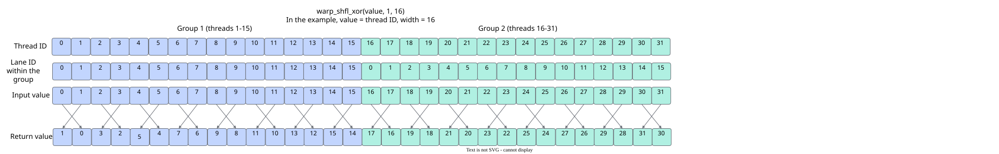

# pypto_pro.language.simt.warp_shfl_xor

## Applicable Products

<!-- npu="950" id1 -->
- Ascend 950PR&950DT products: Supported
<!-- end id1 -->
<!-- npu="A3" id2 -->
- Atlas A3 products: Not supported
<!-- end id2 -->
<!-- npu="910b" id3 -->
- Atlas A2 products: Not supported
<!-- end id3 -->

## Description

Shuffles scalar data within a warp. Each lane performs bitwise XOR on its logical lane ID and lane_mask, and reads the value held by the lane corresponding to the XOR result. This API does not require data to be transferred through the Unified Buffer (UB) and is commonly used for pairwise exchange and butterfly communication between adjacent lanes.

width divides a warp into several consecutive logical subgroups, and each subgroup independently shuffles data. Assume that the logical lane ID of the current lane within the subgroup is logical_lane_id. The logical lane ID of the source lane is:

Logical lane ID of the source lane = logical_lane_id ^ lane_mask

^ indicates bitwise XOR. For example, when lane_mask is 1, the least significant bit is flipped, and data is exchanged between lane 0 and lane 1, and between lane 2 and lane 3 in pairs. When lane_mask is 2, data is exchanged between lane 0 and lane 2, and between lane 1 and lane 3 in pairs.

The following figure shows a complete 32-lane warp. When width is 16, lanes 0–15 and lanes 16–31 form two logical subgroups. The lane IDs in each group are numbered from 0 to 15. After warp_shfl_xor(value, 1, 16) is called, two adjacent lanes in each group exchange data in pairs.



## Prototype

```python
pypto_pro.language.simt.warp_shfl_xor(
    value: Union[int, float],
    lane_mask: int,
    width: int = 32,
) -> Scalar
```

## Parameters

| Parameter| Input/Output| Description|
|---|---|---|
| value | Input| Scalar value of the current lane used for data shuffle. DT_INT32, DT_UINT32, DT_INT64, DT_UINT64, DT_FP16, DT_BF16, and DT_FP32 are supported. Different values can be passed for each lane.|
| lane_mask | Input| Mask for performing bitwise XOR with the current logical lane ID. The value is an integer constant or a runtime integer scalar expression of the DT_INT32 type. The value range is [0, 31] and must be less than width. The target lane selected after XOR must be in the current active thread set. Otherwise, the read result is undefined.|
| width | Input| Width of the logical subgroup. The value is an integer constant or a runtime integer scalar expression of the DT_INT32 type. The value can be 1, 2, 4, 8, 16, or 32. The default value is 32. When width is less than 32, a warp is divided into multiple consecutive and equal-width logical subgroups. You can pass the value by position or by using the width keyword, but you cannot use both methods at the same time.|

## Constraints

- This API can only be called in the SIMT kernel, SIMT vector function, or SIMT helper.

## Return Value

Returns the value of the lane selected after the bitwise XOR operation between the current logical lane ID and lane_mask. The data type of the return value is the same as that of value.

## Examples

In the following example, a warp is divided into two 16-lane logical subgroups, and data of each pair of adjacent lanes is exchanged by using lane_mask=1. If values[0, tid] is equal to tid, the output is [1, 0, 3, 2, ..., 15, 14, 17, 16, ..., 31, 30].

```python
import pypto_pro.language as pl

WARP_SIZE = 32


@pl.vector_function(mode="simt", max_threads=WARP_SIZE)
def warp_shfl_xor_example(
    values: pl.Tensor[[1, WARP_SIZE], pl.DT_FP32],
    output: pl.Tensor[[1, WARP_SIZE], pl.DT_FP32],
):
    tid = pl.simt.linear_thread_idx()
    warp_width = pl.simt.warp_size()
    width = pl.simt.cast(warp_width // 2, pl.DT_INT32)
    output[0, tid] = pl.simt.warp_shfl_xor(values[0, tid], 1, width)


@pl.jit()
def warp_shfl_xor_kernel(
    values: pl.Tensor[[1, WARP_SIZE], pl.DT_FP32],
    output: pl.Tensor[[1, WARP_SIZE], pl.DT_FP32],
):
    with pl.section_vector():
        warp_shfl_xor_example[WARP_SIZE](values, output)
```
