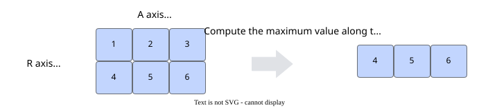
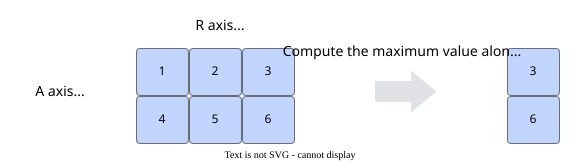

# pypto.amax

<!-- md-trans-meta sourceCommit=9de5cd1f921ab65753457585704a01ca5ed70c40 translatedAt=2026-10-26T15:55:48.703Z pushedAt=2026-10-28T11:57:29.735Z nl=2 -->

## Applicable Products

<!-- npu="950" id1 -->
- Ascend 950PR&950DT products: Supported
<!-- end id1 -->
<!-- npu="A3" id2 -->
- Atlas A3 products: Supported
<!-- end id2 -->
<!-- npu="910b" id3 -->
- Atlas A2 products: Supported
<!-- end id3 -->

## Description

Computes the maximum value of a multidimensional vector along a specified dimension.

Define the specified computation dimension as the R-axis (Reduce axis) and the non-specified dimension as the A-axis (Normal axis). As shown in the figure below, for a two-dimensional matrix of shape \(2, 3\), when the maximum value is computed along the first dimension, the output is [4, 5, 6\]; when computed along the second dimension, the output is \[3, 6\].

**Figure 1**  Example of amax computing along the first dimension


**Figure 2**  Example of amax computing along the last dimension



## Prototype

```python
amax(input: Tensor, dim: int, keepdim: bool = False) -> Tensor
```

## Parameters

| Parameter  | Input/Output | Description                                                                 |
|---------|-----------|----------------------------------------------------------------------|
| input   | Input      | Source operand.<br>Supported type: Tensor. Supported data types vary by model. For details, see [Constraints](#constraints).<br>Empty tensors are not supported. The shape supports only 1 to 4 dimensions. The shape size must not exceed **2147483647** (that is, **INT32_MAX**). |
| dim     | Input      | Dimension for reduction.<br>Any single axis is supported.                                       |
| keepdim | Input      | Whether to retain the reduced dimension after reduction.<br>The default value is **False**. |

## Return Value

Returns the output tensor. The shape of the output tensor depends on the **keepdim** parameter.

If the **keepdim** parameter is **True**, the reduced dimension is retained after the reduction operation. The shape of the output tensor is the same as that of the input tensor in all dimensions except the dimension specified by **dim**, where the size is **1**.

If the **keepdim** parameter is **False** (default), the reduced dimension is removed from the output tensor, while the corresponding dimension in the TileShape remains unchanged. Therefore, it is recommended to reset the TileShape before calling other operations.

## Constraints

1. The TileShape size must not exceed 64 KB.

2. Tensor data type description:
   <!-- npu="950" id4 -->
   - Ascend 950PR&950DT products: DT_FP16, DT_BF16, DT_FP32, DT_INT32, DT_INT16, DT_UINT8, DT_INT8, DT_INT64, DT_UINT64
   <!-- end id4 -->
   <!-- npu="A3" id5 -->
   - Atlas A3 products: DT_FP16, DT_BF16, DT_FP32, DT_INT32, DT_INT16
   <!-- end id5 -->
   <!-- npu="910b" id6 -->
   - Atlas A2 products: DT_FP16, DT_BF16, DT_FP32, DT_INT32, DT_INT16
   <!-- end id6 -->
3. Tensor inputs do not support the `TileOpFormat.TILEOP_NZ` format.

## Examples

### TileShape Setting Example

Before calling this operation API, set the TileShape through **set_vec_tile_shapes**.

The TileShape must have the same dimension count as the input.

For example, if the input shape is [m, n], the output is [m, 1], and the TileShape is set to [m1, n1], then m1 and n1 are used to tile the m and n axes, respectively.

```python
pypto.set_vec_tile_shapes(4, 16)
```

Note: If **keepdim** is set to **false**, the reduced dimension is removed from the output tensor, while the corresponding dimension in the TileShape remains unchanged. Therefore, it is recommended to reset the TileShape before calling other operations.

### API Call Example

```python
x = pypto.tensor([2, 3], pypto.DT_FP32)
y = pypto.amax(x, -1, True)
```

The results are as follows:

```python
Input data x: [[1.0 2.0 3.0],
             [1.0 2.0 3.0]]
Output data y: [[3.0],
             [3.0]]
```
