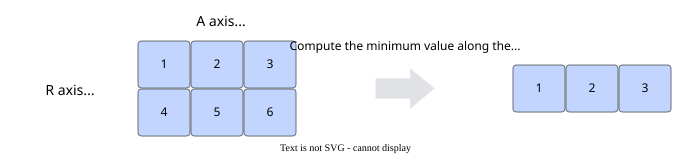
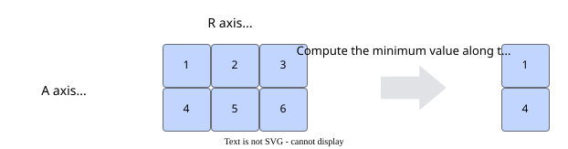

# pypto.amin

## Applicable Products

<!-- npu="950" id1 -->
- Ascend 950PR&950DT products: Supported
<!-- end id1 -->
<!-- npu="A3" id2 -->
- Atlas A3 products: Supported
<!-- end id2 -->
<!-- npu="910b" id3 -->
- Atlas A2 products: Supported
<!-- end id3 -->
<!-- npu="9030" id7 -->
- Kirin 9030 processors: Supported
<!-- end id7 -->
<!-- npu="x90" id8 -->
- Kirin X90 processors: Supported
<!-- end id8 -->
<!-- npu="9050" id11 -->
- Kirin 9050 processors: Supported
<!-- end id11 -->

## Description

Computes the minimum value of a multi-dimensional vector along a specified dimension.

Defines the specified computation dimension as the R-axis (Reduce axis) and the non-specified dimension as the A-axis (Normal axis). As shown in the following figure, the operation is performed on a two-dimensional matrix with shape \(2, 3\). If the minimum value is computed along the first dimension, the output result is \[1, 2, 3\]. If the minimum value is computed along the second dimension, the output result is \[1, 4\].

**Figure 1** Example of amin computation along the first dimension



**Figure 2** Example of amin computation along the last dimension



## Prototype

```python
amin(input: Tensor, dim: int, keepdim: bool = False) -> Tensor
```

## Parameters

| Parameter | Input/Output| Description                                                                |
|---------|-----------|----------------------------------------------------------------------|
| input   | Input     | Source operand.<br>Supported type: Tensor. The supported data types vary by model. For details, see [Constraints](#constraints).<br>Empty tensors are not supported. The shape supports only 1 to 4 dimensions. The shape size must not exceed 2147483647 (INT32_MAX).|
| dim     | Input     | Dimension for reduction.<br>Any single axis is supported.                                      |
| keepdim | Input     | Whether to retain the reduced dimension after reduction.<br>The default value is False.|

## Return Value

Returns the output tensor. Its shape depends on the keepdim parameter.

If keepdim is set to True, the reduced dimension is retained after the reduction operation. The shape of the output tensor is the same as that of the input tensor in all dimensions except the dimension specified by dim, where the size is 1.

If keepdim is set to False (default), the reduced dimension is removed from the output tensor, but the corresponding dimension in TileShape remains unchanged. Therefore, reset TileShape before calling other operations.

## Constraints

1. The size of TileShape must not exceed 64 KB.

2. A tensor supports the following data types:
   <!-- npu="950" id4 -->
   - Ascend 950PR&950DT products: DT_FP16, DT_BF16, DT_FP32, DT_INT32, DT_INT16, DT_UINT8, DT_INT8, DT_INT64, and DT_UINT64
   <!-- end id4 -->
   <!-- npu="A3" id5 -->
   - Atlas A3 products: DT_FP16, DT_BF16, DT_FP32, DT_INT32, and DT_INT16
   <!-- end id5 -->
   <!-- npu="910b" id6 -->
   - Atlas A2 products: DT_FP16, DT_BF16, DT_FP32, DT_INT32, and DT_INT16
   <!-- end id6 -->
   <!-- npu="9030" id9 -->
   - Kirin 9030 processors: DT_FP16 and DT_FP32
   <!-- end id9 -->
   <!-- npu="x90" id10 -->
   - Kirin X90 processors: DT_FP16 and DT_FP32
   <!-- end id10 -->
   <!-- npu="9050" id12 -->
   - Kirin 9050 processors: DT_FP16 and DT_FP32
   <!-- end id12 -->
3. Tensor inputs do not support the `TileOpFormat.TILEOP_NZ` format.

## Examples

### TileShape Setting Example

Note: Before calling this operation API, set TileShape through set_vec_tile_shapes.

TileShape must have the same dimensions as the input.

Example 1: If the input shape is [m, n], the output is [m, 1], and TileShape is set to [m1, n1], then m1 and n1 are used to tile the m and n axes, respectively.

```python
pypto.set_vec_tile_shapes(4, 16)
```

Note: If keepdim is set to false, the reduced dimension is removed from the output tensor, but the corresponding dimension in TileShape remains unchanged. Therefore, reset TileShape before calling other operations.

### API Call Example

```python
x = pypto.tensor([2, 3], pypto.DT_FP32)
y = pypto.amin(x, -1, True)
```

Result example:

```python
Input data x: [[1.0 2.0 3.0],
             [1.0 2.0 3.0]]
Output data y: [[1.0],
             [1.0]]
```
