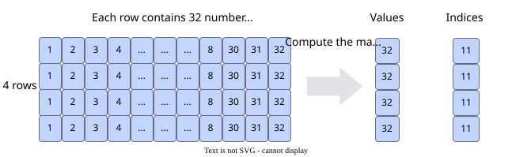

# pypto.topk

<!-- md-trans-meta sourceCommit=9de5cd1f921ab65753457585704a01ca5ed70c40 translatedAt=2026-10-26T17:41:08.332Z pushedAt=2026-10-28T11:57:30.129Z nl=2 -->

## Applicable Products

<!-- npu="950" id1 -->
- Ascend 950PR&950DT products: Supported
<!-- end id1 -->
<!-- npu="A3" id2 -->
- Atlas A3 products: Supported
<!-- end id2 -->
<!-- npu="910b" id3 -->
- Atlas A2 products: Supported
<!-- end id3 -->

## Description

Obtains the top k largest or smallest values along the last dimension and their corresponding indices.

If the input is a vector, this operation finds the top k largest or smallest values and their corresponding indices in the vector. If the input is a matrix, it computes the top k largest or smallest values and their corresponding indices in each row along the last dimension. As shown in the following figure, a two-dimensional matrix with shape \(4, 32\) is sorted with k set to 1, and the output is \[\[32\] \[32\] \[32\] \[32\]\].



## Prototype

```python
topk(input: Tensor, k: int, dim: Optional[int] = None, largest: bool = True, algo: TopKAlgo = TopKAlgo.MERGE_SORT) -> Tuple[Tensor, Tensor]
```

## Parameters

| Parameter | Input/Output | Description                                                                 |
|-----------|--------------|----------------------------------------------------------------------|
| input   | Input      | Source operand.<br>Supported type: Tensor.<br>Data types supported by Tensor:<br>- MERGE_SORT: DT_FP32.<br>- RADIX_SELECT: DT_BF16, DT_FP16, DT_FP32, DT_INT64, DT_UINT64, DT_INT32, DT_UINT32, DT_INT16, DT_UINT16, DT_INT8, DT_UINT8.<br>Empty tensors are not supported. Shape supports only 1 to 4 dimensions. Shape size must not exceed 2147483647 (INT32_MAX). |
| k       | Input      | Number of elements to return.<br>The value of k must satisfy: 1 <= k <= input.shape[dim]. |
| dim     | Input      | Dimension along which to sort.<br>Currently, only sorting along the last dimension is supported, that is, dim = -1 or dim = input.shape.size() - 1. |
| largest | Input      | If **True**, returns the largest elements. If **False**, returns the smallest elements. |
| algo    | Input      | Algorithm enumeration type that controls the TopK computation flow. For details, see [TopKAlgo](../datatype/TopKAlgo.md).<br>Defaults to **MERGE_SORT** (merge sort algorithm). |

## Return Value

Returns a named tuple (values, indices) containing the values and indices of the k largest or smallest elements in each row of input along the specified dimension dim.

## Constraints

1. Only the topk operation on the last axis is supported.
2. When the MERGE_SORT algorithm is selected, the last axis of TileShape must be less than 22KB\(TileShape\[-1\]\*4 < 22KB\).
3. When the RADIX_SELECT algorithm is selected, temporary memory is used. When setting TileShape, ensure that the total usage of the input tile, output tile, and temporary space is less than the available UB. Let the second-to-last axis of TileShape be tileH (1 if it does not exist), the last axis be tileW, and tileW aligned to 128 be tileWAlign. The temporary space for each data type is as follows:

   | input data type | Temporary space size (bytes) |
   |--------------|----------------------|
   | DT_INT8, DT_UINT8, DT_INT16, DT_UINT16, DT_FP16, DT_BF16 | `tileH * max(6 * tileWAlign + max(3072, 8 * tileWAlign), 22 * tileWAlign)` |
   | DT_FP32, DT_INT32, DT_UINT32 | `tileH * max(12 * tileWAlign + max(3072, 8 * tileWAlign), 26 * tileWAlign)` |
   | DT_INT64, DT_UINT64 | `tileH * max(22 * tileWAlign + max(3072, 8 * tileWAlign), 34 * tileWAlign)` |

   max\(a,b\) in the table indicates the maximum of a and b.
4. When the RADIX_SELECT algorithm is selected, the last axis cannot be split, and TileShape\[-1\] must be greater than or equal to input.shape\[-1\];
5. k <= TileShape\[-1\] && k <= input.shape\[-1\];
6. Support for the RADIX_SELECT algorithm on different models:
   <!-- npu="950" id4 -->
   - Ascend 950PR&950DT products: Supported
   <!-- end id4 -->
   <!-- npu="A3" id5 -->
   - Atlas A3 products: Not supported
   <!-- end id5 -->
   <!-- npu="910b" id6 -->
   - Atlas A2 products: Not supported
   <!-- end id6 -->
7. Tensor inputs do not support the `TileOpFormat.TILEOP_NZ` format.

## Examples

### TileShape Setting Example

Note: Before calling this operation API, set the TileShape through **set_vec_tile_shapes**.

The TileShape must have the same dimension count as the input.

Example 1: If the input shape is [m, n, p], **dim** is 2, and **largest** is **True**, the output is [m, n, k]. When **TileShape** is set to [m1, n1, p1], m1, n1, and p1 are used to tile the m, n, and p axes, respectively. p1 must be greater than or equal to k. The k axis does not support tiling and must be fully loaded.

```python
pypto.set_vec_tile_shapes(4, 16, 32)
```

### API Call Example

```python
x = pypto.tensor([2, 3], pypto.DT_FP32)
y = pypto.topk(x, 2, -1, True, pypto.TopKAlgo.MERGE_SORT)
```

The results are as follows:

```python
Input data x: [[1.0 2.0 3.0],
            [1.0 2.0 3.0]]
Output data y[0]: [[3.0 2.0],
               [3.0 2.0]]
Output data y[1]: [[2, 1],
               [2, 1]]
```
