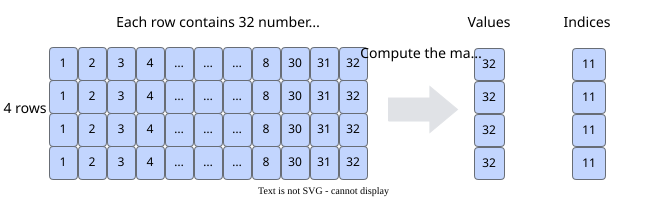

# pypto.topk

## Applicable Products

<!-- npu="950" id1 -->
- Ascend 950PR&950DT products: Supported
<!-- end id1 -->
<!-- npu="A3" id2 -->
- Atlas A3 products: Supported
<!-- end id2 -->
<!-- npu="910b" id3 -->
- Atlas A2 products: Supported
<!-- end id3 -->
<!-- npu="9030" id7 -->
- Kirin 9030 processors: Not supported
<!-- end id7 -->
<!-- npu="x90" id8 -->
- Kirin X90 processors: Not supported
<!-- end id8 -->
<!-- npu="9050" id9 -->
- Kirin 9050 processors: Not supported
<!-- end id9 -->

## Description

Obtains the top k largest or smallest values of the last dimension and their corresponding indices.

If the input is a vector, this operation finds the top k largest or smallest values and their corresponding indices in the vector. If the input is a matrix, it computes the top k largest or smallest values and their corresponding indices in each row along the last dimension. As shown in the following figure, a two-dimensional matrix with shape \(4, 32\) is sorted with k set to 1, and the output is \[\[32\] \[32\] \[32\] \[32\]\].



## Prototype

```python
topk(input: Tensor, k: int, dim: Optional[int] = None, largest: bool = True, algo: TopKAlgo = TopKAlgo.MERGE_SORT) -> List[Tensor]
```

## Parameters

| Parameter | Input/Output| Description                                                                |
|---------|-----------|----------------------------------------------------------------------|
| input   | Input     | Source operand.<br>Supported type: Tensor.<br>Data types supported by Tensor:<br>- MERGE_SORT: DT_FP32.<br>- RADIX_SELECT: DT_BF16, DT_FP16, DT_FP32, DT_INT64, DT_UINT64, DT_INT32, DT_UINT32, DT_INT16, DT_UINT16, DT_INT8, and DT_UINT8.<br>Empty tensors are not supported. The shape supports only 1 to 4 dimensions. The shape size must not exceed 2147483647 (INT32_MAX).|
| k       | Input     | Number of elements to return.<br>The value of k must satisfy 1 <= k <= input.shape[dim].|
| dim     | Input     | Dimension along which to sort.<br>Currently, only sorting along the last dimension is supported, that is, dim= -1 or dim= input.shape.size() - 1.|
| largest | Input     | If True, returns the largest elements. If False, returns the smallest elements.|
| algo    | Input     | Algorithm enumeration type that controls the TopK computation flow. For details, see [TopKAlgo](../datatype/TopKAlgo.md).<br>The default value is MERGE_SORT (merge sort algorithm).|

## Return Value

Returns a list containing two tensors: values and indices in sequence. The values tensor contains the k largest or smallest elements in each row of input along dimension specified by dim, and the indices tensor contains the indices of these elements. You can unpack the sequence to obtain the two tensors.

## Constraints

1. Only the topk operation can be performed on the last axis.
2. When the MERGE_SORT algorithm is used, the last axis of TileShape must be less than 22 KB\(TileShape\[-1\]\*4 < 22 KB\).
3. When the RADIX_SELECT algorithm is used, temporary memory is used. Therefore, when setting TileShape, ensure that the total size of the input tile, output tile, and temporary space is less than the available UB. Assume that the second-to-last axis of TileShape is tileH (or 1 if it does not exist), the last axis is tileW, and tileW is aligned to 128 bytes and is denoted as tileWAlign. The temporary space for each data type is as follows.

   | Input Data Type| Temporary Space Size (Bytes)|
   |--------------|----------------------|
   | DT_INT8, DT_UINT8, DT_INT16, DT_UINT16, DT_FP16, DT_BF16| `tileH * max(6 * tileWAlign + max(3072, 8 * tileWAlign), 22 * tileWAlign)` |
   | DT_FP32, DT_INT32, DT_UINT32| `tileH * max(12 * tileWAlign + max(3072, 8 * tileWAlign), 26 * tileWAlign)` |
   | DT_INT64, DT_UINT64| `tileH * max(22 * tileWAlign + max(3072, 8 * tileWAlign), 34 * tileWAlign)` |

   max\(a,b\) in the table indicates that the larger value between a and b is used.
4. When the RADIX_SELECT algorithm is used, the last axis cannot be tiled, and TileShape\[-1\] must be greater than or equal to input.shape\[-1\].
5. k <= TileShape\[-1\] && k <= input.shape\[-1\].
6. Support for the RADIX_SELECT algorithm on different models:
   <!-- npu="950" id4 -->
   - Ascend 950PR&950DT products: Supported
   <!-- end id4 -->
   <!-- npu="A3" id5 -->
   - Atlas A3 products: Not supported
   <!-- end id5 -->
   <!-- npu="910b" id6 -->
   - Atlas A2 products: Not supported
   <!-- end id6 -->
7. Tensor inputs do not support the `TileOpFormat.TILEOP_NZ` format.

## Examples

### TileShape Setting Example

Note: Before calling this operation API, set TileShape through set_vec_tile_shapes.

TileShape must have the same dimensions as the input.

Example 1: If the input shape is [m, n, p], dim is 2, largest is True, the output is [m, n, k], and TileShape is set to [m1, n1, p1], then m1, n1, and p1 are used to tile the m, n, and p axes, respectively. p1 must be greater than or equal to k. The k axis does not support tiling and must be fully loaded.

```python
pypto.set_vec_tile_shapes(4, 16, 32)
```

### API Call Example

```python
x = pypto.tensor([2, 3], pypto.DT_FP32)
values, indices = pypto.topk(x, 2, -1, True, pypto.TopKAlgo.MERGE_SORT)
```

Result example:

```python
Input data x: [[1.0, 2.0, 3.0],
            [1.0 2.0 3.0]]
Output data values: [[3.0 2.0],
               [3.0 2.0]]
Output data indices: [[2, 1],
               [2, 1]]
```
