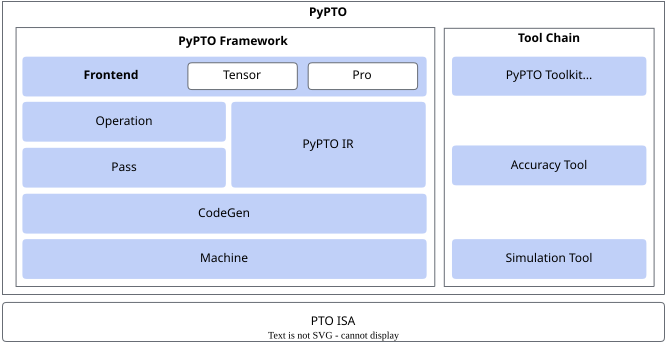
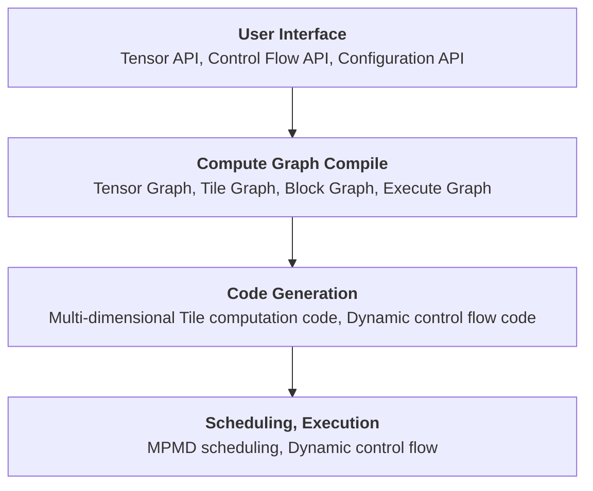
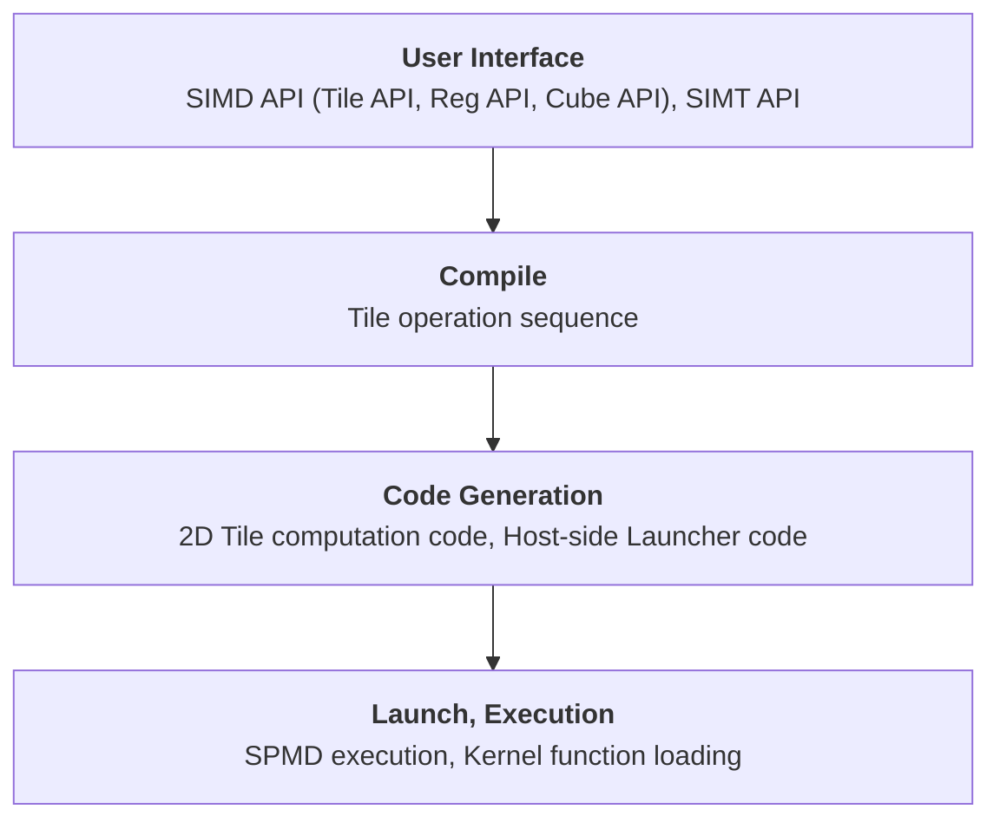

# PyPTO Overview

<!-- md-trans-meta sourceCommit=9de5cd1f921ab65753457585704a01ca5ed70c40 translatedAt=2026-10-27T02:46:07.726Z pushedAt=2026-10-27T08:47:50.444Z nl=2 -->

PyPTO (pronounced "pai p-t-o") is an efficient operator programming framework for AI accelerators launched by CANN. It is designed to simplify the operator development process while retaining high-performance computing capabilities. PyPTO adopts PTO (Parallel Tensor/Tile Operation) as its programming philosophy and supports two programming models: the Tensor programming model for Tensor computation and the Tile programming model for Tile operations. At the framework level, PyPTO supports the Tensor programming model through the "PyPTO Tensor" development mode and the Tile programming model through the "PyPTO Pro" development mode. Developers can choose between them based on operator development efficiency, performance tuning requirements, and hardware control granularity.

| Development Mode | Programming Model | Execution Model | Key Differences | Scenarios |
| --- | --- | --- | --- | --- |
| PyPTO Tensor | Tensor programming model for Tensor computation | MPMD (Multiple Program Multiple Data) | Developers mainly describe the computation logic, while the compiler handles Tile partitioning, memory allocation, task scheduling, and code generation, providing a higher level of abstraction. | Suitable for developers who want to develop operators quickly in a way close to mathematical expressions, as well as scenarios such as general deep learning operators, large model components, and dynamic shapes. |
| PyPTO Pro | Tile programming model for Tile operations | SPMD (Single Program Multiple Data) | Developers can explicitly control multi-core task division, data movement, Tile computation, and pipeline orchestration, providing finer hardware control granularity. | Suitable for developers familiar with hardware architecture who require fine-grained tuning, as well as operator scenarios involving Cube and Vector fusion, complex pipelines, and pursuit of ultimate performance. |

## Overall Architecture

The overall architecture of PyPTO is shown in the preceding figure. PyPTO is an operator programming framework built on the PTO ISA, and it includes the following:
- Compile-time framework, which converts the operators written by developers into high-performance binary code. It consists of the following:
    - Frontend (PyPTO Tensor and PyPTO Pro): provides user programming interfaces.
    - Compilation optimization phase, which consists of the following:
        - PyPTO IR: provides the intermediate representation (IR) of PyPTO.
        - Operation: provides basic operation functions similar to instructions.
        - Pass: an IR transformation framework that provides graph compilation for PyPTO Tensor and compilation for PyPTO Pro.
    - CodeGen: generates binary code.
- Runtime framework, which implements efficient scheduled execution of binary code. The runtime framework mainly consists of multi-level Machine components.

To facilitate debugging and tuning for developers, the PyPTO programming framework also provides a toolchain, including:
- IDE: provides visualized debugging and tuning capabilities.
- Precision tool: used to locate precision issues.
- Simulation tool: used to implement simulation in the absence of hardware.

## PyPTO Tensor

### Workflow

PyPTO Tensor includes the following stages from the user interface to the underlying hardware execution:

- **User Interface**: Provides a Python-style Tensor programming interface, allowing developers to directly express computation logic, control flow, and configuration optimization options without focusing on the underlying hardware instructions.
- **Compute Graph Compile**: Completes the transformation and optimization of multi-level compute graphs through modular passes.
    - Tensor Graph targets algorithm expression and describes high-level Tensor computation.
    - Tile Graph expands Tensor computation into hardware-aware Tile computation, and performs optimizations such as layout transformation, memory type allocation, and data movement.
    - Block Graph splits the Tile graph into computation subgraphs that can be executed in parallel, and performs optimizations such as out-of-order scheduling, memory reuse, and synchronization point insertion.
    - Execute Graph integrates the computation subgraphs and their dependencies to form the final execution graph.
- **Code Generation**: Generates dynamic control flow code based on the Execute Graph, generates multi-dimensional Tile computation code based on the Block Graph, and further compiles it into target platform code.
- **Scheduling and Execution**: Schedules the executable code to device processor cores in MPMD mode, and is responsible for executing dependencies and dynamic control flow.

### Core Features

- **Tensor-level Programming**: Uses Tensor as the basic data unit, with programming expressions close to the mathematical definition of operators.
- **Multi-level Compute Graph**: Lowers the abstraction level step by step through Tensor Graph, Tile Graph, Block Graph, and Execute Graph, preserving information for optimization at different stages.
- **Automatic Compilation and Scheduling**: Automatically completes tiling, layout transformation, memory allocation, data movement, subgraph tiling, synchronization, and code generation.
- **MPMD Execution Model**: Generates multiple programs based on computation subgraphs and resource conditions, and schedules them to different processor cores for parallel execution.
- **Dynamic Shape and Symbolic Programming**: Supports dynamic Shape scenarios such as dynamic Batch Size.
- **Toolchain Support**: Supports viewing intermediate computation graphs at each compilation stage and runtime performance data, and provides compilation and scheduling control capabilities.

### Design Philosophy

PyPTO Tensor adopts "decoupling algorithm expression from hardware execution" as its core design philosophy. Developers use Tensor to describe computation, leaving hardware-related tiling, data movement, pipelining, and scheduling to the compiler, which lowers the barrier to operator development while preserving room for global optimization.

- **Computation layer**: Stay as close as possible to the mathematical expressions of algorithm designers, describing computation in terms of Tensor rather than individual elements, so as to retain complete information for memory layout, data movement, and joint optimization across multiple operators.
- **Compilation layer**: Through a multi-stage lowering pipeline, gradually transform the Tensor Graph into a Tile Graph, Block Graph, and Execute Graph, mapping high-level computation into hardware-friendly execution forms.
- **Execution layer**: Generate PTO virtual instructions and target platform code based on the compilation results, and execute them in parallel on the device side in an MPMD manner.
- **Toolchain**: Provide visualization of compilation intermediate products and runtime performance data, helping developers locate issues and control compilation and scheduling behavior as needed.

### Applicable Products

<!-- npu="950" id1 -->
- Ascend 950PR&950DT products: Supported
<!-- end id1 -->
<!-- npu="A3" id2 -->
- Atlas A3 products: Supported
<!-- end id2 -->
<!-- npu="910b" id3 -->
- Atlas A2 products: Supported
<!-- end id3 -->

## PyPTO Pro

### Workflow

PyPTO Pro is a Python DSL for AI Core kernel development. Its APIs are divided into [SIMD API](../api/pro_api/SIMD-API/index.md), [SIMT API](../api/pro_api/SIMT-API/index.md), and [Utils API](../api/pro_api/Utils-API/index.md). The SIMD API covers Tile computation, Reg computation, Cube computation, as well as data movement, resource management, and synchronization control. The SIMT API is used for per-thread computation. The Utils API provides Python syntax assistance and debugging capabilities.

In the [Kernel function](programming_guide/pro/development/kernel_function.md), developers declare parameters and the execution domain, organize data movement between GM and on-chip buffers, and select Tile, Reg, Cube, or SIMT computation methods. A Kernel declared with `@pypto_pro.language.jit()` is compiled on first launch, and the compilation result can be reused under the same compilation signature thereafter.

The compilation and execution process includes the following stages:

1. **User Interface**: Binds Kernel parameters and launch configuration.
2. **Compile**: Parses the function body, generates a Tile operation sequence, and optimizes the Tile operation sequence.
3. **Code Generation**: CCE CodeGen generates the target code and also generates the Host-side Launcher.
4. **Scheduling and Execution**: The Launcher submits the JIT output of the Kernel to the specified Stream, and the AI Core executes it in SPMD mode.

### Core Features

- **SPMD Parallel Execution**: A single Kernel launch can use multiple AI Cores, and each core determines the data shard it is responsible for through the core index. The launch parameter `block_dim` configures the number of Vector cores, Cube cores, or CV execution groups that actually participate in execution, and its specific meaning is determined by the Kernel execution domain.
- **Hierarchical Computing Capability**: The SIMD API provides three computing modes: Tile, Reg, and Cube, which target on-chip data blocks, vector registers, and cube computation respectively. The SIMT API is used to express per-thread indexing, branching, and atomic updates.
- **Explicit Data Organization**: Tensor represents multi-dimensional data in GM; Tile and TileGroup describe on-chip data and multi-buffer rotation; RegTensor and MaskReg are used for Reg computation. Data movement, layout, and valid regions are all explicitly expressed by the Kernel.
- **Synchronization and Pipelining**: Developers can explicitly set dependencies between different Pipes and different cores, or use automatic synchronization based on the mutex metadata of TileGroup. CV fusion scenarios also support orchestrating cross-core pipelining by `stage`.
- **Compile-time Specialization**: When the values of STATIC dimensions, TilingKey, and data types differ, JIT can generate the corresponding Kernel versions. DYNAMIC dimensions and TilingData are passed in at runtime, and existing versions can usually be reused when their values change.

### Design Philosophy

PyPTO Pro allows developers to write Kernels in Python while retaining control over how the hardware executes them. Developers can arrange data tiling, multi-core task division, on-chip Buffer usage, and the coordination of data movement, computation, and synchronization according to the characteristics of the operator. The compiler is responsible for semantic validation, IR transformation, code generation, and compilation. This approach is especially suitable for operators whose hardware mapping already has a clear plan, or that require fine-tuning of memory access, computation, and parallel pipelining.

- **Data Organization**: Tensor represents data in GM, Tile represents an on-chip data block, and RegTensor represents data in vector registers. Developers determine how large a block of data to process at a time and how to use the on-chip Buffer according to the needs of the operator.
- **Task Division**: Developers use the Vector and Cube execution domains in the Kernel to arrange the corresponding computation, and then determine which part of the data each core processes based on the number of launched cores and the core index. When per-thread processing is required, a SIMT Thread Block can be launched in the Vector execution domain.
- **Data Movement and Synchronization**: Developers arrange when data is moved into on-chip memory, when computation is performed, and when data is written back. They also need to handle data dependencies between different Pipes or different cores. For dependencies that can be recognized by the framework, automatic synchronization can be used. In CV fusion scenarios, automatic CV pipelining can also be used to orchestrate computation.
- **Compilation and Execution**: After developers write the Kernel, JIT is responsible for checking the program, generating PyPTO IR and target code, and compiling, loading, and dispatching them as needed. Kernels with the same compilation signature can be reused within the current process.

### Applicable Products

<!-- npu="950" id4 -->
- Ascend 950PR&950DT products: Supported
<!-- end id4 -->
<!-- npu="A3" id5 -->
- Atlas A3 products: Not supported
<!-- end id5 -->
<!-- npu="910b" id6 -->
- Atlas A2 products: Not supported
<!-- end id6 -->
