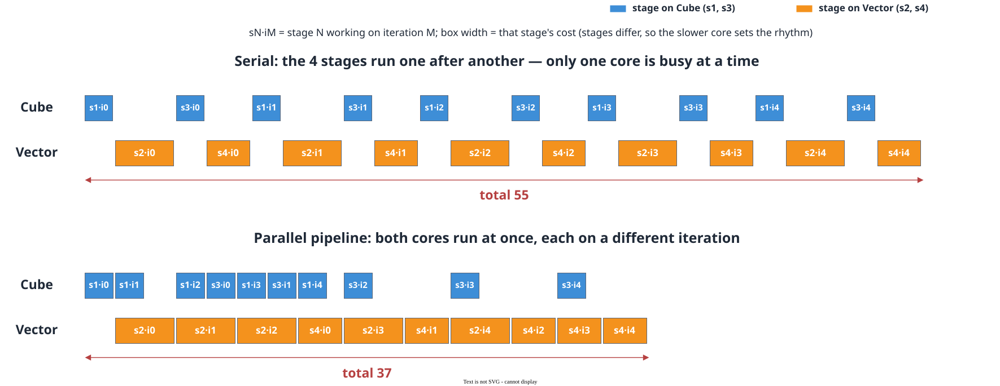
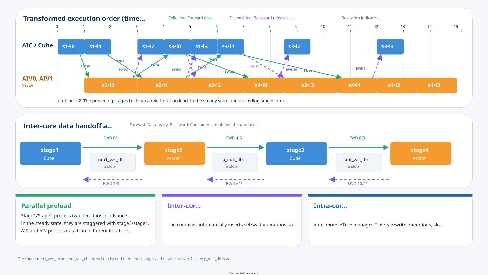

# Automatic CV Parallel Pipeline

<!-- md-trans-meta sourceCommit=7d0ab31d84c294a0a8327f597d2bdee012acb22d translatedAt=2026-10-27T01:46:04.638Z pushedAt=2026-10-27T04:12:18.851Z nl=2 -->

## Description

In a CV fusion operator, the Cube and Vector computations depend on each other. If they are executed as a serial pipeline, one core can only idle while the other core is working. To improve the parallelism between Cube and Vector, the upstream core computes several iterations ahead, while the downstream core processes the data of earlier iterations that the upstream core has already completed. The two cores work simultaneously at staggered rhythms, thereby hiding each other's waiting time.

Automatic CV parallel pipeline is a compile-time transformation in pypto_pro.language.jit. It provides two capabilities:

- **Automatic pipeline scheduling**: automatically rewrites the hand-written serial pipeline kernel code of a CV fusion operator into a parallel pipeline version to improve performance;
- **Automatic inter-core synchronization**: the serial version developed by the user does not need any hand-written CV inter-core synchronization instructions, and the parallel pipeline version inserts all required inter-core synchronization.

The following figure compares the execution diagrams of the same operator (4 stages, with Cube/Vector alternating) under the serial pipeline and the parallel pipeline (Cube executed 2 iterations ahead):

**Figure 1** Execution rhythm comparison between the serial pipeline and the parallel pipeline



In the figure, `sN·iM` indicates that stage N is processing the data of iteration M, and the width of each cell represents the duration of that stage (the duration of each stage differs, and the values in the figure are illustrative).

Note that the upper limit of the pipelining benefit is determined by **the slower core**: in the figure, the per-iteration duration on the Vector side is higher than that on the Cube side, so the steady-state rhythm is determined by the Vector side, and the Cube side has waiting gaps. The more balanced the stage division (the closer the durations of the two cores), the fuller the pipeline is filled and the higher the benefit. In addition, establishing and draining the pipeline each require several beats. The more iterations there are, the lower the proportion of this overhead.

## Usage

The usage constraints of the automatic CV parallel pipeline are listed in the "Notes" following each usage step. Check the corresponding step during development.

### Writing the Stage Function

You need to divide the operator into several computation flows, each corresponding to a stage function identified by the @pypto_pro.language.pipeline.stage decorator.

```python
import pypto_pro.language as pl

@pl.pipeline.stage
def stage1(ki, a, b_l1, a_l1_db, left_db, right_db, acc_db, mm1_vec_db):
    """Cube: mm1 = A_i @ B"""
    cur_a = a_l1_db.next()
    pl.load(cur_a, a, [ki * TILE, 0])
    ...  # Ordinary Tile/Buffer operations; no synchronization is required
```

> [!NOTE]Note
>
> - A stage function cannot nest another stage and cannot have a return value. A normal function called by a stage cannot return a Tile or Tile Group.
> - When a stage function has a struct parameter, it must be declared using `pypto_pro.language.struct()`. `pypto_pro.language.struct_array()` is not supported.

### Declaring Cross-Core Shared Buffers

Cross-core shared buffers are declared using the make_tile_group API. `mutex_ids` and `fwd_ids`/`bwd_ids` operate on different scopes: `mutex_ids` manages the pipeline synchronization and address reuse of intra-core Tile slots, while `fwd_ids` and `bwd_ids` handle data handover between Cube and Vector. Only when `fwd_ids` or `bwd_ids` is declared and the buffer is used by a Cube stage and a Vector stage respectively does the framework recognize it as a cross-core shared buffer and insert the corresponding inter-core synchronization.

`mutex_ids` requires one ID to be configured for each Tile in the buffer, so its count matches the number of Tiles. The counts of `fwd_ids` and `bwd_ids` are not required to always match the number of Tiles: you can configure one ID for each Tile, or configure a single ID shared by all Tiles. Sharing a single inter-core synchronization ID serializes the handover between different Tiles, which reduces synchronization ID usage but may lower pipeline parallelism.

`fwd_ids` is forward synchronization (the producer notifies the consumer after writing), where a set is inserted after the producer stage and a wait is inserted before the consumer stage. `bwd_ids` is backward synchronization (the consumer notifies the producer that it can overwrite after finishing), where a set is inserted after the consumer stage and a wait is inserted before the producer stage. When only `fwd_ids` is configured, it only guarantees that the consumer reads data that the producer has finished writing; it does not guarantee that the consumer has finished reading before the producer overwrites in the next round. The Tile used in each iteration rotates by the number of Tiles, while the inter-core synchronization ID rotates by `ids[iteration index % len(ids)]`, so the rotation periods of the two can differ.

`target_memory` only declares the physical storage space where the buffer resides and does not indicate whether it is cross-core. Cross-core shared buffers support UB and L1. The following `mm1_vec_db` is an example where a Cube stage hands its computation result to a Vector stage. In the complete example later, `p_mat_db` is written by a Vector stage and then read by a Cube stage. The cross-core relationship of both is determined by the producer/consumer relationship of the stages and by `fwd_ids` and `bwd_ids`.

```python
import pypto_pro.language as pl

mm1_vec_db = pl.make_tile_group(
    type=pl.TileType(shape=[TILE_HALF, TILE], dtype=pl.DT_FP32, target_memory=pl.MemorySpace.Vec),
    addrs=0x0000,
    mutex_ids=[12, 13],
    fwd_ids=[0, 1],
    bwd_ids=[2, 3],
)
```

> [!NOTE]
>
> - The `make_tile_group` declarations of cross-core buffers and intra-core buffers must be written inside the kernel function body, not in ordinary functions called by stages. Cross-core buffers support only UB and L1 buffers.
> - A cross-core buffer must be used by exactly two adjacent stages, which are located on Cube and Vector respectively and form a one-to-one producer-consumer relationship. When data needs to be passed to a later stage, it should be handed over stage by stage.
> - The value range of `fwd_ids` and `bwd_ids` is 0 to 15. They can only be written directly as compile-time constant integer lists, or use variables bound to integer lists outside the kernel. Expressions such as slicing, concatenation, and function calls are not supported. The number of IDs must equal the number of Tiles or be 1; when it is 1, all Tiles share the same synchronization ID, which may reduce performance.
> - When reusing addresses, at most two buffers are allowed to reuse them, and the number of Tiles and `mutex_ids` of both must be consistent. Different `mutex_ids` cannot form address mutual exclusion.
> - The Tiles of a cross-core buffer must rotate in iteration order. Stages are numbered by their order of appearance in the main loop (regardless of whether the first stage is on Cube or Vector). When the stage that writes the buffer has an odd number, at least 2 Tiles are required; when it has an even number, at least `preload` Tiles are required. If the number of Tiles is insufficient, a compile-time error is reported with a hint of the minimum required number of Tiles.
> - When space is sufficient, you can allocate more Tiles than the lower limit and determine whether there is a performance benefit based on actual measurements. When adjusting the number of Tiles, you need to adjust the counts of `mutex_ids`, `fwd_ids`, and `bwd_ids` as well as the address space occupied by the buffer accordingly, except when the inter-core synchronization ID is configured as a single ID shared by all Tiles.

### Writing the Main Loop

In the main loop, stage functions are written in dependency order, and the stages must alternate between CV.

```python
import pypto_pro.language as pl

for ki in pl.range(0, N_ITER):
    with pl.section_cube():
        stage1(ki, a, b_l1, a_l1_db, left_db, right_db, acc_db, mm1_vec_db)
    with pl.section_vector():
        stage2(ki, sub_id, mm1_vec_db, relu_vec_db, relu_nz_db, p_mat_db)
    with pl.section_cube():
        stage3(ki, d_l1, p_mat_db, left_db, right_db, acc_db, out_vec_db)
    with pl.section_vector():
        stage4(ki, sub_id, out, out_vec_db)
```

A kernel can contain multiple independent for loops. Each loop undergoes pipeline transformation independently without affecting the others. The multiple loops are executed sequentially in source code order, and preload can be configured per loop (see the next section).

```python
import pypto_pro.language as pl

for ki in pl.range(0, N_ITER):        # First pipeline
    with pl.section_cube():
        stage1(ki, ...)
    with pl.section_vector():
        stage2(ki, ...)

pl.system.sync_all(core_type=pl.SyncCoreType.MIX)

for kj in pl.range(0, M_ITER):        # Second pipeline
    with pl.section_cube():
        stage3(kj, ...)
    with pl.section_vector():
        stage4(kj, ...)
```

> [!NOTE]
>
> - Stage calls in the same pipeline must be placed in the same for loop. The loop step must be positive, and reverse iteration is not supported. Each `section_cube()` or `section_vector()` block can contain only one stage call, and the stages must be arranged in strict Cube, Vector alternation. No other statements can be inserted between the first stage and the last stage.
> - Cross-core Buffers, and intra-core Buffers that reuse addresses with cross-core Buffers, cannot be directly obtained or operated on inside the pipeline loop body. These operations should be placed in stage functions. The same stage function can be called only once in a pipeline, and different stage functions cannot have the same name.
> - An if statement can be used to control whether a stage executes, but the condition must be a compile-time constant. When calling `group.next()` outside the pipeline loop to obtain a Tile, use a separate assignment statement and do not embed it in other expressions. The same variable can obtain a Tile only once; use multiple variables when multiple Tiles are needed.
> - A kernel can contain multiple independent pipeline loops, but these loops cannot be nested in the same outer loop. Manual full-core synchronization must be inserted between the loops. Do not use framework-reserved variable names starting with `_pl_` in the kernel.

### Enabling Pipeline Transformation

In the pypto_pro.language.jit API, configure it through the PipelineConfig parameter:


| Parameter | Description                                                                                                                                                                                                      |
| --------- | --------------------------------------------------------------------------------------------------------------------------------------------------------------------------------------------------------------- |
| preload   | Indicates the number of iterations that the upstream core computes in advance. The type is int or list[int]. When a single integer is passed, all pipeline loops in the kernel share this value. When a list is passed, each pipeline loop is configured separately in source code order. A loop with a value of 0 is not rewritten into a pipeline; only inter-core synchronization is inserted into the original serial loop. |

**Recommended process**: First configure **preload=0** and run to confirm that the serial version is accurate, then gradually increase preload to enable the pipeline. While increasing preload, check whether the number of Tiles of each cross-core Buffer is sufficient according to the instructions following [Declaring Cross-Core Shared Buffers](#declaring-cross-core-shared-buffers). When there are multiple pipeline loops, you can set only one of them to 0 (for example, preload=[0, 2]) to verify the serial accuracy of that pipeline separately.

During tuning, observe the impact of both `preload` and the number of Buffer Tiles on performance. If performance does not improve after increasing `preload` or adding Tiles, reduce the number of Tiles to the minimum value corresponding to the current `preload` to save on-chip storage space. After the reduction, the lower limit of the number of Tiles specified in the instructions following [Declaring Cross-Core Shared Buffers](#declaring-cross-core-shared-buffers) must still be met, and accuracy and performance must be re-verified.

> [!NOTE]
>
> - `preload` must be greater than or equal to 0. When a list is passed, the list length must match the number of pipeline loops in the kernel.

```python
import pypto_pro.language as pl

@pl.jit(auto_mutex=True, pipeline=pl.pipeline.PipelineConfig(preload=0))
def pipeline_demo_kernel(...):
    ...
```

```python
import pypto_pro.language as pl

@pl.jit(auto_mutex=True, pipeline=pl.pipeline.PipelineConfig(preload=2))
def pipeline_demo_kernel(...):
    ...
```

```python
import pypto_pro.language as pl

# There are two pipeline loops in the kernel. The first has preload=1, and the second has preload=2
@pl.jit(auto_mutex=True, pipeline=pl.pipeline.PipelineConfig(preload=[1, 2]))
def pipeline_demo_kernel(...):
    ...
```

### Viewing the Generated Code

The parallel pipeline code automatically generated by the framework is saved in the compilation output directory under the file name pipeline_generated.py. You can continue to modify and debug based on this code.

## Example

```python
import os

import pypto_pro.language as pl
import pytest
import torch
import torch_npu

import pypto

ST_DEVICE_ID = int(os.environ.get("TILE_FWK_DEVICE_ID", 0))
ST_DEVICE = f"npu:{ST_DEVICE_ID}"

TILE = 64
TILE_HALF = TILE // 2  # dual mode splits along M, each AIV processes half
N_ITER = 4


@pl.pipeline.stage
def stage1(ki, a, b_l1, a_l1_db, left_db, right_db, acc_db, mm1_vec_db):
    """Cube: mm1 = A_i @ B"""
    cur_a = a_l1_db.next()
    pl.load(cur_a, a, [ki * TILE, 0])
    b_slot = b_l1.current()
    left = left_db.next()
    right = right_db.next()
    acc = acc_db.next()
    pl.move(left, cur_a)
    pl.move(right, b_slot)
    pl.matmul(acc, left, right)
    mm1_vec = mm1_vec_db.next()
    # DualModeSplitM: the acc of [TILE, TILE] is split along M, each AIV takes [TILE_HALF, TILE]
    pl.move(mm1_vec, acc, acc_to_vec_mode=pl.AccToVecMode.DualModeSplitM)


@pl.pipeline.stage
def stage2(ki, sub_id, mm1_vec_db, relu_vec_db, relu_nz_db, p_mat_db):
    """Vector: apply relu to this AIV's half, convert to NZ, then insert back into the L1 Buffer by row offset"""
    mm1_vec = mm1_vec_db.next()
    relu_vec = relu_vec_db.next()
    pl.relu(relu_vec, mm1_vec)
    relu_nz = relu_nz_db.next()
    pl.move(relu_nz, relu_vec)  # ND -> NZ, insert requires the source Tile to be NZ
    p_mat = p_mat_db.next()
    pl.insert(p_mat, relu_nz, [sub_id * TILE_HALF, 0])


@pl.pipeline.stage
def stage3(ki, d_l1, p_mat_db, left_db, right_db, acc_db, out_vec_db):
    """Cube: mm2 = relu(mm1) @ D"""
    d_slot = d_l1.current()
    p_mat = p_mat_db.next()
    left = left_db.next()
    right = right_db.next()
    acc = acc_db.next()
    pl.move(left, p_mat)
    pl.move(right, d_slot)
    pl.matmul(acc, left, right)
    out_vec = out_vec_db.next()
    pl.move(out_vec, acc, acc_to_vec_mode=pl.AccToVecMode.DualModeSplitM)


@pl.pipeline.stage
def stage4(ki, sub_id, out, out_vec_db):
    """Vector: each AIV writes back half of the result of this iteration"""
    out_vec = out_vec_db.next()
    pl.store(out, out_vec, [ki * TILE + sub_id * TILE_HALF, 0])


@pl.jit(auto_mutex=True, pipeline=pl.pipeline.PipelineConfig(preload=2))
def pipeline_demo_kernel(
    a: pl.Tensor[[N_ITER * TILE, TILE], pl.DT_FP32],
    b: pl.Tensor[[TILE, TILE], pl.DT_FP32],
    d: pl.Tensor[[TILE, TILE], pl.DT_FP32],
    out: pl.Tensor[[N_ITER * TILE, TILE], pl.DT_FP32],
):
    # ===== Cross-core shared Buffer: declare fwd_ids/bwd_ids, the framework inserts synchronization accordingly =====
    mm1_vec_db = pl.make_tile_group(
        type=pl.TileType(shape=[TILE_HALF, TILE], dtype=pl.DT_FP32, target_memory=pl.MemorySpace.Vec),
        addrs=0x0000, mutex_ids=[12, 13], fwd_ids=[0, 1], bwd_ids=[2, 3],
    )
    p_mat_db = pl.make_tile_group(
        type=pl.TileType(shape=[TILE, TILE], dtype=pl.DT_FP32, target_memory=pl.MemorySpace.Mat, layout=pl.NZ),
        addrs=0x8000, mutex_ids=[14, 15], fwd_ids=[4, 5], bwd_ids=[6, 7],
    )
    out_vec_db = pl.make_tile_group(
        type=pl.TileType(shape=[TILE_HALF, TILE], dtype=pl.DT_FP32, target_memory=pl.MemorySpace.Vec),
        addrs=0x10000, mutex_ids=[16, 17], fwd_ids=[8, 9], bwd_ids=[10, 11],
    )

    # ===== Cube-side local Buffer =====
    with pl.section_cube():
        a_l1_db = pl.make_tile_group(
            type=pl.TileType(shape=[TILE, TILE], dtype=pl.DT_FP32, target_memory=pl.MemorySpace.Mat, layout=pl.NZ),
            addrs=0x0000, mutex_ids=[0, 1],
        )
        b_l1 = pl.make_tile_group(
            type=pl.TileType(shape=[TILE, TILE], dtype=pl.DT_FP32, target_memory=pl.MemorySpace.Mat, layout=pl.NZ),
            addrs=0x10000, mutex_ids=[2],
        )
        d_l1 = pl.make_tile_group(
            type=pl.TileType(shape=[TILE, TILE], dtype=pl.DT_FP32, target_memory=pl.MemorySpace.Mat, layout=pl.NZ),
            addrs=0x14000, mutex_ids=[3],
        )
        left_db = pl.make_tile_group(
            type=pl.TileType(shape=[TILE, TILE], dtype=pl.DT_FP32, target_memory=pl.MemorySpace.Left, layout=pl.NZ),
            addrs=0x0000, mutex_ids=[4, 5],
        )
        right_db = pl.make_tile_group(
            type=pl.TileType(shape=[TILE, TILE], dtype=pl.DT_FP32, target_memory=pl.MemorySpace.Right, layout=pl.ZN),
            addrs=0x0000, mutex_ids=[6, 7],
        )
        acc_db = pl.make_tile_group(
            type=pl.TileType(
                shape=[TILE, TILE], dtype=pl.DT_FP32,
                target_memory=pl.MemorySpace.Acc, layout=pl.NZ, fractal=1024,
            ),
            addrs=0x0000, mutex_ids=[8, 9, 10, 11],
        )
        # B and D are moved in once outside the loop and reused throughout.
        b_slot = b_l1.current()
        d_slot = d_l1.current()
        pl.load(b_slot, b, [0, 0])
        pl.load(d_slot, d, [0, 0])

    # ===== Vector-side local Buffer =====
    with pl.section_vector():
        sub_id = pl.get_subblock_idx()
        relu_vec_db = pl.make_tile_group(
            type=pl.TileType(shape=[TILE_HALF, TILE], dtype=pl.DT_FP32, target_memory=pl.MemorySpace.Vec),
            addrs=0x8000, mutex_ids=[18, 19],
        )
        relu_nz_db = pl.make_tile_group(
            type=pl.TileType(
                shape=[TILE_HALF, TILE], dtype=pl.DT_FP32,
                target_memory=pl.MemorySpace.Vec, layout=pl.NZ,
            ),
            addrs=0x18000, mutex_ids=[20, 21],
        )

    # ===== Pipeline loop: alternately call the 4 stages by Cube/Vector =====
    for ki in pl.range(0, N_ITER):
        with pl.section_cube():
            stage1(ki, a, b_l1, a_l1_db, left_db, right_db, acc_db, mm1_vec_db)
        with pl.section_vector():
            stage2(ki, sub_id, mm1_vec_db, relu_vec_db, relu_nz_db, p_mat_db)
        with pl.section_cube():
            stage3(ki, d_l1, p_mat_db, left_db, right_db, acc_db, out_vec_db)
        with pl.section_vector():
            stage4(ki, sub_id, out, out_vec_db)


@pytest.mark.soc("950")
@pypto.options(pass_options={"enable_slice": False})
def test_pipeline_demo_kernel():
    device = ST_DEVICE
    torch.npu.set_device(device)
    torch.manual_seed(0)
    a = torch.randn(N_ITER * TILE, TILE, device=device, dtype=torch.float32)
    b = torch.randn(TILE, TILE, device=device, dtype=torch.float32)
    d = torch.randn(TILE, TILE, device=device, dtype=torch.float32)
    out = torch.zeros(N_ITER * TILE, TILE, device=device, dtype=torch.float32)

    pipeline_demo_kernel[None, 1](a, b, d, out)
    torch.npu.synchronize()

    ref = torch.relu(a @ b) @ d
    torch.testing.assert_close(out, ref, rtol=1e-2, atol=1e-2)
```

### Pipeline and Synchronization Relationship of the Complete Example

The following figure corresponds to the `N_ITER=4` and `preload=2` configuration of the complete example above. `sN·iM` indicates that stage N is processing the M-th iteration. The two AIVs execute the same Vector stage and each processes half of the M direction, so they are merged into a single Vector lane in the figure. The box widths and gaps are used to illustrate the execution time and waiting relationship of each stage, and do not represent actual execution cycles.

Cross-core synchronization IDs rotate according to the Buffer slots corresponding to logical iterations, rather than being assigned by AIV number. Taking `mm1_vec_db` as an example, `stage1(i0)` notifies `stage2(i0)` through Forward ID 0, and `stage1(i1)` notifies `stage2(i1)` through Forward ID 1. Subsequently, `i2` and `i3` reuse slot 0 and slot 1, respectively. When the two AIVs execute the same Vector stage iteration, they use the same cross-core event corresponding to that iteration. The default `INTRA_BLOCK` synchronization mode handles the handover between the AIC and the two AIVs.

**Figure 2** Execution order and synchronization relationship of the complete example when preload=2



- **Parallel preload**: During the fill phase, the preceding stages first process two iterations. After entering the steady state, the Cube side interleaves `stage1(i+2)` and `stage3(i)`, while the Vector side interleaves `stage2(i+2)` and `stage4(i)`. The AIC and AIVs process data of different iterations simultaneously. After the main loop ends, the compiler continues to drain the `stage3` and `stage4` tasks that have already entered the pipeline.
- **Inter-core synchronization**: The compiler automatically inserts `set_cross_core` and `wait_cross_core` based on the `fwd_ids` and `bwd_ids` of the cross-core Buffers. `mm1_vec_db` uses Forward IDs 0/1 and Backward IDs 2/3, `p_mat_db` uses Forward IDs 4/5 and Backward IDs 6/7, and `out_vec_db` uses Forward IDs 8/9 and Backward IDs 10/11. Forward events ensure that the consumer waits for the data to be written, while Backward events ensure that the producer waits for the consumer to finish using the data before overwriting the corresponding slot.
- **Intra-core synchronization**: `auto_mutex=True` manages, based on the `mutex_ids` of each Tile Group, the read/write of Tiles, slot rotation, and address reuse among different pipeline units within the same AIC or AIV. `mutex_ids` handles intra-core synchronization, while `fwd_ids` and `bwd_ids` handle data handover between the AIC and AIVs. Their scopes of effect are different.

In this example, `mm1_vec_db` and `out_vec_db` are written by the odd-numbered stage1 and stage3, respectively, so at least 2 Tiles are required. `p_mat_db` is written by the even-numbered stage2, so its Tile count cannot be less than `preload`. Since `preload=2` here, all three cross-core Buffers are configured with 2 Tiles.

> [!NOTE]
>
> - This example is designed for a single 1:2 CV execution group, so `block_dim` is set to 1. When extending to multiple execution groups, use `pypto_pro.language.get_block_idx()` to divide the GM data and output range processed by each execution group. For a complete description of `block_dim`, see [Kernel Function](../development/kernel_function.md#meaning-and-setting-of-blockdim).
