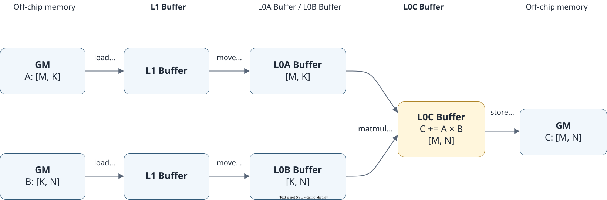
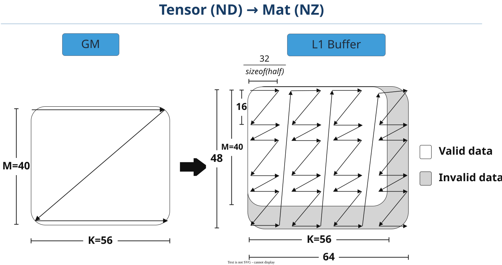
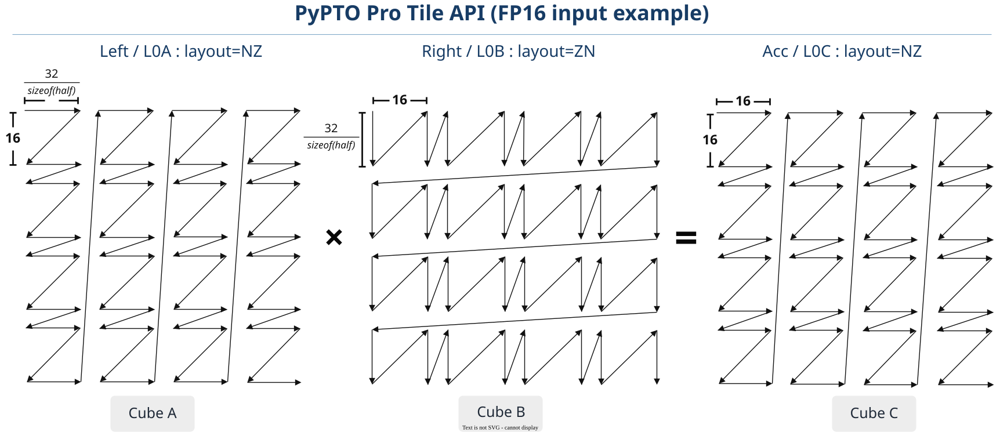

# Cube Computation

<!-- md-trans-meta sourceCommit=7d0ab31d84c294a0a8327f597d2bdee012acb22d translatedAt=2026-10-27T02:00:41.561Z pushedAt=2026-10-28T08:34:15.407Z nl=2 -->

This document describes how to use the Tile API in PyPTO Pro to write **cube computation code** based on on-chip storage such as L1 Buffer, L0A Buffer, L0B Buffer, and L0C Buffer.

## Basic Steps of Cube Programming

A common Cube computation procedure is as follows:

1. Create the L1 Buffer, L0A Buffer, L0B Buffer, and L0C Buffer respectively.
2. Move the left and right cubes from GM into the L1 Buffer.
3. Move the left cube data from the L1 Buffer into the L0A Buffer, and the right cube data into the L0B Buffer.
4. Perform the Cube computation and write the result into the L0C Buffer.
5. Write the result in the L0C Buffer back to GM.
6. Configure the synchronization instructions correctly to ensure that no data race occurs between the data movement and computation steps.

The preceding steps must be written in the Cube execution domain marked by [pypto_pro.language.section_cube()](../../../../api/pro_api/SIMD-API/controlflow/section_cube.md). Tile creation can be placed outside the execution domain. For the complete Kernel code, see the [complete example](#complete-example) at the end of this document.

The corresponding data flow and hardware pipeline are as follows:

**Figure 1 Data flow and hardware pipeline of Cube computation**



## Cube Computation Memory Management

### Cube-side Tile Creation

Input data is moved from GM to the L1 Buffer, then from the L1 Buffer to the L0A Buffer and L0B Buffer. After Cube computation, the result is written to the L0C Buffer.

PyPTO Pro uses [TileType](../../../../api/pro_api/SIMD-API/basic_data_structures/TileType.md) to describe the shape, dtype, and target_memory of a Tile. TileType itself does not create a Tile; it must be passed to [pypto_pro.language.make_tile](../../../../api/pro_api/SIMD-API/resource_management/make_tile.md) or [pypto_pro.language.make_tile_group](../../../../api/pro_api/SIMD-API/resource_management/make_tile_group.md) to bind the Tile to the address of a specified Buffer.

The code in this section only demonstrates Tile creation and synchronization, omitting the computation, invocation, and result verification code of the complete Kernel. For the overall code structure and invocation method, see the [complete example](#complete-example) at the end of this document.

The typical roles of each memory space are as follows:

| pypto_pro.language.MemorySpace | Physical Buffer | Typical Role |
|:---|:---|:---|
| Mat | L1 Buffer | Cube staging between GM and L0A Buffer/L0B Buffer |
| Left | L0A Buffer | Left operand of matmul |
| Right | L0B Buffer | Right operand of matmul |
| Acc | L0C Buffer | Accumulation result of matmul (usually FP32/INT32) |

#### Creating a Single Tile Using make_tile

pypto_pro.language.make_tile binds a Tile to a fixed on-chip buffer address. addr must be specified; the number of bytes in the address range is automatically derived from the shape and dtype of TileType. When using make_tile, cross-Pipe dependencies are synchronized through explicit [pypto_pro.language.system.sync_src](../../../../api/pro_api/SIMD-API/synchronization/sync_src.md)/[pypto_pro.language.system.sync_dst](../../../../api/pro_api/SIMD-API/synchronization/sync_dst.md) pairs.

```python
import pypto_pro.language as pl


TILE_M = 128
TILE_K = 128
TILE_N = 128

a_l1_type = pl.TileType(
    shape=[TILE_M, TILE_K], dtype=pl.DT_FP16, target_memory=pl.MemorySpace.Mat)
b_l1_type = pl.TileType(
    shape=[TILE_K, TILE_N], dtype=pl.DT_FP16, target_memory=pl.MemorySpace.Mat)
a_left_type = pl.TileType(
    shape=[TILE_M, TILE_K], dtype=pl.DT_FP16, target_memory=pl.MemorySpace.Left)
b_right_type = pl.TileType(
    shape=[TILE_K, TILE_N], dtype=pl.DT_FP16, target_memory=pl.MemorySpace.Right)
acc_type = pl.TileType(
    shape=[TILE_M, TILE_N], dtype=pl.DT_FP32, target_memory=pl.MemorySpace.Acc)

a_l1 = pl.make_tile(a_l1_type, addr=0x00000)
b_l1 = pl.make_tile(b_l1_type, addr=0x08000)
a_left = pl.make_tile(a_left_type, addr=0x0000)
b_right = pl.make_tile(b_right_type, addr=0x0000)
acc = pl.make_tile(acc_type, addr=0x0000)
```

#### Creating Rotating Tiles Using make_tile_group

pypto_pro.language.make_tile_group creates a group of rotating Tiles bound to different on-chip addresses. The number of Tiles in the group is specified by depth; when depth is not specified and mutex_ids is not empty, it is determined by the length of mutex_ids. You can select a Tile using next(), current(), and previous(). When used with `@pypto_pro.language.jit(auto_mutex=True)`, the framework automatically inserts cross-Pipe synchronization based on the mutex_id of each Tile. A single buffer can also use mutex_ids of length 1 to reuse the automatic synchronization mechanism.

```python
import pypto_pro.language as pl


TILE_M = 128
TILE_K = 128
TILE_N = 128


@pl.jit(auto_mutex=True)
def matmul_kernel(a: pl.Tensor[[pl.DYNAMIC, TILE_K], pl.DT_FP16],
                  b: pl.Tensor[[TILE_K, pl.DYNAMIC], pl.DT_FP16],
                  out: pl.Tensor[[pl.DYNAMIC, pl.DYNAMIC], pl.DT_FP32]):
    # Use double buffering for the L1 Buffer.
    a_l1 = pl.make_tile_group(
        type=pl.TileType(
            shape=[TILE_M, TILE_K], dtype=pl.DT_FP16,
            target_memory=pl.MemorySpace.Mat),
        addrs=0x00000, mutex_ids=[0, 1])
    b_l1 = pl.make_tile_group(
        type=pl.TileType(
            shape=[TILE_K, TILE_N], dtype=pl.DT_FP16,
            target_memory=pl.MemorySpace.Mat),
        addrs=0x10000, mutex_ids=[2, 3])

    # Use single buffering for the L0A Buffer, L0B Buffer, and L0C Buffer, with synchronization managed by auto_mutex.
    a_left = pl.make_tile_group(
        type=pl.TileType(
            shape=[TILE_M, TILE_K], dtype=pl.DT_FP16,
            target_memory=pl.MemorySpace.Left),
        addrs=0x0000, mutex_ids=[4])
    b_right = pl.make_tile_group(
        type=pl.TileType(
            shape=[TILE_K, TILE_N], dtype=pl.DT_FP16,
            target_memory=pl.MemorySpace.Right),
        addrs=0x0000, mutex_ids=[5])
    acc = pl.make_tile_group(
        type=pl.TileType(
            shape=[TILE_M, TILE_N], dtype=pl.DT_FP32,
            target_memory=pl.MemorySpace.Acc),
        addrs=0x0000, mutex_ids=[6])
```

The differences between the two allocation methods are as follows:

| Aspect | make_tile | make_tile_group |
|:---|:---|:---|
| Buffer organization | A single fixed buffer; addr must be specified, and size is optional | A group of rotating buffers using addrs and mutex_ids |
| Buffer selection | Use the Tile variable directly | Select via next(), current(), and previous() |
| Cross-Pipe synchronization | Manually insert sync_src/sync_dst | Automatically inserted when mutex metadata is present and `auto_mutex=True` is used |
| Scenarios | Scenarios requiring precise control of synchronization timing | Common scenarios such as single buffering, double buffering, and N-buffering |

For common single-buffering, double-buffering, and N-buffering scenarios, use make_tile_group with auto_mutex=True enabled; for scenarios requiring precise control of synchronization events and insertion positions, use make_tile with explicit synchronization.

### Cube Computation Fractal Introduction

#### Ascend Cube Fractal Layout

The Ascend Cube compute unit uses fractal blocks as the basic unit of computation and data movement. The traditional ND linear layout stores a cube contiguously by rows, so reading a two-dimensional compute block requires collecting data row by row from multiple address segments. The fractal layout rearranges data through the movement pipeline so that compute blocks are stored contiguously in physical memory, thereby reducing addressing overhead and improving data throughput.

One side of an input fractal is fixed at 16, and the other side is `32B / sizeof(dtype)`. The fractal sizes for common data types are as follows:

- FP32: cube A is 16×8, and cube B is 8×16.
- FP16/BF16: both cube A and cube B are 16×16.
- FP8 (E4M3FN/E5M2): cube A is 16×32, cube B is 32×16, and the accumulation result is FP32.
- HF8: cube A is 16×32, cube B is 32×16, and the accumulation result is FP32.
- INT8: cube A is 16×32, cube B is 32×16, and the accumulation result is INT32.

The result fractal in the L0C Buffer is fixed at 16×16. Taking an FP32/INT32 accumulation result as an example, one result fractal occupies `16 × 16 × 4B = 1024B`.

The following figure uses an FP16 40×56 cube as an example to show the standard fractal layout when compact=0: the ND Tensor in GM is moved into a Tile in the L1 Buffer and converted to the NZ layout. The valid region is 40×56, and the addressing boundary after 16×16 fractal alignment is 48×64. Fractals are arranged in column-major order between fractals and in row-major order inside a fractal. In the figure, the white region is valid data, and the gray region is the invalid region, whose values are not necessarily 0. [pypto_pro.language.set_validshape](../../../../api/pro_api/SIMD-API/basic_data_structures/TileType.md#parameters) sets the valid region of the Tile, and [pad](../../../../api/pro_api/SIMD-API/basic_data_structures/TilePad.md) and [pypto_pro.language.fillpad](../../../../api/pro_api/SIMD-API/memory_data_movement/load.md#loading-tail-blocks) determine whether and how to fill the invalid region. When compact=1, the on-chip layout is interpreted compactly according to the valid shape, and the complete standard fractal boundary shown in Figure 2 is not used.

**Figure 2** pypto_pro.language.load completes the ND-to-NZ fractal conversion



#### Naming of Fractal Formats

The cube fractal format uses the "big Y, small x" naming convention:

- Big Y (Z/N) indicates the permutation order between fractals: Z is row-major, and N is column-major.
- Small x (z/n) indicates the element permutation order inside a fractal: z is row-major, and n is column-major.

Taking a two-dimensional cube as an example, the meanings of several common formats are as follows:

- **ND**: A general linear layout, typically used for input and output tensors in GM.
- **NZ**: Fractals are arranged in column-major order between fractals, and elements are arranged in row-major order inside a fractal. For a cube with shape [M, N], after padding and splitting into [M1, M0, N1, N0], the physical permutation order is [N1, M1, M0, N0].
- **ZN**: Fractals are arranged in row-major order between fractals, and elements are arranged in column-major order inside a fractal. For a cube with shape [K, N], after padding and splitting into [K1, K0, N1, N0], the physical permutation order is [K1, N1, N0, K0].

For details about data layout formats such as ND, NZ, and ZN, see [Data Layout Format](https://gitcode.com/cann/asc-devkit/blob/9.2.0/docs/en/guide/technical_appendix/concepts_and_terms/neural_networks_and_operators/data_layout.md).

For cube multiplication `C = A × B`, the left cube A uses NZ, the right cube B uses ZN, and the result cube C uses NZ. When the left cube reads data by row and the right cube reads data by column, the corresponding elements can all be read from consecutive addresses.

The default data path is as follows:

- ND data in GM is converted to NZ when moved into the L1 Buffer.
- Cube A remains in NZ after being moved from the L1 Buffer to the L0A Buffer.
- Cube B is converted to ZN when moved from the L1 Buffer to the L0B Buffer.
- The matmul result is stored in NZ in the L0C Buffer.

layout describes the physical arrangement of a Tile, while TileType.shape retains the logical axis semantics. For example, cube B still uses [K, N] to describe its shape in the L0B Buffer, with the physical layout being ZN. Special scenarios such as transposed move-in require the layout to be explicitly specified.

The following figure uses FP16 input and FP32 accumulation as an example to show the correspondence between the Tiles in the L0A Buffer, L0B Buffer, and L0C Buffer and the PyPTO Pro APIs.

**Figure 3 NZ × ZN = NZ fractal combination for cube multiplication (FP16 input)**



### Cube-side Synchronization

The four steps of Cube computation correspond to four pipelines: MTE2, MTE1, M, and FIX. Each pipeline executes asynchronously. When data produced by one pipeline is consumed by another pipeline, synchronization must be inserted to ensure data dependency.

| Pipeline | Description | Typical Operation |
|:---|:---|:---|
| MTE2 | GM→L1 Buffer movement | pypto_pro.language.load/pypto_pro.language.load_tile |
| MTE1 | L1 Buffer→L0A Buffer/L0B Buffer movement | pypto_pro.language.move |
| M | Cube Computation | pypto_pro.language.matmul/pypto_pro.language.matmul_acc |
| FIX | L0C Buffer→GM movement | pypto_pro.language.store/pypto_pro.language.store_tile |

When using make_tile_group and enabling automatic synchronization via `@pypto_pro.language.jit(auto_mutex=True)`, the framework inserts mutex_lock/mutex_unlock based on the usage relationships of Tiles and mutex_id.

When using make_tile, the framework does not automatically insert cross-pipe synchronization. You need to insert a paired pypto_pro.language.system.sync_src and pypto_pro.language.system.sync_dst after the producing operation and before the consuming operation. The following shows the forward data dependency in a complete Cube computation:

```python
import pypto_pro.language as pl


with pl.section_cube():
    pl.load(a_l1, a, [0, 0])
    pl.load(b_l1, b, [0, 0])
    pl.system.sync_src(
        set_pipe=pl.PipeType.MTE2, wait_pipe=pl.PipeType.MTE1, event_id=0)
    pl.system.sync_dst(
        set_pipe=pl.PipeType.MTE2, wait_pipe=pl.PipeType.MTE1, event_id=0)

    pl.move(a_left, a_l1)
    pl.move(b_right, b_l1)
    pl.system.sync_src(
        set_pipe=pl.PipeType.MTE1, wait_pipe=pl.PipeType.M, event_id=1)
    pl.system.sync_dst(
        set_pipe=pl.PipeType.MTE1, wait_pipe=pl.PipeType.M, event_id=1)

    pl.matmul(acc, a_left, b_right)
    pl.system.sync_src(
        set_pipe=pl.PipeType.M, wait_pipe=pl.PipeType.FIX, event_id=2)
    pl.system.sync_dst(
        set_pipe=pl.PipeType.M, wait_pipe=pl.PipeType.FIX, event_id=2)
    pl.store(out, acc, [0, 0])
```

sync_src sets the flag on the producing pipeline, and sync_dst waits for the flag on the consuming pipeline. The set_pipe, wait_pipe, and event_id of the two must be consistent. The static event_id ranges from [0, 7]; the runtime value of a dynamic integer Scalar must also fall within this range. The same ID can be reused only after the previous synchronization has been consumed. When reusing Tiles in a loop, you also need to handle the reverse dependency that the buffer can be overwritten only after consumption is complete. For regular pipelined scenarios, make_tile_group and automatic synchronization are recommended.

> [!NOTE]
> When matmul/matmul_acc uses the phase parameter, the synchronization between the M pipeline and the FIX pipeline is completed by the hardware unit_flag, and the framework does not automatically insert this synchronization.

## Moving Cube Data In

### GM → L1 Buffer Movement

Use pypto_pro.language.load to load a cube from GM into the L1 Buffer. During the movement, load automatically completes the ND-to-NZ format conversion, so you do not need to manually configure fractal parameters.

```python
import pypto_pro.language as pl


with pl.section_cube():
    cur_a = a_l1.current()
    cur_b = b_l1.current()
    pl.load(cur_a, a, [i, 0])    # Load cube A into the L1 Buffer, automatically converting ND to NZ
    pl.load(cur_b, b, [0, j])    # Load cube B into the L1 Buffer, automatically converting ND to NZ
```

The coordinate parameter [row, col] of load is the element offset on the GM Tensor, indicating that data of one Tile size is moved starting from this position.

### L1 Buffer → L0A Buffer/L0B Buffer Movement

Use pypto_pro.language.move to move data from the L1 Buffer into the L0A Buffer or L0B Buffer. During the move, the format conversion from NZ to ZN (L0B Buffer) is completed automatically.

```python
import pypto_pro.language as pl


cur_a_left = a_left.current()
cur_b_right = b_right.current()
pl.move(cur_a_left, cur_a)    # L1 Buffer → L0A Buffer, NZ→NZ
pl.move(cur_b_right, cur_b)   # L1 Buffer → L0B Buffer, NZ→ZN
```

### Transposed Load

When the axis order of the GM input cube is opposite to that of the Tile in the L1 Buffer (for example, the Tensor is [K, M] while the Tile is [M, K]), transposition is required during loading. This is controlled by the order parameter of load: order=[1, 0] indicates a transposed load, in which case the layout of the L1 Buffer must be set to ZN.

Take `C[M, N] = A[M, K] @ B[K, N]` as an example:

| Operand | Tensor shape | Whether to transpose | order of load | L1 Buffer Tile layout |
|:---|:---|:---|:---|:---|
| Left Cube A | [M, K] | No | [0, 1] (default) | NZ (default) |
| Left Cube A | [K, M] | Yes | [1, 0] | ZN |
| Right Cube B | [K, N] | No | [0, 1] (default) | NZ (default) |
| Right Cube B | [N, K] | Yes | [1, 0] | ZN |

Example of transposed load of the left cube:

```python
import pypto_pro.language as pl


M = 64
K = 128
N = 64


@pl.jit(auto_mutex=True)
def kernel_left_transpose(
    a: pl.Tensor[[K, M], pl.DT_FP16],               # [K, M], transpose required
    b: pl.Tensor[[K, N], pl.DT_FP16],               # [K, N], no transpose
    out: pl.Tensor[[M, N], pl.DT_FP32],
):
    a_l1 = pl.make_tile_group(
        type=pl.TileType(shape=[M, K], dtype=pl.DT_FP16,
                         target_memory=pl.MemorySpace.Mat, layout=pl.ZN),  # ZN
        addrs=0x00000, mutex_ids=[0])
    b_l1 = pl.make_tile_group(
        type=pl.TileType(shape=[K, N], dtype=pl.DT_FP16,
                         target_memory=pl.MemorySpace.Mat),                # NZ (default)
        addrs=0x10000, mutex_ids=[1])
    ...
    with pl.section_cube():
        cur_a = a_l1.current()
        pl.load(cur_a, a, [0, 0], order=[1, 0])    # Transposed load
        cur_b = b_l1.current()
        pl.load(cur_b, b, [0, 0])                   # No transpose
```

## Moving Cube Data Out

Use pypto_pro.language.store to move the computation result from the L0C Buffer to GM, with automatic format conversion (for example, NZ to ND) supported during the move.

```python
import pypto_pro.language as pl


pl.store(out, acc, [i, j])    # L0C Buffer -> GM, automatic NZ->ND
```

If the output Tensor is marked as NZ, store writes the computation result of the L0C Buffer directly to GM in NZ fractals without additional format conversion:

```python
import pypto_pro.language as pl


@pl.jit(auto_mutex=True)
def kernel(
    nz_out: pl.Tensor[[64, 64], pl.DT_FP32, pl.NZ],
):
    # acc is the computed L0C Buffer Tile; other steps are omitted
    ...
    pl.store(nz_out, acc, [0, 0])    # Write to GM in NZ fractals
```

## Cube Computation

[pypto_pro.language.matmul](../../../../api/pro_api/SIMD-API/cube_computation/matmul.md) is the core cube multiplication API through which PyPTO Pro encapsulates the NPU hardware computation capability. It implements `dst_tile = lhs_tile × rhs_tile`, with the data path L0A Buffer x L0B Buffer → L0C Buffer.

**Table: Description of cubes A, B, and C in cube multiplication computation**

| Cube | Storage Location | Dimension | Data Format | Data Type |
|:---|:---|:---|:---|:---|
| A | L0A Buffer | M x K | NZ | FP16, BF16, FP32, INT8, HF8, FP8E4M3FN, or FP8E5M2 |
| B | L0B Buffer | K x N | ZN | The data type combination supported by the API when combined with A |
| C | L0C Buffer | M x N | NZ | FP32 or INT32, determined by the input data type combination |

```python
import pypto_pro.language as pl


pl.matmul(acc_tile, a_left, b_right)    # C = A × B
```

### MXFP8/MXFP4 Cube Multiplication

MX cube multiplication uses pypto_pro.language.matmul_mx or pypto_pro.language.matmul_mx_acc. In addition to the Tiles in the L0A Buffer/L0B Buffer, it also requires E8M0 quantization coefficient Tiles located in the L0A_MX Buffer and L0B_MX Buffer, respectively. Each quantization coefficient corresponds to 32 consecutive mantissa elements in the K direction, and K must be a multiple of 64. MXFP8 supports DT_FP8E4M3FN/DT_FP8E5M2, and MXFP4 supports DT_FP4E2M1/DT_FP4E1M2. For complete parameter constraints, quantization coefficient Tensor layout, and call examples, see [matmul_mx](../../../../api/pro_api/SIMD-API/cube_computation/matmul_mx.md) and [matmul_mx_acc](../../../../api/pro_api/SIMD-API/cube_computation/matmul_mx_acc.md).

### K-dimension Block Accumulation

When the K dimension is large and cannot be loaded into the L1 Buffer and L0 Buffer at once, the K axis needs to be split into multiple blocks and accumulated block by block. The first block is written to the accumulator using pypto_pro.language.matmul, and the remaining blocks are accumulated into the same L0C Buffer using [pypto_pro.language.matmul_acc](../../../../api/pro_api/SIMD-API/cube_computation/matmul_acc.md).

```python
import pypto_pro.language as pl


TILE = 128
K_SIZE = 384


@pl.jit(auto_mutex=True)
def matmul_acc_kernel(
    a: pl.Tensor[[TILE, K_SIZE], pl.DT_FP16],
    b: pl.Tensor[[K_SIZE, TILE], pl.DT_FP16],
    c: pl.Tensor[[TILE, TILE], pl.DT_FP32],
):
    a_l1 = pl.make_tile_group(
        type=pl.TileType(shape=[TILE, TILE], dtype=pl.DT_FP16, target_memory=pl.MemorySpace.Mat),
        addrs=0x00000, mutex_ids=[0, 1])
    b_l1 = pl.make_tile_group(
        type=pl.TileType(shape=[TILE, TILE], dtype=pl.DT_FP16, target_memory=pl.MemorySpace.Mat),
        addrs=0x10000, mutex_ids=[2, 3])
    a_left = pl.make_tile_group(
        type=pl.TileType(shape=[TILE, TILE], dtype=pl.DT_FP16, target_memory=pl.MemorySpace.Left),
        addrs=0x0000, mutex_ids=[4, 5])
    b_right = pl.make_tile_group(
        type=pl.TileType(shape=[TILE, TILE], dtype=pl.DT_FP16, target_memory=pl.MemorySpace.Right),
        addrs=0x0000, mutex_ids=[6, 7])
    acc = pl.make_tile_group(
        type=pl.TileType(shape=[TILE, TILE], dtype=pl.DT_FP32, target_memory=pl.MemorySpace.Acc,
                         fractal=1024),
        addrs=0x0000, mutex_ids=[8])

    with pl.section_cube():
        ac = acc.current()
        for k in pl.range(0, K_SIZE, TILE):
            cur_a = a_l1.next()
            cur_b = b_l1.next()
            al = a_left.next()
            br = b_right.next()
            pl.load(cur_a, a, [0, k])
            pl.load(cur_b, b, [k, 0])
            pl.move(al, cur_a)
            pl.move(br, cur_b)
            if k == 0:
                pl.matmul(ac, al, br)
            else:
                pl.matmul_acc(ac, ac, al, br)
        pl.store(c, ac, [0, 0])
```

## Tail Block Processing

When the shape of a GM Tensor is not divisible by the Tile shape, tail blocks smaller than the Tile appear at the boundary. In Cube scenarios, you need to set mutually matching valid shapes for the input Tiles and output Tiles involved in the current cube multiplication:

- `valid_shape`: When omitted, the dynamic mode is used by default, which is equivalent to `[-1, -1]`. The actual valid region is subsequently set through pypto_pro.language.set_validshape.
- `compact=1`: Makes the data in the L0A Buffer, L0B Buffer, and L0C Buffer adopt a compact layout according to the valid shape, but does not change the Buffer size bound to the Tile.

```python
import pypto_pro.language as pl


tt_a_l1 = pl.TileType(shape=[TILE_M, TILE_K], dtype=pl.DT_FP16,
                       target_memory=pl.MemorySpace.Mat)
tt_b_l1 = pl.TileType(shape=[TILE_K, TILE_N], dtype=pl.DT_FP16,
                       target_memory=pl.MemorySpace.Mat)
tt_left = pl.TileType(shape=[TILE_M, TILE_K], dtype=pl.DT_FP16,
                      target_memory=pl.MemorySpace.Left,
                      compact=1)
tt_right = pl.TileType(shape=[TILE_K, TILE_N], dtype=pl.DT_FP16,
                       target_memory=pl.MemorySpace.Right,
                       compact=1)
tt_acc = pl.TileType(shape=[TILE_M, TILE_N], dtype=pl.DT_FP32,
                     target_memory=pl.MemorySpace.Acc,
                     compact=1)
```

The following uses the case where the K dimension is complete and tail blocks exist in the M and N directions as an example. At runtime, before the corresponding load, move, and matmul operations are executed, you need to set the valid shapes of the Tiles on the L1 Buffer, L0A Buffer, L0B Buffer, and L0C Buffer simultaneously:

```python
import pypto_pro.language as pl


valid_m = pl.min(TILE_M, M - i * TILE_M)
valid_n = pl.min(TILE_N, N - j * TILE_N)
pl.set_validshape(cur_a, [valid_m, TILE_K])
pl.set_validshape(cur_b, [TILE_K, valid_n])
pl.set_validshape(cur_a_left, [valid_m, TILE_K])
pl.set_validshape(cur_b_right, [TILE_K, valid_n])
pl.set_validshape(cur_acc, [valid_m, valid_n])
```

## Complete Example

The following is a complete Matmul Kernel that computes `C[M, N] = A[M, K] @ B[K, N]`. M and N use dynamic shapes, and the M and N passed in at runtime must be divisible by TILE_M and TILE_N respectively. For non-divisible scenarios, see [Tail Block Processing](#tail-block-processing) above. The Kernel uses make_tile_group with auto_mutex=True to automatically manage pipeline synchronization.

```python
import os
import pypto_pro.language as pl
import torch
import torch_npu

TILE_M = 128
TILE_K = 128
TILE_N = 128
M_SIZE = 8192
K_SIZE = 128
N_SIZE = 8192


@pl.jit(auto_mutex=True)
def matmul_kernel(
    a: pl.Tensor[[pl.DYNAMIC, TILE_K], pl.DT_FP16],
    b: pl.Tensor[[TILE_K, pl.DYNAMIC], pl.DT_FP16],
    out: pl.Tensor[[pl.DYNAMIC, pl.DYNAMIC], pl.DT_FP32],
):
    num_cores = pl.get_block_num()
    core_id = pl.get_block_idx()
    M = a.shape[0]
    N = b.shape[1]

    # L1 Buffer double buffering (next() rotation)
    a_l1 = pl.make_tile_group(
        type=pl.TileType(shape=[TILE_M, TILE_K], dtype=pl.DT_FP16, target_memory=pl.MemorySpace.Mat),
        addrs=0x00000, mutex_ids=[0, 1])
    b_l1 = pl.make_tile_group(
        type=pl.TileType(shape=[TILE_K, TILE_N], dtype=pl.DT_FP16, target_memory=pl.MemorySpace.Mat),
        addrs=0x10000, mutex_ids=[2, 3])
    # L0A Buffer/L0B Buffer/L0C Buffer single buffering (current())
    a_left = pl.make_tile_group(
        type=pl.TileType(shape=[TILE_M, TILE_K], dtype=pl.DT_FP16, target_memory=pl.MemorySpace.Left),
        addrs=0x0000, mutex_ids=[4])
    b_right = pl.make_tile_group(
        type=pl.TileType(shape=[TILE_K, TILE_N], dtype=pl.DT_FP16, target_memory=pl.MemorySpace.Right),
        addrs=0x0000, mutex_ids=[5])
    acc = pl.make_tile_group(
        type=pl.TileType(shape=[TILE_M, TILE_N], dtype=pl.DT_FP32, target_memory=pl.MemorySpace.Acc),
        addrs=0x0000, mutex_ids=[6])

    with pl.section_cube():
        for i in pl.range(core_id, M // TILE_M, num_cores):
            for j in pl.range(0, N // TILE_N, 1):
                cur_a = a_l1.next()
                cur_b = b_l1.next()
                pl.load_tile(cur_a, a, [i, 0])
                pl.load_tile(cur_b, b, [0, j])

                cur_a_left = a_left.current()
                cur_b_right = b_right.current()
                pl.move(cur_a_left, cur_a)
                pl.move(cur_b_right, cur_b)

                acc_tile = acc.current()
                pl.matmul(acc_tile, cur_a_left, cur_b_right)
                pl.store_tile(out, acc_tile, [i, j])


# Host-side invocation
device_id = int(os.environ.get("TILE_FWK_DEVICE_ID", 0))
device = f"npu:{device_id}"
torch.npu.set_device(device)
torch.manual_seed(42)
a = torch.randn(M_SIZE, K_SIZE, device=device, dtype=torch.float16)
b = torch.randn(K_SIZE, N_SIZE, device=device, dtype=torch.float16)
out = torch.zeros(M_SIZE, N_SIZE, device=device, dtype=torch.float32)

matmul_kernel(a, b, out)
torch.npu.synchronize()

golden = torch.matmul(a.float(), b.float())
torch.testing.assert_close(out, golden, rtol=1e-2, atol=1e-2)
print("Matmul kernel passed!")
```
