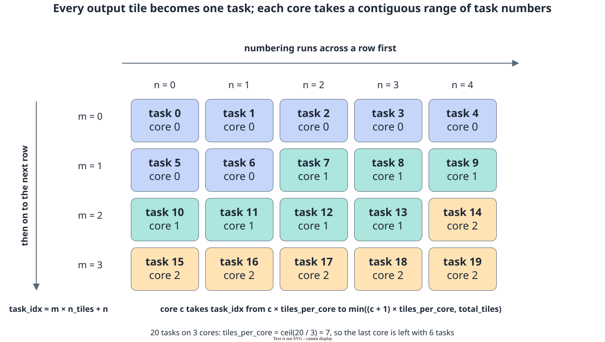

# Multi-Core Tiling

<!-- md-trans-meta sourceCommit=7d0ab31d84c294a0a8327f597d2bdee012acb22d translatedAt=2026-10-27T01:54:56.253Z pushedAt=2026-10-27T07:17:29.109Z nl=2 -->

Multi-core tiling divides large-scale data such as a large batch into smaller tiles and then assigns these tiles to multiple AI Cores for parallel processing. This document describes the method of inter-core assignment. For the concepts, hierarchy, and parameter sources of tiling, see [Tiling Overview](tiling_overview.md).

## Basic Writing of Multicore Tiling

Taking cube multiplication as an example, the output is divided into `m_tiles * n_tiles` tiles, and the computation of each tile is independent of the others. The number of tiles is calculated by rounding up to ensure that data smaller than one full tile is also covered:

```python
m_tiles = (m + tile_m - 1) // tile_m
n_tiles = (n + tile_n - 1) // tile_n
total_tiles = m_tiles * n_tiles
```

These tiles are numbered in row-major order into `total_tiles` tasks, with each core responsible for a contiguous segment of them, and the task number is then converted back to two-dimensional subscripts:

```python
import pypto_pro.language as pl


core_id = pl.get_block_idx() // pl.get_subblock_num()
core_num = pl.get_block_num()

tiles_per_core = (total_tiles + core_num - 1) // core_num
start = core_id * tiles_per_core
end = pl.min(start + tiles_per_core, total_tiles)

for task_idx in pl.range(start, end, 1):
    tile_m_idx = task_idx // n_tiles
    tile_n_idx = task_idx % n_tiles
    # Compute the (tile_m_idx, tile_n_idx)-th output tile.
    ...
```

[`pypto_pro.language.get_block_num()`](../../../../../api/pro_api/SIMD-API/system_variables/get_block_num.md) returns the number of cores actually in effect for this run. Use its return value when calculating the task range of each core. For the default value, call form, and core count limit of `block_dim`, see [Kernel Function](../kernel_function.md#meaning-and-setting-of-blockdim).

`core_id` is obtained by dividing [`pypto_pro.language.get_block_idx()`](../../../../../api/pro_api/SIMD-API/system_variables/get_block_idx.md) by [`pypto_pro.language.get_subblock_num()`](../../../../../api/pro_api/SIMD-API/system_variables/get_subblock_num.md). In pure Vector and pure Cube kernels, `get_subblock_num()` returns 1, so this division does not change the result. In a MIX kernel, `get_block_idx()` on the Vector side is the global index of the Vector core. After dividing it by the number of Vector cores in each AI Core, the result is the same AI Core number as on the Cube side, so that both sides can process the same batch of data using the same tiling scheme.

**Figure 1** Task numbering and contiguous allocation



This allocation does not require the number of tasks to be divisible by the number of cores: `tiles_per_core` is rounded up, and the trailing cores use [`pypto_pro.language.min()`](../../../../../api/pro_api/Utils-API/python_syntax_sugar/min.md) to cap the upper bound at `total_tiles`. The remaining tasks naturally fall on the last core that enters the loop, so no separate branch is needed for the "not evenly divisible" case. When the total number of tasks is smaller than the number of cores, cores whose numbers are out of range get an empty interval and do not enter the loop.

The execution time of the operator depends on the core with the most tasks, which is the time taken by `ceil(total_tiles / core_num)` tasks.

The numbering scheme above is a general choice. An operator can define other tiling schemes based on its own data reuse and dependencies. For example, when cross-iteration accumulation exists between output tiles, the accumulated dimension must remain entirely within the same core.

## MIX Kernel Tiling

There are multiple AI Cores on a Device, and each AI Core contains a Cube core (AIC) and a Vector core (AIV). On chips where the AIC-to-AIV ratio is 1:2, one AI Core contains one Cube core and two Vector cores. A Kernel that contains both Cube and Vector [execution domains](../kernel_function.md#defining-the-execution-domain) is called a MIX Kernel.

A MIX Kernel is launched in units of AI Cores, and inter-core tiling is performed only once at the AI Core layer: `get_block_num()` returns the number of AI Cores on both sides, and `core_id` takes `get_block_idx() // get_subblock_num()` on both sides (`get_subblock_num()` returns 1 on the AIC and 2 on the AIV, so both sides obtain the same AI Core number). The task division from the previous section is directly reused, and the Cube and Vector advance by the same `task_idx` in the same task loop:

```python
import pypto_pro.language as pl


core_id = pl.get_block_idx() // pl.get_subblock_num()
core_num = pl.get_block_num()

tiles_per_core = (total_tiles + core_num - 1) // core_num
start = core_id * tiles_per_core
end = pl.min(start + tiles_per_core, total_tiles)

for task_idx in pl.range(start, end, 1):
    with pl.section_cube():
        # Compute the whole-block output of this task
        ...

    with pl.section_vector():
        # Process the block of data just computed by the Cube
        ...
```

On a 1:2 chip, one AI Core contains two Vector cores, and the two must share the data produced by the Cube in the same task. Therefore, the amount of data processed by each Vector core is half that of the Cube. This step uses [`pypto_pro.language.get_subblock_idx()`](../../../../../api/pro_api/SIMD-API/system_variables/get_subblock_idx.md) to tile the data into two halves along a certain dimension. This is intra-core tiling and does not participate in inter-core task allocation:

```python
import pypto_pro.language as pl

sub_id = pl.get_subblock_idx()

first_half = (rows + 1) // 2
half_rows = first_half
if sub_id == 1:
    half_rows = rows - first_half

for task_idx in pl.range(start, end, 1):
    with pl.section_cube():
        # Compute the rows-row output of this task
        ...

    with pl.section_vector():
        if half_rows > 0:
            # Start row sub_id * first_half
            # Row count half_rows
            ...
```

The dimension to split is determined by the operator itself, and it can be the row, column, or batch direction, provided that the work of the two Vector cores does not overlap and together covers the entire output of the Cube.

## Load Balancing and Tiling Granularity

The allocation method above ensures that the **number of Tile blocks** assigned to each core is similar, but it does not guarantee that the **computational workload** of each core is similar. When the computational workload of each Tile block is similar, the two are equivalent. When the workload varies significantly (for example, when the effective lengths of different row blocks differ under a causal mask), additional adjustments are required:

- Adjust the numbering order of Tile blocks so that Tile blocks with heavy computational workloads are distributed across different cores rather than concentrated on a few cores.
- Split Tile blocks with excessive computational workloads to reduce the tail waiting caused by a single Tile block.

The selection of tiling granularity needs to consider both ends:

- **The total number of Tile blocks must be sufficient to cover the number of cores.** When the number of Tile blocks is less than the number of cores, some cores will not enter the loop. When the number of Tile blocks is close to the number of cores, the remainder will be significantly amplified into a load imbalance.
- **The number of Tile blocks assigned to each core should not be excessive.** For a given data scale, processing too many Tile blocks per core usually means that too few cores are used, resulting in an overly long serial iteration and difficulty in fully leveraging the multi-core computing power.
- **A single Tile block should not be too small.** The smaller the Tile block, the higher the proportion of overhead from loop control, data movement initiation, and synchronization, and the lower the proportion of compute instructions, preventing the computing power from being fully utilized.

When designing the tiling method, focus on checking the following:

- Whether the total number of Tile blocks is sufficient to cover the planned number of cores.
- Whether the number of Tile blocks and the computational workload assigned to each core are close, and whether a single core undertakes too many Tile blocks.
- Whether the shape of the split Tile meets the constraints of the data movement and computation APIs.

For the Tile size, Buffer allocation, and Tile computation, see [Tile Creation and Operations](../tile_creation_and_operations.md) and [Tile Computation](../vector_computation/tile_computation.md), respectively. For the runtime Tiling parameters generated on the Host side, see [Tiling Parameter Definition and Passing](tiling_parameter_definition.md).

## Tail Block Processing

In tail block scenarios, the number of tiles must be rounded up to cover all tasks, and the tile size must be selected based on the alignment requirements of the data movement and computation APIs. For details about valid shapes, padding, and computation methods, see [Tail Block Processing in Tile Computation](../vector_computation/tile_computation.md#tail-block-processing).
