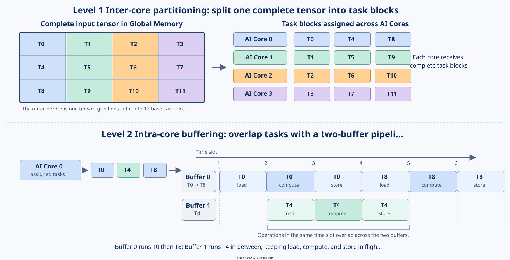
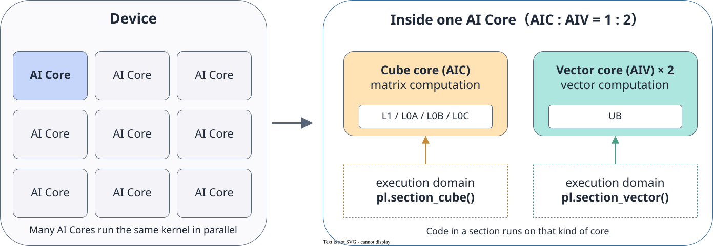

# Tiling Overview

<!-- md-trans-meta sourceCommit=7d0ab31d84c294a0a8327f597d2bdee012acb22d translatedAt=2026-10-27T01:55:15.012Z pushedAt=2026-10-28T08:24:55.995Z nl=2 -->

On the Device side, a kernel is executed in parallel by multiple AI Cores, and the on-chip buffer capacity of each AI Core is limited. To fully utilize the multi-core computing power and ensure that the data processed by a single core fits into the on-chip buffer, the input data of the operator must be divided into basic task blocks, a group of task blocks must be assigned to each core, and buffers must be configured for intra-core processing. This process of partitioning data and computing in blocks is called Tiling.

Tiling is the first step in operator development: the partitioning method determines whether the load is balanced across cores, whether the on-chip buffer can hold the data, and whether data movement is contiguous, directly affecting operator performance.

## Why Tiling Is Needed

Two hardware constraints determine the necessity of Tiling.

**A Device has multiple AI Cores.** If the operator's data is processed by only one core, the other cores remain idle and the multi-core computing power cannot be fully utilized. Only by dividing the data into basic task blocks and assigning a group of task blocks to each core for parallel processing can the computing power be fully utilized.

**The on-chip Buffer capacity of a single core is limited.** Computation can only be performed in the on-chip Buffer, while the input and output of an operator are usually far larger than the on-chip capacity and cannot be loaded completely at once. The size of a basic task block must fit the on-chip capacity. Within a core, double buffering or multiple Buffer slots can be allocated for the assigned tasks, and the "load-compute-store" cycle is executed in rotation so that the data transfer and computation of different tasks run in parallel as much as possible.

Therefore, Tiling consists of two layers:

| Layer | Description | Details |
| --- | --- | --- |
| Inter-core partitioning | Divides the operator's data into basic task blocks and assigns a group of task blocks to each AI Core for parallel processing. | [Multi-core Tiling](multi_core_tiling.md) |
| Intra-core partitioning | Divides the on-core Buffer based on the assigned tasks, for example, using double buffering or multiple Buffer slots in rotation to run data transfer and computation in parallel. | [Tile Creation and Operations](../tile_creation_and_operations.md), [Tile Computation](../vector_computation/tile_computation.md) |

**Figure 1 Two layers of Tiling**

In the figure, AI Core 0 is responsible for the three complete basic task blocks T0, T4, and T8. The intra-core illustration shows the rotation of these tasks across Buffer slots, not the further division of T0 into smaller Tiles.

## AI Core and Execution Domain

A device contains multiple AI Cores, and each AI Core contains a Cube core (AIC) and Vector cores (AIV). On chips where the AIC-to-AIV ratio is 1:2, an AI Core contains one Cube core and two Vector cores: the Cube core performs cube computation, and the Vector cores perform vector computation. Each has its own on-chip buffer and instruction pipeline.

A kernel declares which type of core its code runs on through the [execution domain](../kernel_function.md#defining-the-execution-domain): the code in `pypto_pro.language.section_cube()` is executed by the Cube core, and the code in `pypto_pro.language.section_vector()` is executed by the Vector cores. The execution domains contained in a kernel determine which type of core it uses and the number of cores available for inter-core partitioning.

**Figure 2** AI Core and execution domain

For details about the layers, capacity, and data paths of the on-chip buffer, see [SIMD Abstract Hardware Architecture](../../programming_paradigm/SIMD/abstract_hardware_architecture.md).

## Generating and Passing Tiling Parameters

The parameters required for partitioning (how many tasks each core processes, how large each tile is, how many times to loop, and so on) usually depend on the runtime shape and cannot be hardcoded when writing the Kernel. They must be computed on the Host side and then passed to the Kernel. These parameters are carried jointly by TilingKey and TilingData: TilingKey determines which implementation to use at compile time, while TilingData provides the values required by that implementation at runtime.

For the division of responsibilities, declaration methods, and passing rules of the two, see [Tiling Parameter Definition and Passing](tiling_parameter_definition.md).

## Considerations for Designing Tiling

- **Load balancing**: The number of tasks and the amount of computation assigned to each core should be as close as possible, to avoid a single core becoming a long tail that slows down the whole process.
- **On-chip capacity**: Each tile moved in at a time must fit into the corresponding on-chip buffer, and space should be reserved for optimizations such as double buffering.
- **API constraints**: The shape of a tile must meet the alignment, layout, and fractal requirements of the data movement and computation APIs.
- **Data reuse**: If adjacent tasks reuse the same block of data, the partitioning order should place them on the same core as much as possible.
- **Tail block handling**: The data volume usually cannot be divided evenly by the tile size, so the number of tasks needs to be rounded up, and the last block uses a valid shape to express the actual range.

## Related Content

- [Multi-Core Tiling](multi_core_tiling.md): Specific implementation of inter-core partitioning, including task IDs and continuous core assignment, MIX Kernel partitioning, and load balancing.
- [Tiling Parameter Definition and Passing](tiling_parameter_definition.md): Declaration, passing, and combined use of TilingData and TilingKey.
- [Tile Creation and Operations](../tile_creation_and_operations.md): Tile specification description, on-chip address binding, and valid shape setting.
- [SIMD Abstract Hardware Architecture](../../programming_paradigm/SIMD/abstract_hardware_architecture.md): Compute units, on-chip memory hierarchy, and data paths of AIC and AIV.
