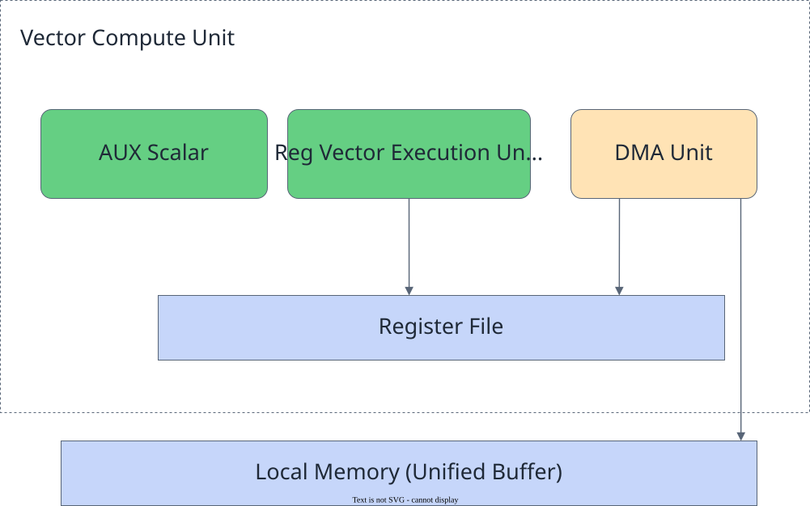
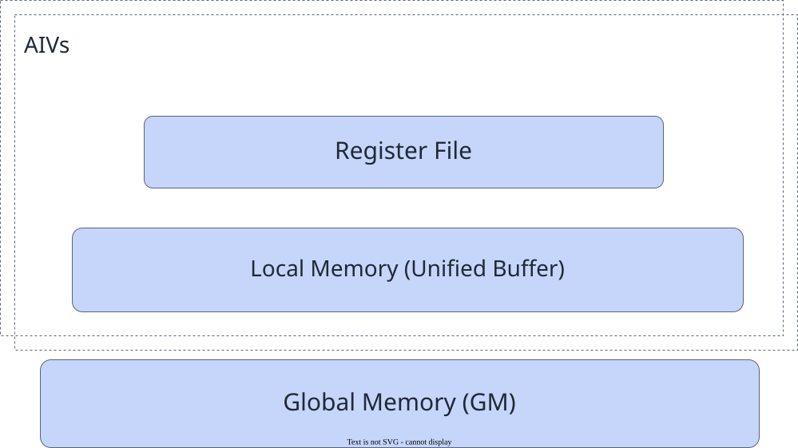
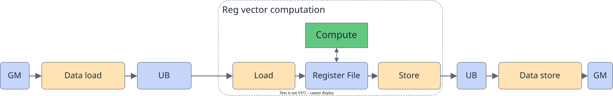

# Reg Computation

<!-- md-trans-meta sourceCommit=7d0ab31d84c294a0a8327f597d2bdee012acb22d translatedAt=2026-10-27T01:57:34.126Z pushedAt=2026-10-27T07:23:16.252Z nl=2 -->

Reg computation directly uses the SIMD Register File to store vector data and intermediate results. PyPTO Pro defines VF functions through @pypto_pro.language.vector_function, and uses the [vf.* API](../../../../../api/pro_api/SIMD-API/Reg-API/index.md) within the function to express register loading, computation, and storage.

> [!NOTE]
> Reg computation depends on the VF Register File. Before use, confirm the support scope of the corresponding VF API.

## Scenarios

Tile computation uses UB Tiles as the data carrier. When multiple vector operations are chained, intermediate results usually need to be written back to UB and then read by the next instruction. When the computation chain is long, repeatedly accessing UB increases read/write bandwidth pressure and the probability of Bank conflicts.

Reg computation keeps a continuous segment of computation in registers, interacting with UB only at the entry and exit of the computation chain:

| Dimension | Tile computation | Reg computation |
|:---|:---|:---|
| Data carrier | Tile in UB | RegTensor / MaskReg in Register File |
| Intermediate result | Usually written back to UB | Can be directly consumed by subsequent vf.* operations |
| PyPTO Pro API | pypto_pro.language.add, pypto_pro.language.sub, pypto_pro.language.sum, etc. | vf.add, vf.sub, vf.reduce_*, etc. |
| Scenarios | General vector computation, quick implementation | Continuous computation chains, high-performance scenarios that require reducing UB round-trip overhead |

## Hardware Components

The hardware units on the Vector side that participate in Reg computation include:

- **Reg vector execution unit**: reads operands from the Register File and writes computation results back to registers.
- **DMA unit**: moves data between UB and the Register File.
- **Aux Scalar**: performs scalar computations such as addresses and loops within the VF domain.

**Figure 1 SIMD Reg vector execution relationship**



## Memory Hierarchy

The Register File sits above the UB and cannot load data directly from the GM or write data directly back to the GM. The complete data path is as follows:

```text
GM → UB → Register File → UB → GM
```

**Figure 2** Reg computation memory hierarchy



The API correspondence at each stage in PyPTO Pro is as follows:

| Data Path | PyPTO Pro Expression |
|:---|:---|
| GM → UB | pypto_pro.language.load / pypto_pro.language.load_tile |
| UB → Register File | vf.load / vf.load_align / vf.load_unalign, etc. |
| Computation within the Register File | vf.add, vf.mul, vf.reduce_sum, etc. |
| Register File → UB | vf.store / vf.store_align / vf.store_unalign, etc. |
| UB → GM | pypto_pro.language.store / pypto_pro.language.store_tile |

## Programming Model

Based on the "data move-in → compute → data move-out" flow of Tile computation, Regbase further refines the vector computation phase into "Load → Compute → Store".

**Figure 3 Overall structure of the Regbase programming model**



### VF Functions and Execution Domain

Use @pypto_pro.language.vector_function to declare a VF function. The function body is implicitly in the VF execution domain, where vf.* operations are used to load, compute, and store registers. The type of the Tile parameter is inferred at the call site.

vf.* operations can only be used inside VF functions. Even when placed inside pypto_pro.language.section_vector(), they still need to be invoked through a VF function.
A VF function can call other VF functions and use scalar expressions, pypto_pro.language.range loops, and scalar pypto_pro.language.min, pypto_pro.language.max, and pypto_pro.language.const.
Other pypto_pro.language.* calls (including Tile operations, synchronization operations, and pypto_pro.language.section_vector()/pypto_pro.language.section_cube()) should be placed outside VF functions,
and the required results should be passed in as parameters. The same applies to next()/current()/previous() of TileGroup: advancing the cursor produces scalar operations,
which cannot enter the VF execution domain. You should select the Tile on the calling side and pass it in as a parameter. pypto_pro.language.DT_* and enumeration constants can still be used inside VF functions.
When the execution domain restriction is violated, the frontend parser reports an error at the corresponding call site.

```python
import pypto_pro.language as pl
from pypto_pro.language import Vf as vf


@pl.vector_function
def add_vf(src_a, src_b, dst):
    preg = vf.create_mask(pattern=pl.MaskPattern.ALL, dtype=pl.DT_FP32)
    reg_a = vf.load_align(src_a, 0)
    reg_b = vf.load_align(src_b, 0)
    reg_out = vf.add(reg_a, reg_b, preg)
    vf.store_align(dst, reg_out, preg)
```

The outer @pypto_pro.language.jit Kernel is responsible for data transfer between GM and UB as well as cross-Pipe synchronization, and calls the VF function inside pypto_pro.language.section_vector():

```python
import pypto_pro.language as pl

@pl.jit(auto_mutex=True)
def add_kernel(
    a: pl.Tensor[[1, 64], pl.DT_FP32],
    b: pl.Tensor[[1, 64], pl.DT_FP32],
    out: pl.Tensor[[1, 64], pl.DT_FP32],
):
    tt = pl.TileType(shape=[1, 64], dtype=pl.DT_FP32,
                     target_memory=pl.MemorySpace.Vec)
    a_group = pl.make_tile_group(type=tt, addrs=0x000, mutex_ids=[0])
    b_group = pl.make_tile_group(type=tt, addrs=0x100, mutex_ids=[1])
    out_group = pl.make_tile_group(type=tt, addrs=0x200, mutex_ids=[2])

    with pl.section_vector():
        tile_a = a_group.current()
        tile_b = b_group.current()
        tile_out = out_group.current()
        pl.load(tile_a, a, [0, 0])
        pl.load(tile_b, b, [0, 0])
        add_vf(tile_a, tile_b, tile_out)
        pl.store(out, tile_out, [0, 0])
```

For a complete description of the register lifecycle, see [reg_tensor](../../../../../api/pro_api/SIMD-API/Reg-API/basic_data_structures/reg_tensor.md).

### Tile Pointer Offset in VF Functions

The Tile parameters received by a VF function can be linearly offset by elements using tile + offset. The offset expression can be passed to memory access APIs such as vf.load_align and vf.store_align. For example, the following VF function reads the source Tile row by row and writes the results consecutively to the destination Tile:

```python
import pypto_pro.language as pl
from pypto_pro.language import Vf as vf

@pl.vector_function
def copy_rows(dst_tile, src_tile, row_count, col_count, src_stride):
    preg = vf.update_mask(col_count, dtype=pl.DT_FP16)
    for row in pl.range(row_count):
        vreg = vf.load_align(src_tile, row * src_stride)
        vf.store_align(dst_tile + row * col_count, vreg, preg)
```

The unit of offset is an element, which can be an integer constant or a runtime integer Scalar. tile + offset only forms an offset pointer expression; it does not create a new Tile, nor does it carry shape or valid_shape information.

Slicing in the form of tile[row_start:row_stop, col_start:col_stop] is not supported inside a VF function. If you need to select a two-dimensional region first, create a sub-Tile in pypto_pro.language.section_vector() and then pass it to the VF function:

```python
import pypto_pro.language as pl

with pl.section_vector():
    src_tile = src_group.next()
    dst_tile = dst_group.next()
    pl.load(src_tile, src, [0, 0])
    copy_rows(dst_tile, src_tile[1:4, 16:48], 3, 32, 64)
    pl.store(dst, dst_tile, [0, 0])
```

## Synchronization and Dependencies

- Cross-pipe dependencies between GM↔UB transfers and Vector/VF computation are automatically managed by TileGroup + auto_mutex=True, or manually managed using pypto_pro.language.system.sync_src / pypto_pro.language.system.sync_dst.
- When local dependencies such as write-after-read and write-after-write exist within a VF function, use vf.mem_bar to specify the corresponding mode as required by the API.
- vf.* expressions with direct data dependencies in the Register File should maintain a clear data flow relationship, and avoid performing computation on uninitialized registers.

## Usage Suggestions

Reg computation and [Tile computation](tile_computation.md) focus on performance and ease of use respectively. You can choose between them based on the development requirements of the operator:

- **Reg computation (VF computation)**: Intermediate results can be retained in the Vector Register File, reducing UB reads and writes for better performance. Before use, confirm that the target device and the required VF APIs are supported, and comply with the register, data type, and API constraints.
- **Tile computation**: The APIs and data flow are more intuitive, making development, debugging, and maintenance more convenient. Intermediate results usually need to be read from and written to UB, resulting in relatively lower performance.
