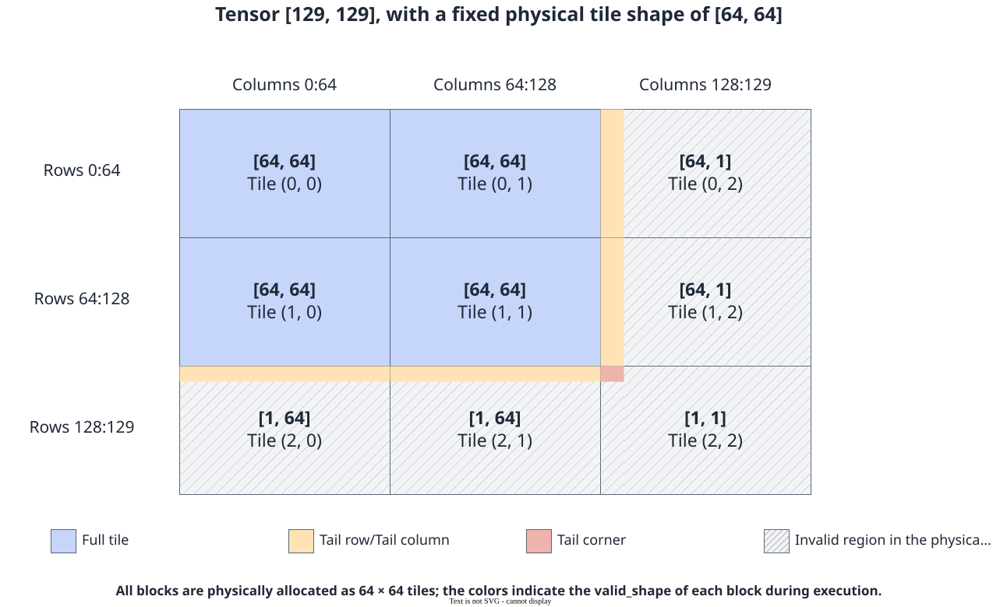
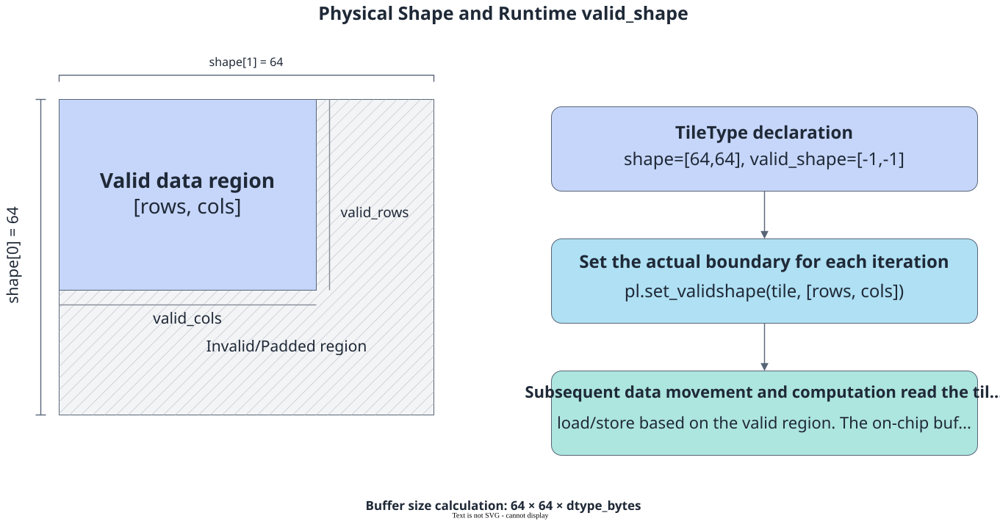
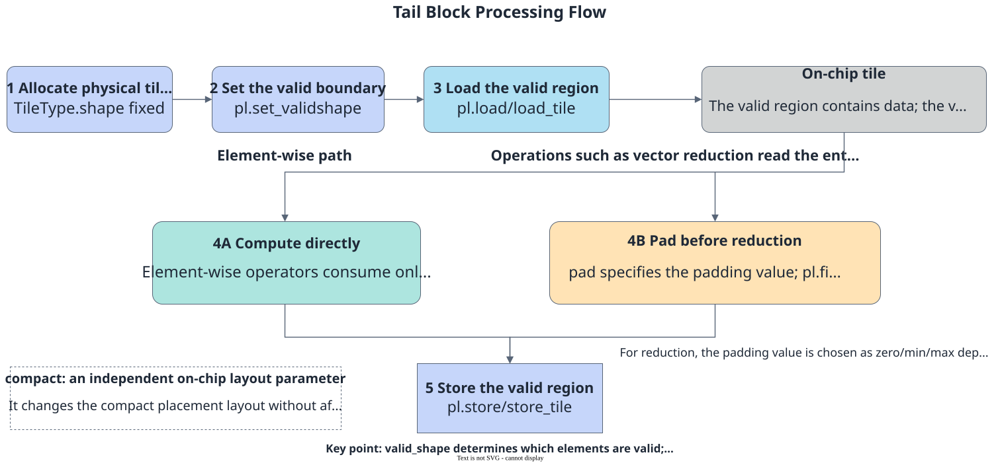

# Tile Computation

<!-- md-trans-meta sourceCommit=7d0ab31d84c294a0a8327f597d2bdee012acb22d translatedAt=2026-10-27T02:00:52.917Z pushedAt=2026-10-28T08:26:43.011Z nl=2 -->

Tile computation is the vector computation method provided by PyPTO Pro on the Vector side. Developers use Tiles in the UB as input and output, and perform batch computation on multiple data elements in the valid region through the Tile computation API. It is suitable for regular computations such as element-wise computation, reduction, type conversion, and data rearrangement.

The typical data flow of a complete operator is as follows:

```text
Tensor → Data load → Input Tile → Tile computation → Output Tile → Data move-out → Tensor
```

For details about the creation, on-chip addresses, and data movement of Tiles and TileGroups, see [Tile Creation and Operations](../tile_creation_and_operations.md).

## Computation Model

Tile computation is executed in the Vector execution domain. Before calling a computation API, you need to prepare the input Tile and output Tile. The API writes the result to the output Tile and does not create or return a new Tile:

```python
import pypto_pro.language as pl

with pl.section_vector():
    pl.add(out_tile, lhs_tile, rhs_tile)
```

In the example above, the valid regions of lhs_tile and rhs_tile are added element-wise, and the result is written to out_tile. Most Tile computation APIs take the output Tile as the first parameter, followed by inputs, temporary Tiles, and optional parameters.

- out is the destination Tile that stores the computation result and must be prepared before calling the API.
- Inputs can be Tiles; some APIs also support Scalars or Python scalar constants.
- Computation acts on the valid region of a Tile. The shape, valid_shape, data type, and layout of the inputs and output must satisfy the constraints of the corresponding API.
- Some APIs support in-place computation, meaning that out can use the same Tile as one of the inputs. Do not assume in-place computation is supported unless explicitly stated.

## Computation APIs and Common Patterns

The Tile computation operations currently exposed by PyPTO Pro are as follows:

| Computation Type | Primary Purpose |
|---|---|
| [Element-wise Computation](../../../../../api/pro_api/SIMD-API/tile_computation/elementwise/index.md) | Performs arithmetic, logical, or activation computation on corresponding elements in a Tile. |
| [Comparison](../../../../../api/pro_api/SIMD-API/tile_computation/comparison/index.md) | Compares elements element-wise and generates a bitwise-compressed mask Tile. |
| [Selection](../../../../../api/pro_api/SIMD-API/tile_computation/selection/index.md) | Selects results element-wise from two inputs based on a mask. |
| [Type Conversion](../../../../../api/pro_api/SIMD-API/tile_computation/type_conversion/index.md) | Converts elements in the valid region of the source Tile to the data type of the destination Tile. |
| [Math Functions](../../../../../api/pro_api/SIMD-API/tile_computation/math_functions/index.md) | Fills a Tile with a scalar, or performs sum reduction along a specified dimension. |
| [Composite Computation](../../../../../api/pro_api/SIMD-API/tile_computation/composite_computation/index.md) | Performs multiply-add computation between a Tile and a scalar. |
| [Fused Vector Computation](../../../../../api/pro_api/SIMD-API/tile_computation/fused_vector_computation/index.md) | Completes addition and ReLU activation in a single API call. |
| [Transpose](../../../../../api/pro_api/SIMD-API/tile_computation/transpose_and_element_access/index.md) | Swaps the two axes of a two-dimensional Tile. |

The data types, storage space, layout, and in-place computation methods supported by each API may differ. Refer to the descriptions in [Tile Computation API](../../../../../api/pro_api/SIMD-API/tile_computation/index.md).

### Tile-to-Tile Element-wise Computation

The corresponding elements of the two input Tiles participate in the computation, and the result is written to the destination Tile:

```python
import pypto_pro.language as pl

pl.add(out_tile, lhs_tile, rhs_tile)
pl.mul(out_tile, lhs_tile, rhs_tile)
pl.maximum(out_tile, lhs_tile, rhs_tile)
```

Before using such APIs, confirm based on the corresponding API whether the shape, valid_shape, data type, and layout of the input and output Tiles match.

### Element-wise Computation Between Tile and Scalar

Some APIs support computation between a Tile and a Scalar, where the same Scalar participates in the operation of every element in the valid region of the Tile. For example:

```python
import pypto_pro.language as pl

pl.add(out_tile, src_tile, 1.0)
```

Tile-Scalar is not a universal capability of all element-wise APIs, and the Scalar type must also be compatible with the Tile element type.

### In-place Computation

When an API explicitly supports in-place computation, you can reuse the input Tile to store the result. For example, the following code performs addition and then ReLU in sequence:

```python
import pypto_pro.language as pl

pl.add(out_tile, lhs_tile, rhs_tile)
pl.relu(out_tile, out_tile)
```

In-place computation reduces intermediate Tiles but overwrites the original data. If subsequent computation still needs the input values, use a separate output Tile.

### Comparison and Selection

The comparison API generates a bitwise-compressed mask, and the selection API selects the result based on the mask:

```python
import pypto_pro.language as pl

pl.eq(mask_tile, lhs_tile, rhs_tile)
pl.select(out_tile, mask_tile, lhs_tile, fallback_tile, tmp_tile)
```

The types and layouts of the mask Tile, temporary Tile, and input/output Tiles must meet the requirements of the corresponding APIs.

### Reduction Computation

The reduction API can sum a two-dimensional Tile along a specified dimension:

```python
import pypto_pro.language as pl

pl.sum(out_tile, src_tile, tmp_tile, dim=0)
pl.sum(out_tile, src_tile, tmp_tile, dim=1)
```

Here, dim indicates the reduction direction rather than directly deleting the axis with the same number. When the source Tile has the shape [M, N], dim=0 sums each row along the N direction, producing an output shape of [M, 1]; dim=1 sums each column along the M direction, producing an output shape of [1, N]. The data types supported differ between reduction directions.

### Type and Layout Conversion

The type conversion API converts a Tile to the data type of the destination Tile, with the target type determined by <code>out_tile.dtype</code>; the transpose API swaps the two axes of a two-dimensional Tile:

```python
import pypto_pro.language as pl

pl.cast(out_tile, src_tile, mode=pl.RoundMode.CAST_ROUND)
pl.transpose(transposed_tile, src_tile)
```

Both APIs write the result to a pre-prepared destination Tile. For rounding modes, data type combinations, and shape and alignment requirements, see the corresponding API descriptions.

## Computation Orchestration and Synchronization

A Tile computation can be organized as follows:

1. **Determine the computation semantics**: Clarify whether the computation is element-wise, comparison/selection, reduction, type conversion, or data rearrangement, and select the corresponding Tile computation API.
2. **Determine the input-output relationship**: Prepare the input, output, and temporary Tiles based on the API prototype, and confirm that the shape, valid_shape, data type, and layout meet the API constraints.
3. **Orchestrate the computation operations**: Call one or more Tile computation APIs in the Vector execution domain, using the output Tile of the previous operation as the input Tile of the next operation.
4. **Handle data dependencies**: When a Tile is passed between the data movement pipeline and the Vector computation pipeline, use automatic synchronization based on TileGroup mutex metadata or explicit synchronization to ensure that the producer completes before the consumer.
5. **Handle the tail block**: When the actual data range is smaller than the physical shape of the Tile, set the correct valid_shape so that the computation only applies to the valid region.

Multiple Tile computation APIs can form a computation chain in the Vector execution domain. The output of the previous API can be used as the input of the next API; adjacent operations on the same Vector computation pipeline execute in dependency order, and cross-Pipe synchronization between operations is not required. When a Tile is passed between different pipelines such as MTE2, Vector, and MTE3, automatic synchronization based on TileGroup mutex metadata or [explicit synchronization](../../../../../api/pro_api/SIMD-API/synchronization/index.md) is still required to ensure the read/write order.

The following snippet first performs element-wise addition on two input Tiles, and then performs ReLU in place. The code assumes that the Tiles have been created, the input data has been moved in, and the cross-Pipe dependencies before and after the computation are handled by the outer Kernel:

```python
import pypto_pro.language as pl

with pl.section_vector():
    pl.add(out_tile, lhs_tile, rhs_tile)
    pl.relu(out_tile, out_tile)
```

If [pypto_pro.language.add_relu](../../../../../api/pro_api/SIMD-API/tile_computation/fused_vector_computation/add_relu.md) is used instead, note that this API modifies lhs_tile during the computation. The fused API can replace the preceding computation chain only when the original data of lhs_tile is no longer used and the input and output meet the API constraints.

## Tail Block Processing

When the actual valid range of the current data block is smaller than the physical shape of the Tile, the Tile is called a **tail block**. The most common scenario is that the number of rows or columns of a GM Tensor is not divisible by the Tile size, which may also result from processing a sub-region of a Tensor or a runtime valid window. This section describes how to use valid_shape to limit the valid region of a tail block, and when padding of the invalid region is required.

### Identifying Tail Blocks

Take a two-dimensional Tensor as an example. Assume the Tensor shape is [M, N] and the Tile shape is [TILE_M, TILE_N]. The number of Tiles in each direction is:

```python
m_tiles = (M + TILE_M - 1) // TILE_M
n_tiles = (N + TILE_N - 1) // TILE_N
```

When M % TILE_M != 0, trailing rows are produced; when N % TILE_N != 0, trailing columns are produced. When both occur simultaneously, the bottom-right corner is the trailing corner.

**Figure 1 Full blocks, trailing rows, trailing columns, and trailing corner in a two-dimensional Tensor**



For the Tile at row i and column j, the current valid number of rows and columns can be calculated as follows:

```python
import pypto_pro.language as pl

valid_rows = pl.min(M - i * TILE_M, TILE_M)
valid_cols = pl.min(N - j * TILE_N, TILE_N)
```

### shape and valid_shape

TileType.shape and TileType.valid_shape describe different objects:

| Parameter | Description |
| --- | --- |
| shape | Physical specification of the Tile, which determines the on-chip buffer size and addressing boundary |
| valid_shape | Row and column range that is actually valid in the current Tile |

**Figure 2 Relationship between the physical shape and logical valid_shape of a Tile**



For tail blocks whose valid size may differ at each run, [TileType](../../../../../api/pro_api/SIMD-API/basic_data_structures/TileType.md) can omit valid_shape; the default value None is equivalent to the dynamic mode [-1, -1]:

```python
import pypto_pro.language as pl

tile_type = pl.TileType(
    shape=[64, 128],
    dtype=pl.DT_FP16,
    target_memory=pl.MemorySpace.Vec,
)
```

When valid_shape is omitted, the valid sizes of both dimensions can be determined at runtime, and there is no need to explicitly write [-1, -1]. If only one dimension is dynamic, you can also declare valid_shape=[64, -1]. The valid size passed to pypto_pro.language.set_validshape at runtime must be a positive integer and cannot exceed the corresponding dimension of shape.

### Standard Processing Flow

The key sequence for tail block processing is: **set the valid shape first, then load and compute**.

**Figure 3** Tail block processing flow



```python
import pypto_pro.language as pl

tile_a = a_group.next()
tile_b = b_group.next()
tile_c = c_group.next()

valid_rows = pl.min(M - i * TILE_M, TILE_M)
valid_cols = pl.min(N - j * TILE_N, TILE_N)

# Must be set first so that the subsequent load, computation, and store use the same valid region.
pl.set_validshape(tile_a, [valid_rows, valid_cols])
pl.set_validshape(tile_b, [valid_rows, valid_cols])
pl.set_validshape(tile_c, [valid_rows, valid_cols])

pl.load_tile(tile_a, a, [i, j])
pl.load_tile(tile_b, b, [i, j])
pl.add(tile_c, tile_a, tile_b)
pl.store_tile(c, tile_c, [i, j])
```

When `pypto_pro.language.set_validshape` is passed a Tile, it updates only the valid region of that Tile; when passed a TileGroup, it updates the valid region of all Tiles in the group. In the sequence above:

- The data load operation loads only the valid region from GM, avoiding out-of-bounds reads for the tail block.
- Vector computation uses the current valid region.
- The data write-back operation writes back only the valid region, avoiding out-of-bounds writes.

> Set `valid_shape` before data loading to constrain the GM load; setting it after data loading affects only subsequent operations.

#### Tile and TileGroup

When the valid shape of each buffer differs, set valid_shape for each Tile obtained from the TileGroup separately:

```python
import pypto_pro.language as pl

tile = tile_group.next()
pl.set_validshape(tile, [valid_rows, valid_cols])
```

If all buffers in the TileGroup use the same valid shape throughout the entire Kernel, you can set it uniformly for the TileGroup:

```python
import pypto_pro.language as pl

pl.set_validshape(tile_group, [valid_rows, valid_cols])
```

For tail blocks that vary block by block, set the valid shape of the current block after each Tile is obtained.

### compact and Tile Computation

valid_shape describes the valid region of a Tile that participates in the current operation; compact describes how a specific data movement, rearrangement, or cube computation path interprets the on-chip physical layout. The two cannot replace each other.

The UB ND element-wise tail block in this section uses valid_shape to control the actual movement and computation range, while the on-chip stride is still determined by the physical shape, so compact is usually not required. When fractal movement, Cube computation, or RowPlusOne layout is involved, configure it according to the requirements of the specific API. For details, see [the compact parameter of TileType](../../../../../api/pro_api/SIMD-API/basic_data_structures/TileType.md#parameters) and [Cube Computation](../cube_computation.md).

### When Is Padding of Invalid Regions Required

valid_shape only marks which elements are valid; it does not automatically write values to invalid regions. If a subsequent operation reads the entire physical Tile, you need to use pad to specify a safe padding value and explicitly perform the padding operation.

| Computation Semantics | Recommended Padding Value |
| --- | --- |
| Element-wise addition, subtraction, and multiplication, where both computation and write-back follow valid_shape | Padding is usually not required |
| Summation | 0 |
| Maximum, or maximum reduction before Softmax | Minimum value of the data type |
| Minimum | Maximum value of the data type |

The following key snippet fills the invalid region of src with 0. The TileGroup creation process is omitted:

```python
import pypto_pro.language as pl

src_type = pl.TileType(
    shape=[64, 128],
    dtype=pl.DT_FP16,
    target_memory=pl.MemorySpace.Vec,
)
dst_type = pl.TileType(
    shape=[64, 128],
    dtype=pl.DT_FP16,
    target_memory=pl.MemorySpace.Vec,
    pad=pl.TilePad.zero,
)

src = src_group.next()
dst = dst_group.next()
pl.set_validshape(src, [valid_rows, valid_cols])
pl.load(src, x, [row_offset, col_offset])
pl.fillpad(dst, src)
```

pad only specifies the padding semantics; [pypto_pro.language.fillpad](../../../../../api/pro_api/SIMD-API/memory_data_movement/load.md#loading-tail-blocks) actually performs the padding. Whether padding is required depends on whether subsequent operations read the invalid region and whether invalid values affect the computation result. For the handling of tail blocks in cube computation, see [Cube Computation](../cube_computation.md).

### Complete Example: Four Types of Tail Blocks in Two-Dimensional Addition

The following Kernel supports dynamic two-dimensional shapes. The shapes of x, y, and z must be identical; the Kernel uses x.shape to compute the loop range and accesses the other two Tensors with the same block index. The example uses a 64 × 128 physical Tile and computes valid_rows and valid_cols block by block, handling full blocks, trailing rows, trailing columns, and trailing corners simultaneously.

```python
import pypto_pro.language as pl
import torch
import torch_npu

TILE_M = 64
TILE_N = 128


@pl.jit(auto_mutex=True)
def add_tail_kernel(
    x: pl.Tensor[[pl.DYNAMIC, pl.DYNAMIC], pl.DT_FP16],
    y: pl.Tensor[[pl.DYNAMIC, pl.DYNAMIC], pl.DT_FP16],
    z: pl.Tensor[[pl.DYNAMIC, pl.DYNAMIC], pl.DT_FP16],
):
    tile_type = pl.TileType(
        shape=[TILE_M, TILE_N],
        dtype=pl.DT_FP16,
        target_memory=pl.MemorySpace.Vec,
    )
    a_group = pl.make_tile_group(
        type=tile_type, addrs=[0x0000, 0x4000], mutex_ids=[0, 1])
    b_group = pl.make_tile_group(
        type=tile_type, addrs=[0x8000, 0xC000], mutex_ids=[2, 3])
    c_group = pl.make_tile_group(
        type=tile_type, addrs=[0x10000, 0x14000], mutex_ids=[30, 31])

    with pl.section_vector():
        m = x.shape[0]
        n = x.shape[1]
        m_tiles = (m + TILE_M - 1) // TILE_M
        n_tiles = (n + TILE_N - 1) // TILE_N

        for i in pl.range(0, m_tiles, 1):
            for j in pl.range(0, n_tiles, 1):
                tile_a = a_group.next()
                tile_b = b_group.next()
                tile_c = c_group.next()

                valid_rows = pl.min(m - i * TILE_M, TILE_M)
                valid_cols = pl.min(n - j * TILE_N, TILE_N)
                pl.set_validshape(tile_a, [valid_rows, valid_cols])
                pl.set_validshape(tile_b, [valid_rows, valid_cols])
                pl.set_validshape(tile_c, [valid_rows, valid_cols])

                pl.load_tile(tile_a, x, [i, j])
                pl.load_tile(tile_b, y, [i, j])
                pl.add(tile_c, tile_a, tile_b)
                pl.store_tile(z, tile_c, [i, j])

device = "npu:0"
torch.npu.set_device(device)
x = torch.randn(129, 257, dtype=torch.float16, device=device)
y = torch.randn_like(x)
z = torch.empty_like(x)
add_tail_kernel[None, 1](x, y, z)
torch.npu.synchronize()
torch.testing.assert_close(z, x + y, rtol=1e-3, atol=1e-3)
```

129 × 257 contains tail blocks in both dimensions, so the example covers four types of Tiles: full blocks, row tail blocks, column tail blocks, and corner tail blocks, and sets the corresponding valid_shape for each.

### FAQs

#### Setting valid_shape After Data Loading

```python
import pypto_pro.language as pl

# Error: This load has already occurred, so it can no longer be restricted by valid_shape.
pl.load(tile, x, offsets)
pl.set_validshape(tile, [valid_rows, valid_cols])
```

It should be adjusted to:

```python
import pypto_pro.language as pl

pl.set_validshape(tile, [valid_rows, valid_cols])
pl.load(tile, x, offsets)
```

#### Tests Only Cover Full Blocks

For example, if the physical Tile is [64, 128] and the test still uses a Tensor of [64, 128], it only proves that the full block path works, but cannot prove that the tail block does not go out of bounds. Tail block tests should include at least one shape where both dimensions are smaller than the physical Tile, or one larger shape where both dimensions cannot evenly divide the Tile size.

#### Setting valid_shape Only for the Input Tile

The input Tile, the computation result Tile, and the write-back Tile should use a consistent valid shape for the same logical region. Omitting the output Tile may cause out-of-bounds writes or writing back invalid data.

#### Treating pad as automatic padding

pad only declares the padding value and does not generate a padding operation by itself. When actual padding of the invalid region is required, explicitly call the padding API.

#### Padding All Tail Blocks

Element-wise computation usually requires only correct valid shape settings. Padding values that match the computation semantics are required only when subsequent operations read the invalid region and the invalid values affect the result.

### Parameter Selection Quick Reference

| Scenario | valid_shape | compact | Padding Method |
| --- | --- | --- | --- |
| Fixed shape with all full blocks | Same as shape | Not required | Not required |
| Vector element-wise ND dynamic tail block | [-1, -1], set per block | Not required | Usually not required |
| Sum after tail block | [-1, -1] | Not required | Pad with 0 |
| Maximum reduction after tail block | [-1, -1] | Not required | Pad with the minimum value of the data type |
| Cube dynamic tail block | Set matching valid sizes for the Tiles in the L1 Buffer, L0A Buffer, L0B Buffer, and L0C Buffer that participate in cube multiplication | L0A Buffer, L0B Buffer, and L0C Buffer are usually set to 1; special paths are configured as required by the API | Determined by the specific data path and operator semantics |

## Computation Constraints and Recommendations

- Tile computation APIs generally take the output Tile as the first parameter, and the computation result is written into that Tile. You cannot receive the return value in the manner of Tensor expressions.
- Different APIs have different requirements for shape, valid_shape, data type, layout, and memory space. When combining APIs, you must satisfy the constraints of both the preceding and following operations.
- Use Tile-Scalar, in-place computation, or input/output reuse only when the API explicitly supports them.
- Some selection and reduction APIs require additional masks or temporary Tiles, which should be taken into account when designing on-chip space.
- Cross-Pipe dependencies before and after computation must be properly synchronized. For specific APIs, see [Synchronization Control](../../../../../api/pro_api/SIMD-API/synchronization/index.md).

For the complete list of Tile computation APIs, see [Tile Computation API](../../../../../api/pro_api/SIMD-API/tile_computation/index.md).
