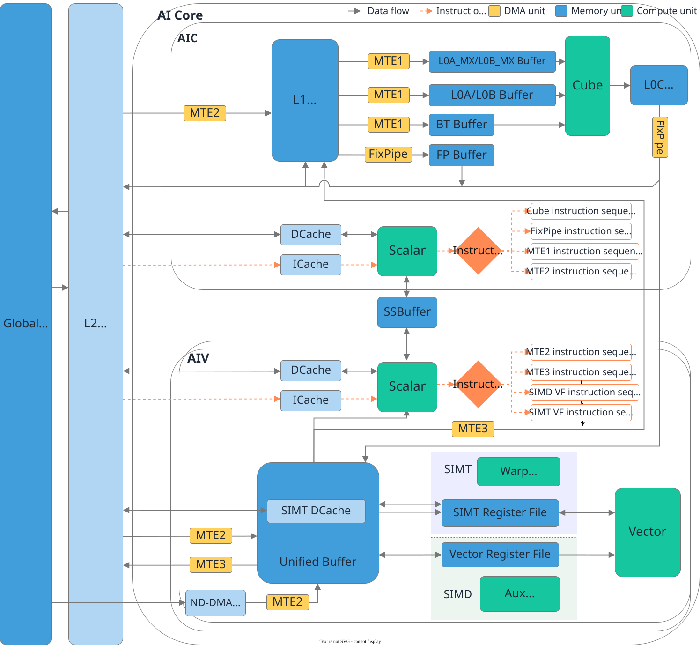

# Abstract Hardware Architecture

<!-- md-trans-meta sourceCommit=7d0ab31d84c294a0a8327f597d2bdee012acb22d translatedAt=2026-10-27T02:10:15.928Z pushedAt=2026-10-28T08:41:47.959Z nl=2 -->

SIMD computation in PyPTO Pro uses the Vector resources of the AIV and the Cube resources of the AIC. Understanding these two types of compute resources and their data paths helps you choose Tile computation, Reg computation, or Cube computation, and correctly organize data movement and synchronization. For the thread execution resources of SIMT, see [SIMT Abstract Hardware Architecture](../SIMT/abstract_hardware_architecture.md).

## Overview

The hardware related to the AI Core can be understood from three aspects: compute units, storage units, and data movement units. The following figure shows the AIC, AIV, and their instruction flow and main data flow.

**Figure 1 AI Core hardware architecture (Ascend 950PR & 950DT series)**

In the figure, the black solid lines represent the main data flow, and the orange dashed lines represent the instruction flow. The SIMT resources in the figure are used to illustrate their location within the AIV and are not within the scope of this chapter.

## Compute Units

| Unit | Primary Function | PyPTO Pro Computation Mode |
|:---|:---|:---|
| Scalar | Handles scalar logic such as address computation and loop control, and issues instructions to the compute and data movement pipelines | Control logic in the kernel |
| Vector unit on the AIV | Executes vector operations | [Tile computation](../../development/vector_computation/tile_computation.md), [Reg computation](../../development/vector_computation/reg_computation.md) |
| Cube unit on the AIC | Executes cube operations | [Cube computation](../../development/cube_computation.md) |

Tile computation uses the Tile in the UB as the data carrier for computation. Reg computation loads data from the UB into the Vector Register File, and intermediate results can be retained in registers. Cube computation reads cube operands from the L0A Buffer and L0B Buffer, and writes the accumulation results to the L0C Buffer. For the APIs and usage constraints of each mode, see the corresponding programming chapters.

## Storage and Data Movement Units

GM is located outside the AI Core and is used to store kernel inputs, outputs, and workspace. AIV and AIC each have on-chip storage, and data must be moved into the corresponding storage hierarchy before computation.

| Execution Side | Main On-chip Storage | Typical Data Path |
|:---|:---|:---|
| AIV Tile computation | UB | GM → UB → Vector unit → UB → GM |
| AIV Reg computation | UB, Vector Register File | GM → UB → Vector Register File → UB → GM |
| AIC Cube computation | L1 Buffer, L0A Buffer, L0B Buffer, L0C Buffer | GM → L1 Buffer → L0A Buffer/L0B Buffer → Cube unit → L0C Buffer → GM |

The paths in the table represent the main storage hierarchies involved in a single computation, and do not imply that all data movement and computation must be performed serially. For the register data path and hardware units of Reg computation, see [Reg Computation](../../development/vector_computation/reg_computation.md#hardware-components). For the roles, layouts, and movement paths of the AIC buffers, see [Cube Computation](../../development/cube_computation.md).

Data movement units such as MTE are responsible for data transfer between GM and on-chip buffers, as well as between different on-chip buffers. For AIV, data movement between GM and UB mainly uses MTE2 and MTE3. Reg computation also uses the DMA unit to move data between UB and the Vector Register File. For AIC, cube data typically enters the L1 Buffer through MTE2 and then enters the L0A Buffer and L0B Buffer through MTE1. FIX is responsible for moving results out. For specific APIs and supported movement paths, refer to [Tile Creation and Operations](../../development/tile_creation_and_operations.md), [Reg Computation](../../development/vector_computation/reg_computation.md), and [Cube Computation](../../development/cube_computation.md).

## Instruction Flow, Data Flow, and Synchronization

The instruction flow and data flow in Figure 1 have different meanings: Scalar dispatches data movement and computation tasks to the corresponding pipelines; the data movement units and compute units access storage resources along their respective data paths. Different pipelines can execute asynchronously, so the order in the source code does not necessarily reflect the completion order on the hardware.

When data produced by one pipeline is consumed by another pipeline, a synchronization dependency must be established. For example, before Vector computation reads UB data, the related data movement into UB must be completed; before the computation results are moved back to GM, the related computation must also be completed. Synchronization signals only constrain the execution order and do not perform data movement.

PyPTO Pro can manage dependencies through TileGroup and automatic mutex, or explicitly specify dependencies using synchronization APIs. For details, see [Tile Creation and Operations](../../development/tile_creation_and_operations.md) and [Tile Computation](../../development/vector_computation/tile_computation.md).

Multiple AICs or AIVs can process different data shards in parallel. For the core count configuration, core index, and the mapping between AIC and AIV in a hybrid Kernel, see [SIMD Programming Paradigm](programming_paradigm.md#multi-core-spmd-and-intra-core-simd) and [Multi-core Tiling](../../development/tiling/multi_core_tiling.md).
