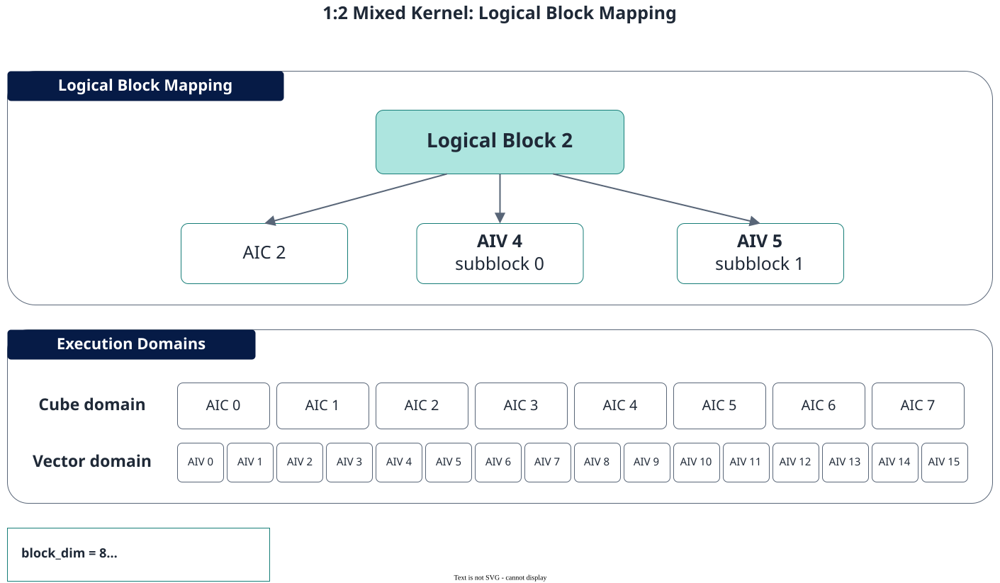

# Programming Paradigm

<!-- md-trans-meta sourceCommit=7d0ab31d84c294a0a8327f597d2bdee012acb22d translatedAt=2026-10-27T02:12:17.450Z pushedAt=2026-10-27T10:26:04.066Z nl=2 -->

SIMD (Single Instruction Multiple Data) uses data blocks as the primary programming object, where a single instruction performs the same operation on multiple homogeneous data elements simultaneously. PyPTO Pro uses Tensor, Tile, and RegTensor to represent data at different storage levels, and organizes multi-core data partitioning and intra-core batch computation within the same Kernel.

SIMD programming in PyPTO Pro includes three main computation methods: Tile computation based on UB Tile, Reg computation based on Vector Register, and Cube computation based on L1 Buffer and L0 Buffer Tile. All three operate on batch data and are suitable for operators with regular memory access and computation patterns and high parallelism.

## Multi-Core SPMD and Intra-Core SIMD

A PyPTO Pro SIMD kernel adopts a two-level parallelism of "outer multi-core SPMD + inner single-core SIMD":

- **Multi-core SPMD (Single Program Multiple Data)**: Multiple AI Cores execute the same kernel code, and each core processes a different data slice based on its core index.
- **Intra-core SIMD**: Each AI Core uses Vector or Cube instructions to process multiple elements in the current data slice in batches.

On the host side, the number of cores is configured through `block_dim`. Inside the kernel, `pypto_pro.language.get_block_num()` obtains the actual number of effective cores, and `pypto_pro.language.get_block_idx()` obtains the core index in the current execution domain. For the default value, call form, and meaning of `block_dim` under different kernel types, see [Kernel Function](../../development/kernel_function.md#meaning-and-setting-of-blockdim).

```python
import pypto_pro.language as pl


num_cores = pl.get_block_num()
core_id = pl.get_block_idx()

# Process data blocks with core_id as the core index and num_cores as the stride.
for tile_idx in pl.range(core_id, tile_num, num_cores):
    ...
```

The commonly used strided splitting ensures that the number of data blocks processed by each core differs by at most 1, and avoids a single core serially traversing all data. For the complete block count calculation and multi-core splitting method, see [Multi-Core Tiling](../../development/tiling/multi_core_tiling.md).

### Pure Vector, Pure Cube, and Hybrid Kernels

A SIMD kernel can use only one execution domain, or combine the Vector and Cube execution domains:

| Kernel Type | Execution Resource | Meaning of `get_block_idx()` |
|:---|:---|:---|
| Pure Vector kernel | AIV | Global index of the current Vector core |
| Pure Cube kernel | AIC | Global index of the current Cube core |
| Cube/Vector hybrid kernel | AIC and AIV | Returns the corresponding global core index in the execution domain |

A hybrid kernel uses an AIC:AIV mapping of 1:2. Each AI Core execution group contains one AIC and two AIVs. When `block_num = pypto_pro.language.get_block_num()`, the Cube execution domain actually uses `block_num` AICs, and the Vector execution domain actually uses `2 * block_num` AIVs.

**Figure 1** Execution group mapping of a hybrid kernel



`get_block_idx()` in the Vector execution domain is already the flattened global AIV index. To distinguish the two AIVs within the same execution group, use `pypto_pro.language.get_subblock_idx()`.

## SIMD Data Objects

PyPTO Pro uses different data objects to represent the location of SIMD data in the storage hierarchy:

| Data Object | Data Location | Purpose |
|:---|:---|:---|
| Tensor | GM | Describes a multi-dimensional data view of the Kernel input, output, or Workspace |
| Tile | On-chip storage such as UB, L1 Buffer, L0A Buffer, L0B Buffer, and L0C Buffer | Represents the data of the current block and serves as the operand of Tile computation and Cube computation |
| TileGroup | Same as Tile | Manages a group of rotating Tiles for single buffering, double buffering, and N buffering |
| RegTensor, MaskReg | Vector Register File | Stores the input, intermediate results, and output of Reg computation |

Tensor represents global data, and Tile represents the local data block processed by the current AI Core. Developers use Tiling to divide a large Tensor into multiple Tiles, which are then processed by different cores and different loop iterations. For details about how to create Tensors and Tiles, see [Tensor Creation and Operations](../../development/tensor_creation_and_operations.md) and [Tile Creation and Operations](../../development/tile_creation_and_operations.md), respectively.

## SIMD Computation Method

### Tile Computation

Tile computation uses a two-dimensional tile in the UB as the computation object and performs batch operations in the `pypto_pro.language.section_vector()` execution domain. The Tile API is suitable for general vector scenarios such as element-wise operations, reduction, data type conversion, and data rearrangement.

For tile allocation, data movement, computation APIs, buffer rotation, and tail block handling, see [Tile Computation](../../development/vector_computation/tile_computation.md). For a complete runnable example, see [Softmax Operator Quick Start (SIMD)](../../../../quick_start/pro/softmax_simd.md).

### Reg Computation

Reg computation, also known as Regbase vector computation, defines a VF function through `@pypto_pro.language.vector_function` and uses the `vf.*` APIs within the function to operate on RegTensor and MaskReg in the Vector Register File. Intermediate results can be kept in registers, making it suitable for high-performance scenarios with long computation chains that require reducing round-trip access to UB.

A VF function cannot be launched independently; it must be called by an outer JIT Kernel in the Vector execution domain. For the complete rules on register data types, VF functions, load/store, and computation APIs, see [Reg Computation](../../development/vector_computation/reg_computation.md).

### Cube Computation

Cube computation uses cube tiles in the L1 Buffer, L0A Buffer, L0B Buffer, and L0C Buffer to complete the multiply-accumulate operation of a cube block in parallel through a single cube instruction. The kernel uses `pypto_pro.language.section_cube()` to mark the Cube execution domain.

Developers select the tile shape based on the cube block and organize the cube computation. For details about cube tiling, on-chip addresses, data movement, computation APIs, and complete examples, see [Cube Computation](../../development/cube_computation.md).

## SIMD Kernel Development Process

Developing SIMD operators with PyPTO Pro typically involves the following steps:

1. **Determine the computation method**: Select Tile computation, Reg computation, or Cube computation based on the data access and computation characteristics.
2. **Design multi-core and Tile partitioning**: Determine `block_dim`, the data range of each core, the Tile shape, and the tail block handling method.
3. **Declare Tensor parameters**: Describe the data type, shape, and layout of the GM inputs, outputs, and Workspace in the Kernel signature.
4. **Plan on-chip data**: Select the MemorySpace and data layout for the Tile based on the computation method.
5. **Write the execution domain**: Express the corresponding SIMD computation in `section_vector()` or `section_cube()`.
6. **Compile and launch**: Compile the Kernel using `@pypto_pro.language.jit`, and launch it on the Host side via `kernel[stream, block_dim](...)`.

SIMD is suitable for performing the same operation on contiguous or regularly partitioned data. If the algorithm is better suited to per-thread indexing, irregular memory access, complex branching, or atomic updates, consider the [SIMT programming paradigm](../SIMT/programming_paradigm.md).
