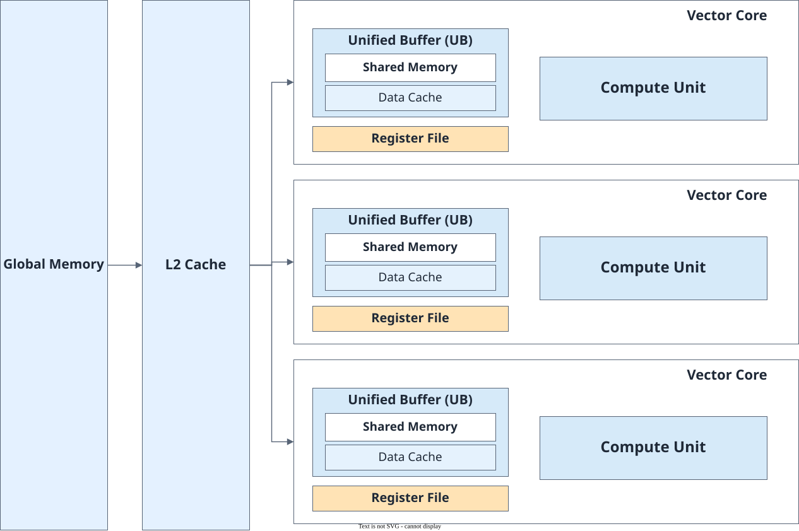

# Abstract Hardware Architecture

<!-- md-trans-meta sourceCommit=7d0ab31d84c294a0a8327f597d2bdee012acb22d translatedAt=2026-10-27T02:12:20.011Z pushedAt=2026-10-27T10:24:56.351Z nl=2 -->

The SIMT functions of PyPTO Pro run on the AIV (Vector Core).

**Figure 1** SIMT abstract hardware architecture

An AI processor contains multiple Vector Cores. Each Vector Core includes compute units, Shared Memory (located in the UB), and registers. The GM outside the cores is the global memory space shared by all Vector Cores. The L2 Cache sits between the GM and each Vector Core and is also shared by multiple Vector Cores.

The main hardware resources involved in SIMT computation are as follows:

- **Compute units**: Execute scalar computation, address computation, and control logic in SIMT functions.
- **Registers and stack space**: Used independently by each Thread to store function parameters, thread indexes, local variables, and intermediate results.
- **Shared Memory**: Uses part of the UB space for Threads within the same Thread Block to exchange data and reuse intermediate results.
- **Data Cache**: Uses part of the UB space to cache GM data accessed by SIMT threads.
- **L2 Cache**: Caches GM data and reduces access latency, managed by hardware.
- **GM**: Stores input, output, and data accessed by different Thread Blocks.

When a SIMT thread accesses GM, the data passes through the L2 Cache and the Data Cache in the Vector Core before entering the thread's private registers. Data shared within a Thread Block can be stored in Shared Memory and directly accessed by threads in the block.
