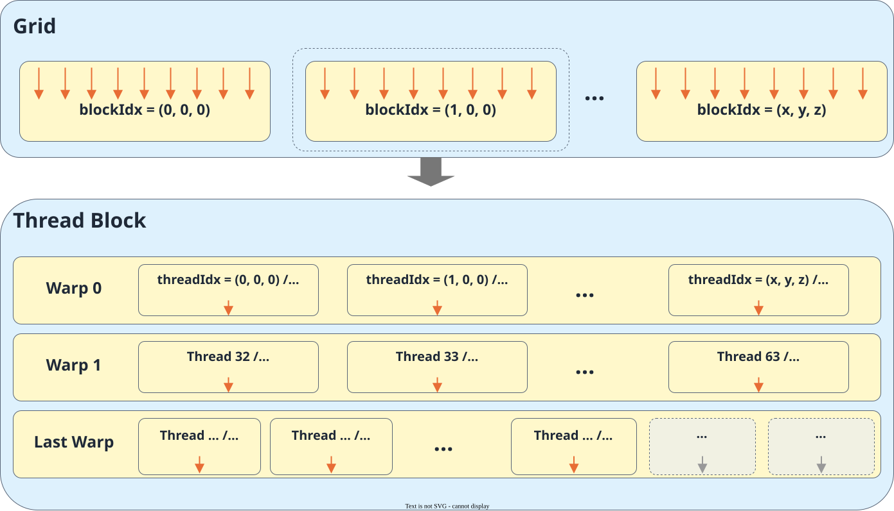
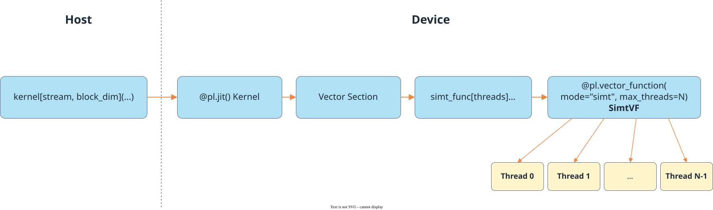

# Programming Paradigm

<!-- md-trans-meta sourceCommit=7d0ab31d84c294a0a8327f597d2bdee012acb22d translatedAt=2026-10-27T02:13:50.444Z pushedAt=2026-10-27T10:24:48.376Z nl=2 -->

SIMT (Single Instruction Multiple Threads) is a thread parallelism model that uses Thread as the basic execution unit. The same program is executed in parallel by multiple threads, and each thread processes different data based on its own index. SIMT allows each thread to address memory independently and enter different conditional branches or loops based on the data. Compared with SIMD, which targets regular data blocks and performs the same operation in batches, SIMT is more suitable for expressing irregular data access and per-thread control logic.

PyPTO Pro provides hybrid SIMD and SIMT programming capabilities on the AIV. The outer layer Kernel organizes regular Tile computation, data movement, and SIMT launch, while SIMT functions describe per-thread logic. For specific development steps, see [SIMT computation](../../development/vector_computation/simt_computation.md).

## Thread Architecture

### Thread Hierarchy

SIMT adopts a three-level thread hierarchy consisting of Grid, Thread Block, and Thread, which divides parallel tasks level by level from the top layer to the bottom layer. The sizes of Grid and Thread Block, as well as the coordinates of Thread Block and Thread, are all dim3 three-dimensional structures containing three components: X, Y, and Z.

**Figure 1 SIMT thread hierarchy**



#### Grid (Thread Block Grid)

Grid is the topmost layer of the SIMT thread hierarchy and consists of multiple Thread Blocks. grid_dim = (grid_x, grid_y, grid_z) represents the quantity of Thread Blocks in each dimension of the Grid, and each Thread Block is identified by its own coordinates.

In PyPTO Pro, Grid has the following characteristics:

- Each Vector core that executes to the SIMT launch point launches one Thread Block; pypto_pro.language.simt.grid_dim() describes the outer layer Vector execution domain, whose scale is determined by the number of Vector cores actually in effect when the Host launches the Kernel;
- Different Thread Blocks are independent of each other and cannot rely on a fixed execution order;
- The current Grid uses only the X dimension, that is, grid_dim = (grid_x, 1, 1), and in the corresponding Thread Block coordinates, both Y and Z are 0.

#### Thread Block

A Thread Block is a component of a Grid and consists of multiple threads. block_dim = (block_x, block_y, block_z) indicates the quantity of threads in each dimension of a Thread Block. The product of the three components is the total number of threads in the Block, which currently does not exceed 2048.

A Thread Block has the following characteristics:

- Threads within the same Thread Block execute the same SIMT entrypoint function and have the same Thread Block size;
- Threads within a Block can access the shared Tile passed in;
- When defining a SIMT entrypoint function, you can declare the maximum number of threads allowed to be launched for a single Thread Block. The actual number of threads is determined by the threads in the square brackets of `simt_func[threads](...)`.

#### Thread

A Thread is the smallest programming unit in the SIMT structure. Each thread has independent local variables and execution state, and processes different data through its three-dimensional coordinates within the Thread Block.

When each outer-layer Vector core calls the same `simt_func[threads](...)` once, the total number of launched threads is:

$$
threads = grid_x \times grid_y \times grid_z
\times block_x \times block_y \times block_z
$$

### Warp Execution and Branching

A warp is the unit by which hardware organizes execution within a thread block. The warp size is 32, and threads are assigned to warps by their linear index within the block. When the total number of threads is not a multiple of 32, only some threads in the last warp are active.

Threads in the same warp can enter different branches based on data, but branch divergence reduces execution efficiency. Using a thread count that is a multiple of 32 is a performance choice worth considering.

### Thread Index

Each thread has a corresponding three-dimensional coordinate. Developers obtain information about the Grid, Thread Block, and thread through the thread hierarchy query APIs, thereby determining the data that the current thread is responsible for processing.

| PyPTO Pro API | Description | Return Form | Constraint |
|---|---|---|---|
| pypto_pro.language.simt.grid_dim() | The number of Thread Blocks in each dimension of the Grid. | A three-dimensional object in dim3 form, where each component is a DT_UINT32 Scalar. | Currently only the X dimension is used, and the Y and Z dimensions are both 1. The X dimension is determined by the number of Vector cores actually used by the outer-layer Kernel. |
| pypto_pro.language.simt.block_dim() | The number of threads in each dimension of the Thread Block. | A three-dimensional object in dim3 form, where each component is a DT_UINT32 Scalar. | The product of the three components must not exceed the max_threads of the entrypoint function, and must not exceed 2048. |
| pypto_pro.language.simt.block_idx() | The three-dimensional coordinate of the current Thread Block in the Grid. | A three-dimensional object in dim3 form, where each component is a DT_UINT32 Scalar. | The X coordinate range is determined by the X-dimension size of the Grid. Currently the Y and Z coordinates are both 0. |
| pypto_pro.language.simt.thread_idx() | The three-dimensional coordinate of the current thread within the Thread Block. | A three-dimensional object in dim3 form, where each component is a DT_UINT32 Scalar. | The coordinate range of each dimension is determined by the size of the corresponding dimension of the Thread Block. |
| pypto_pro.language.simt.linear_thread_idx() | The index of the current thread within the block, expanded with the X dimension first. | A DT_UINT32 Scalar. | The range is [0, total number of threads in the block), excluding the Block offset. |

**Example: Locating the Data Processed by a Thread**

Assume that the Host uses `copy_kernel[None, 3](...)` to launch 3 Vector cores, and each Vector core in the outer-layer Kernel calls `copy_by_index[4, 2](...)` once. In this case, the Grid contains 3 Thread Blocks, that is, grid_dim is (3, 1, 1), and each Thread Block contains 8 threads, with block_dim being (4, 2, 1).

The following example obtains the position of the current thread in the SIMT entrypoint function and computes its corresponding global one-dimensional index. The outer-layer JIT Kernel is responsible for launching the Thread Block with the size (4, 2, 1):

```python
import pypto_pro.language as pl


@pl.vector_function(mode="simt", max_threads=8)
def copy_by_index(
    source: pl.Tensor[[1, 24], pl.DT_FP32],
    output: pl.Tensor[[1, 24], pl.DT_FP32],
):
    grid_size = pl.simt.grid_dim()
    block_size = pl.simt.block_dim()
    block_pos = pl.simt.block_idx()
    thread_pos = pl.simt.thread_idx()
    local_idx = pl.simt.linear_thread_idx()

    threads_per_block = block_size.x * block_size.y * block_size.z
    global_idx = block_pos.x * threads_per_block + local_idx
    threads_num = grid_size.x * grid_size.y * grid_size.z * threads_per_block
    output[0, global_idx] = source[0, global_idx]


@pl.jit(arch="3510")
def copy_kernel(
    source: pl.Tensor[[1, 24], pl.DT_FP32],
    output: pl.Tensor[[1, 24], pl.DT_FP32],
):
    with pl.section_vector():
        copy_by_index[4, 2](source, output)
```

Taking the thread with the coordinate (2, 1, 0) in the second Thread Block as an example, the return values and meanings of each API are as follows. The indices returned by the APIs all start from 0, so the X coordinate of the second Thread Block is 1.

| API or Variable | Current Value | Description |
|---|---|---|
| grid_dim() | (3, 1, 1) | How many Thread Blocks the Grid contains in the X, Y, and Z dimensions, respectively. |
| block_dim() | (4, 2, 1) | How many threads each Thread Block contains in the X, Y, and Z dimensions, respectively. |
| block_idx() | (1, 0, 0) | The current thread is located in the second Thread Block of the Grid. |
| thread_idx() | (2, 1, 0) | The current thread is located in the third column of the X dimension and the second row of the Y dimension of its Thread Block. |
| linear_thread_idx() | 6 | The in-block coordinate (2, 1, 0) is expanded with the X dimension first, and the computation result is 2 + 1 × 4 + 0 × 4 × 2 = 6. |
| global_idx | 14 | There are 8 threads before the second Thread Block, so the global one-dimensional index is 1 × 8 + 6 = 14. |
| threads_num | 24 | Each of the 3 Thread Blocks contains 8 threads, so a total of 24 threads are launched this time. |

If each thread copies one element, you can use output[0, global_idx] = source[0, global_idx], in which case this thread is responsible for copying the element with index 14. All threads together cover indices 0 to 23.

## SIMT Functions

PyPTO Pro supports SIMT entrypoint functions and SIMT helper functions. An entrypoint function describes the computation logic executed by each Thread in a Thread Block. A helper function is used to reuse per-Thread logic and is executed in the Thread that calls it.

| Function Type | Definition | Function | Call Method |
|---|---|---|---|
| SIMT entrypoint function | @pypto_pro.language.vector_function(mode="simt", max_threads=N) | Defines the complete computation executed by each Thread, and writes the result into the passed-in Tile or Tensor. | Called by the outer JIT Kernel through `simt_func[threads](...)`. |
| SIMT helper function | @pypto_pro.language.vector_function(mode="simt") | Encapsulates reusable per-Thread computation, and may return no value or return a Scalar. | Called by a SIMT entrypoint function or another helper function. |

The Host first launches the outer @pypto_pro.language.jit(arch="3510") Kernel, and then the outer Kernel launches the SIMT entrypoint function in the Vector execution domain. The entrypoint function can further call helper functions. A helper function is executed in the Thread that calls it and does not create new threads. For details about the definition and call methods, see [SIMT Computation](../../development/vector_computation/simt_computation.md).

**Figure 2 SIMD/SIMT mixed-mode launch relationship**



In the figure, Thread 0 to Thread N-1 represent the case where N threads are actually launched. In general, the actual number of threads is determined by the `threads` in the square brackets of `simt_func[threads](...)`, and can be smaller than the `max_threads` declared by the decorator. Currently, launching a SIMT function directly from the Host or nesting a SIMT entrypoint function call within a SIMT function is not supported.

## Memory Hierarchy and Operating Objects

SIMT functions can operate on Scalar, Tile, and Tensor. These three types of objects correspond to different memory hierarchies and sharing scopes:

| Operating Object | Memory Hierarchy | Scope | Main Purpose |
|---|---|---|---|
| Scalar | Usually mapped to registers | Thread-private | Stores parameters, indices, local variables, and intermediate results of scalar computation. |
| Tile | UB | Shared within a Thread Block | Stores data within the block and exchanges intermediate results between threads. |
| Tensor | GM | Accessible within the Grid scope | Stores input, output, and data accessed across Thread Blocks, and supports irregular memory access based on runtime indices. |
