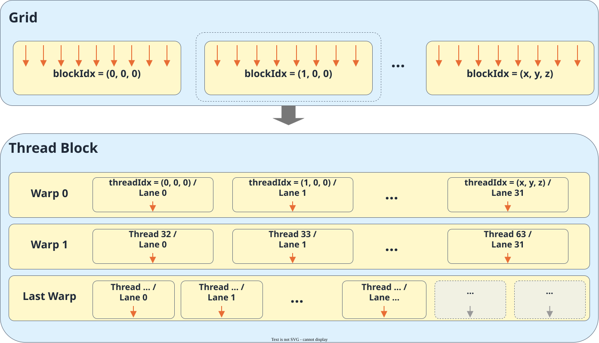
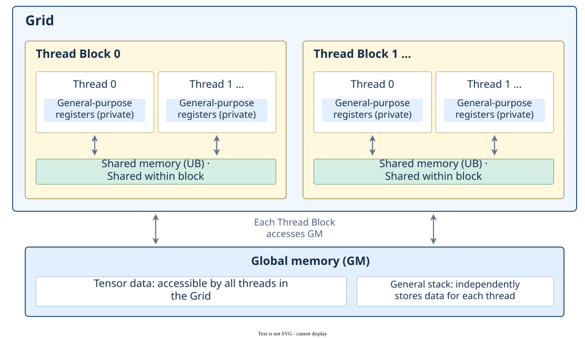
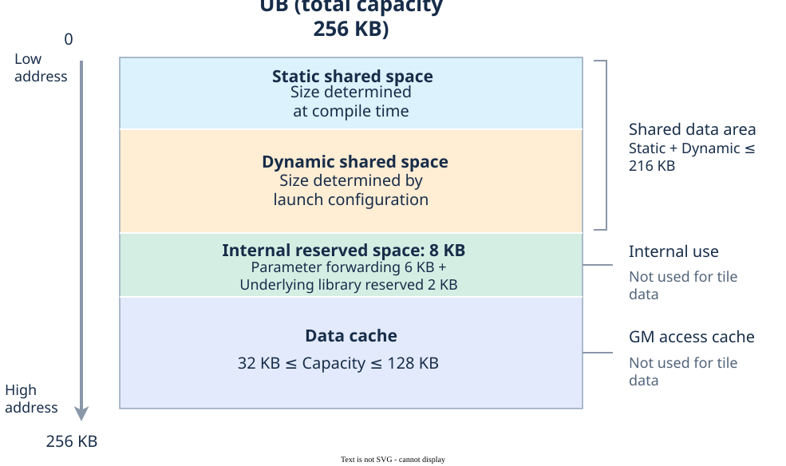
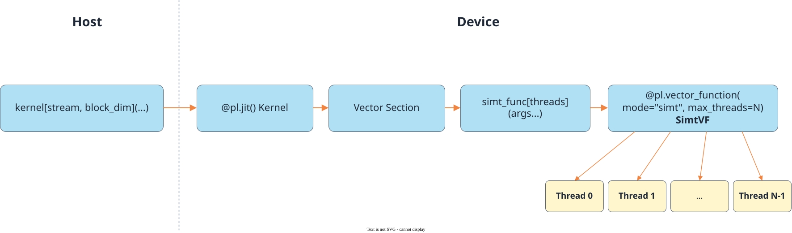

# Programming Paradigm

<!-- md-trans-meta sourceCommit=df395348283af93d277845fb0518b3abec019a53 translatedAt=2026-11-15T02:38:44.120Z pushedAt=2026-11-18T06:03:01.386Z nl=2 -->

SIMT (Single Instruction Multiple Threads) is a thread-parallel model that uses Thread as the basic execution unit. The same program is executed in parallel by multiple Threads, and each Thread processes different data based on its own index. SIMT allows each Thread to address memory independently and enter different conditional branches or loops based on the data. Compared with SIMD, which targets regular data blocks and executes the same operation in batches, SIMT is better suited to expressing irregular data access and per-Thread control logic.

PyPTO Pro supports SIMT programming and SIMD-SIMT mixed programming on AIV. Developers can directly launch a SIMT kernel from the Host, or call a SIMT vector function (SIMT VF for short) in the outer Kernel to combine data movement, SIMD computation, and SIMT computation. For the specific development steps, see [SIMT Computation](../../development/vector_computation/simt_computation.md).

## Thread Architecture

### Thread Hierarchy

SIMT uses a three-level thread hierarchy consisting of Grid, Thread Block, and Thread, dividing parallel tasks from the top level to the bottom level.

**Figure 1** SIMT thread hierarchy



#### Grid (Thread Block Grid)

Grid is the topmost level of the SIMT thread hierarchy and consists of multiple Thread Blocks. grid_dim = (grid_x, grid_y, grid_z) indicates the number of Thread Blocks in each dimension of the Grid. Each Thread Block is identified by its own coordinate. A Grid has the following characteristics:

- The dimensions of a Grid are determined by the user's execution configuration: in SIMT programming, the Grid size is configured through the grid parameter when the Host launches a SIMT kernel; in SIMD-SIMT mixed programming, the Grid scale is determined by the number of actually effective Vector cores, and only the X dimension is used, that is, grid_dim = (grid_x, 1, 1).
- The product of the dimensions of a Grid does not exceed 65535, that is, the total number of thread blocks in a Grid cannot exceed 65535.
- All thread blocks in a Grid have the same size, are independent of each other, and are executed in any order.
- The total number of threads launched at one time is:

$$
threads = grid_x \times grid_y \times grid_z
\times block_x \times block_y \times block_z
$$

#### Thread Block

A Thread Block is the constituent unit of a Grid and consists of several Threads. block_dim = (block_x, block_y, block_z) indicates the number of Threads in each dimension of a Thread Block, and the product of the three components is the total number of Threads within the block. A Thread Block has the following characteristics:

- Threads within the same Thread Block execute the same SIMT operations, and each Thread can select a different execution path based on its own index and data.
- In mixed programming, threads within a Thread Block can access the shared UB Tile passed in from the outer Kernel to implement data interaction.
- Threads within a Thread Block can cooperate through synchronization mechanisms.
- The maximum number of threads within a Thread Block is 2048. The number of threads in a thread block is:

$$
threads_{\mathrm{block}} = block_x \times block_y \times block_z
$$

#### Thread

A thread is the smallest programming unit in the SIMT structure. Each thread has independent local variables and execution state, and has independent registers and stack space.

#### Thread Index

Under the SIMT thread architecture, each thread is uniquely identified within the Grid by the thread block coordinate and the thread coordinate within the block. Developers can use the thread hierarchy query APIs to determine the data that the current thread is responsible for:

| API | Description | Return form and scope |
|---|---|---|
| pypto_pro.language.simt.grid_dim() | Number of Thread Blocks in each dimension of the Grid. | dim3 object, each component is a DT_UINT32 Scalar, and the value is determined by the launch configuration. |
| pypto_pro.language.simt.block_dim() | Number of Threads in each dimension of the Thread Block. | dim3 object, each component is a DT_UINT32 Scalar, and the product of the three components does not exceed max_threads. |
| pypto_pro.language.simt.block_idx() | Three-dimensional coordinate of the current Thread Block in the Grid. | dim3 object, each component is a DT_UINT32 Scalar, and the range is [0, size of the corresponding Grid dimension). |
| pypto_pro.language.simt.thread_idx() | Three-dimensional coordinate of the current Thread within the Thread Block. | dim3 object, each component is a DT_UINT32 Scalar, and the range is [0, size of the corresponding Thread Block dimension). |
| pypto_pro.language.simt.linear_thread_idx() | Number of the current Thread within the block expanded with the X dimension first, excluding the thread block offset. | DT_UINT32 Scalar, and the range is [0, total number of threads within the block). |

When the coordinate within the block is (thread_x, thread_y, thread_z), the linear thread number is calculated as follows, with the X dimension varying fastest:

```text
linear_thread_idx = thread_x + thread_y × block_x + thread_z × block_x × block_y
```

**Example: Locating Data from Two-Dimensional Thread Coordinates**

Assume that the Grid size is (3, 1, 1) and each Thread Block size is (4, 2, 1), so there are 3 thread blocks and 8 threads per block. In SIMT programming, these two sizes can be configured on the Host side. In mixed programming, the three actually effective Vector cores each call `copy_by_index[4, 2](...)` once. The following uses mixed programming to demonstrate index computation:

```python
import pypto_pro.language as pl


@pl.vector_function(mode="simt", max_threads=8)
def copy_by_index(
    source: pl.Tensor[[1, 24], pl.DT_FP32],
    output: pl.Tensor[[1, 24], pl.DT_FP32],
):
    block_size = pl.simt.block_dim()
    block_pos = pl.simt.block_idx()
    local_idx = pl.simt.linear_thread_idx()

    threads_per_block = block_size.x * block_size.y * block_size.z
    global_idx = block_pos.x * threads_per_block + local_idx
    output[0, global_idx] = source[0, global_idx]


@pl.jit(arch="3510")
def copy_kernel(
    source: pl.Tensor[[1, 24], pl.DT_FP32],
    output: pl.Tensor[[1, 24], pl.DT_FP32],
):
    with pl.section_vector():
        copy_by_index[4, 2](source, output)
```

The Host launches the kernel through `copy_kernel[None, 3](source, output)`. Taking the thread with coordinate (2, 1, 0) in the second Thread Block as an example, the relationship between its position and the data index is as follows:

| Information | Current value | Meaning or calculation process |
|---|---|---|
| Grid size | (3, 1, 1) | There are 3 Thread Blocks in the X dimension. |
| Thread Block size | (4, 2, 1) | 4 threads in the X dimension and 2 threads in the Y dimension, 8 threads per block in total. |
| Thread Block coordinate | (1, 0, 0) | Coordinates start from 0, so the X coordinate of the second Thread Block is 1. |
| Thread coordinate | (2, 1, 0) | The current thread is in the third column of the X dimension and the second row of the Y dimension within the block. |
| local_idx | 6 | 2 + 1 × 4 + 0 × 4 × 2 = 6. |
| global_idx | 14 | The previous Thread Block occupies 8 positions, therefore 1 × 8 + 6 = 14. |
| Total number of threads | 24 | 3 Thread Blocks × 8 threads per block. |

This thread copies the element at index 14, and all threads together cover indices 0 to 23. In this example, the total number of threads is the same as the number of elements. When the data size is not an integer multiple of the number of threads per block, boundary checking must be performed before element access. If the Grid uses two or three dimensions, the Thread Block coordinate must also be expanded first when computing the global one-dimensional index, and you cannot use only its X component.

For thread coordinate query, index expansion, and boundary handling, see also [Thread Hierarchy and Index](../../development/vector_computation/simt_computation.md#thread-hierarchy-and-index).

### Warp Execution Mechanism

A warp is the unit by which the hardware organizes execution and scheduling within a thread block. Threads are divided into warps of 32 based on their linear numbering within a block; threads in a warp execute the same instruction while each retains an independent register state. The execution position within a warp is called a lane, and the lane ID ranges from 0 to 31.

Threads in the same warp can enter different branches based on data, which is called branch divergence. When a branch path is executed, the lanes belonging to that path participate in execution while other lanes are temporarily masked; the hardware processes different paths in sequence and then continues execution on the common path. Therefore, threads can have different control flows, but branch divergence reduces the execution efficiency of a warp.

Active threads are threads that actually participate in execution at the current instruction position, and the active state changes with the execution position. When dividing tasks, try to make adjacent threads execute similar computation paths to reduce branch divergence; when there are data dependencies between threads, the corresponding synchronization or warp cooperation APIs must still be used. For concepts and examples, see [Warp Introduction](../../../../../api/pro_api/SIMT-API/warp/warp_intro.md). For API usage, see [Warp API](../../../../../api/pro_api/SIMT-API/warp/index.md).

### Configuring the Maximum Number of Threads

Each thread has independent registers and stack space, while the total number of registers on each AIV core is limited. The more complex the computation of a single thread, the more local variables and intermediate results it has, and the more registers it usually needs to occupy.

The maximum number of threads indicates the upper limit of the number of threads allowed to be launched per Thread Block, and is determined at compile time. The compiler allocates general-purpose register resources based on this upper limit. As the maximum number of threads increases, the number of registers that can be allocated to each thread decreases in steps. For the specific quantities, see the correspondence table in [Registers](#registers).

When configuring the maximum number of threads, note the following:

- The maximum number of threads must be an integer determined at compile time, with a range of 1 to 2048.
- The actual number of threads within a block launched is the product of the dimensions of the Thread Block. It can be less than the maximum number of threads, but cannot exceed this value. For example, when the maximum number of threads is 256, a computation task with 128 threads per block can be launched.
- The compiler allocates registers based on the configured maximum number of threads. For the same compilation result, merely reducing the actual number of threads launched does not automatically increase the register quota of each thread.
- The maximum number of threads should be selected based on task partitioning and the computation complexity of a single thread. If the configuration is too large, the registers available to each thread may be insufficient, and the compiler will transfer some data to [Stack Space](#stack-space), increasing memory access overhead. If the configuration is too small, the number of threads that can be launched per Thread Block will be limited.

For the specific configuration methods of the two programming approaches, see [Defining a SIMT Kernel](../../development/vector_computation/simt_computation.md#defining-a-simt-kernel) and [Defining a SIMT VF](../../development/vector_computation/simt_computation.md#defining-a-simt-vf).

## Memory Hierarchy

SIMT threads can access global memory, shared memory, stack space, and registers:

| Memory Type | Thread Access Scope | Lifecycle | Physical Location |
|---|---|---|---|
| Global memory | All threads in the Grid | From allocation to release, can be retained across Kernel calls. | Off-core GM (Global Memory) |
| Shared memory | Threads within the same Thread Block | In mixed programming, determined by the usage scope of the Tile in the outer Kernel. | UB (Unified Buffer) of the AIV |
| General-purpose stack space | A single thread | During thread execution. | GM |
| General-purpose register | A single thread | During thread execution. | AIV register file |

- Global memory is the memory space that all threads in the Grid can directly access, that is, GM (Global Memory).
- Shared memory is the memory shared by all threads within the same thread block, located in the UB (Unified Buffer), and is used for data exchange and reuse between threads.
- Each thread has an independent general-purpose stack space, located in GM, mainly used to store thread-private temporary data.
- Each thread has independent general-purpose registers, used to store local variables and intermediate results. The available quantity is related to the [maximum number of threads](#configuring-the-maximum-number-of-threads).
- Registers have the highest access speed; the access latency of shared memory is usually lower than that of global memory.

**Figure 2** SIMT memory hierarchy diagram



### Global Memory

Global memory resides on the Device side and is used to save the input, output, and workspace of a Kernel. Its lifecycle is independent of a single Kernel execution: as long as the corresponding storage has not been released or reused, the data in it can continue to be used by subsequent Kernels.

PyPTO Pro accesses GM through Tensors. Before launching a Kernel, the Host prepares the NPU Tensor and initializes the input data. Each thread reads and writes Tensor elements according to its own index, and the Host must wait for the related tasks to complete before reading the output.

When multiple threads access the same Tensor, the data range that each thread is responsible for should be divided, and corresponding synchronization or atomic operations should be used to handle data dependencies. The caches involved in GM access are managed by the underlying layer.

### Shared Memory

Shared memory resides in the UB within the AIV and is suitable for storing intermediate data that threads within a block need to exchange or reuse.

In SIMD-SIMT mixed programming, the outer Kernel creates and manages UB Tiles and then passes them to the SIMT VF for shared access by threads within a block. After the SIMT VF returns, the outer Kernel can continue to use the Tile for SIMD computation or data movement.

The current SIMT kernel does not provide a shared UB object and does not support passing in or creating Tiles.

Shared memory is not automatically initialized. Before using the data in a Tile, complete the data movement or write first. If there is a cross-thread write-before-read dependency, also ensure that the corresponding synchronization is complete. For details, see [Tile Creation and Operations](../../development/tile_creation_and_operations.md) and [SIMT Data Access Constraints](../../development/vector_computation/simt_computation.md#data-object).

#### UB Memory Division

UB is divided into the following regions from low addresses to high addresses:

1. **Static shared space**: Its size is determined at compile time and is used to save shared data.
2. **Dynamic shared space**: Its size is determined by the launch configuration and, together with the static shared space, stores shared data. In mixed programming, the required size is automatically derived by the framework based on Tile occupancy, without requiring manual configuration by developers.
3. **Internally reserved space**: Used by the compiler and underlying libraries.
4. **Data Cache**: Caches GM data accessed by SIMT threads and uses a different region in UB from the shared data.

<!-- npu="950" id1 -->
**Figure 3** UB memory division layout diagram



The total UB capacity is 256KB, and the default internally reserved space is 8KB. The Data Cache requires at least 32KB and uses at most 128KB. Its capacity is calculated as follows:

```text
Data Cache capacity = min(256KB - static shared space - dynamic shared space - 8KB, 128KB)
```

Therefore, while reserving the preceding internal space and the minimum Data Cache, the total static and dynamic shared space cannot exceed 216KB.
<!-- end id1 -->

The more shared data is occupied, the less space may be left for the Data Cache, which in turn affects GM access efficiency. Tile read/write must be limited to the valid address range and must not occupy the internally reserved space or the Data Cache.

### Stack Space

The stack space is managed by the compiler and runtime, and developers do not need to allocate it manually. The SIMT general-purpose stack on the GM stores thread-private temporary data, and the branch stack stores the state required for warp branch divergence and recovery of execution. The internally reserved space in the UB is also used for relaying function call parameters.

When registers are insufficient, the compiler may spill some local variables and intermediate results to the general-purpose stack on the GM, which is called register spill. Therefore, although Scalar is thread-private data, it is not guaranteed to always reside in registers.

Accessing the stack on the GM increases memory access overhead, and excessive stack space usage may also cause stack overflow. During development, reduce unnecessary temporary variables, simplify the function call chain and branch logic, and configure the [maximum number of threads](#configuring-the-maximum-number-of-threads) based on the single-thread computation complexity.

### Registers

Each SIMT thread has independent general-purpose registers, which are used to save local variables and intermediate results and are allocated by the compiler based on the maximum number of threads.

<!-- npu="950" id2 -->
The correspondence between the maximum number of threads and the number of general-purpose registers available per thread is as follows:

| Maximum Number of Threads | Number of General-Purpose Registers Available per Thread |
|---|---|
| 1~256 | 127 |
| 257~512 | 64 |
| 513~1024 | 32 |
| 1025~2048 | 16 |

The bit width of a general-purpose register is 32 bits, and a 64-bit data item usually occupies two registers.
<!-- end id2 -->

## SIMT Programming

PyPTO Pro supports two programming modes: pure SIMT programming and SIMD-SIMT mixed programming. The two modes differ mainly in entry definition, launch location, outer execution domain, and available data objects. PyPTO Pro also supports SIMT helpers for reusing SIMT per-thread logic.

| Function Type | Caller | Thread Configuration | Result Passing |
|---|---|---|---|
| SIMT kernel | Host | The Host configures the Grid and Thread Block sizes. | Writes the result to a Tensor and returns no value. |
| SIMT VF | Vector execution domain of the outer kernel | The outer kernel configures the Thread Block size at the call site, and the Grid is determined by the number of Vector cores that actually take effect. | Writes the result to a Tensor or UB Tile and returns no value. |
| SIMT helper | SIMT kernel, SIMT VF, or another SIMT helper | Uses the configuration of the caller's current thread and creates no new threads. | May return no value or return a Scalar, and may also write to the passed-in Tensor or Tile. |

### SIMT Programming

A SIMT kernel is launched directly by the host, and the function body describes the computation executed by each thread. The developer configures the Grid and Thread Block on the host side, and accesses GM tensors through thread indices within the function, without wrapping a Vector execution domain.

This approach is suitable for organizing the entire computation task with per-thread addressing and control flow. For function definition, parameters, and launch methods, see also [Defining and Launching a SIMT Kernel](../../development/vector_computation/simt_computation.md#simt-programming).

### SIMD and SIMT Mixed Programming

The outer kernel organizes data movement, SIMD computation, and SIMT VF invocation. The SIMT VF is launched by the outer kernel in the Vector execution domain and describes the computation executed by each thread within a block. It cannot be launched directly by the Host.

This approach is suitable for combining regular SIMD computation with irregular SIMT computation and exchanging intermediate data through UB Tile.

**Figure 4** Launch relationship of SIMD-SIMT mixed programming



In the figure, each Vector core launches a Thread Block containing N threads. The outer kernel also needs to organize the data dependencies between data movement and computation. For details, see [Defining and Launching SIMT VF](../../development/vector_computation/simt_computation.md#simd-and-simt-mixed-programming).

In the figure, N indicates the actual number of threads for this invocation, which can be smaller than the max_threads declared by the SIMT VF. The same outer kernel can invoke the SIMT VF at different computation stages, and each invocation uses the thread size configured at that call site.

### SIMT helper

A SIMT helper is used to reuse per-thread computation logic and can be called by a SIMT kernel, a SIMT VF, or another SIMT helper. It executes within the current thread of the caller, without creating new threads or re-dividing the Grid or Thread Block.

Both programming approaches can use SIMT helpers. The data objects they can access are determined by the call entry: the call chain of a SIMT kernel uses Scalar and Tensor; the call chain of a SIMT VF can additionally use Tiles that meet the requirements.
