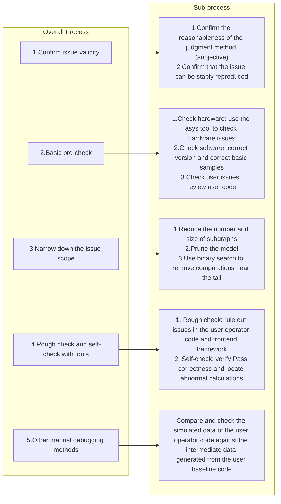

# Precision Debugging

<!-- md-trans-meta sourceCommit=6dc68739e530164e836f473e2668f6a3df7ad7fd translatedAt=2026-10-27T02:23:12.681Z pushedAt=2026-10-28T08:56:43.813Z nl=2 -->

## Overview

When a PyPTO operator runs without functional alarms or errors but the output data does not meet expectations, you can use the following methods to isolate and locate the precision issue. Precision issues mainly come from two sources:

- Functional errors: Obvious data errors or deviations caused by hardware silent faults, software silent functional issues, or incorrect formula implementation.
- Computation errors: Obvious data deviations caused by differences in data types, algorithms (splitting, accumulation, formula approximation), and other factors.

## Overall Process



## Confirming Problem Validity

**Step 1**: Confirm whether the problem determination method is reasonable (empirical judgment and experimental verification).

- Whether the error threshold is used reasonably, for example:
    - Operators with low-precision data types such as bfloat16 use float32 error thresholds.
    - Operators with deep computation paths use error thresholds intended for small operators.
- For unreasonable parts, correct them based on experience. If the issue disappears, precision debugging is complete.

**Step 2**: Confirm that the issue can be stably reproduced.

- After multiple rounds of repeated execution, the output data is consistent and contains abnormal values.
- After switching to other environments, the output remains consistent and contains abnormal values across multiple rounds.
- If the issue cannot be stably reproduced, it is clearly a functional issue, and it is recommended to abort precision debugging.

## Basic Pre-Check

The basic pre-check provides guidance on common but easily overlooked issues with a high probability of errors. If you or the debugger confirm that the corresponding check items are correct, you can skip these steps.

1. Use the asys tool to check hardware issues. For details, see [Troubleshooting](https://gitcode.com/cann/docs/blob/master/docs/en/troubleshooting/00_troubleshooting.md).
    1. Use the hardware self-test tool to rule out hardware installation issues.
    2. Use the hardware stress test tool to rule out hardware faults.

2. Check for software issues.
    1. Confirm that the software version is correct based on the installation guide.
    2. Execute the example cases in the project and confirm that the results are correct.

3. Check whether issues are introduced on the user side.
    1. Review the operator code from multiple perspectives and confirm:
        - The computation process is consistent with the algorithm prototype.
        - The data types and computation types are consistent with the competitor implementation (if no competitor implementation exists, the designer who provides the operator implementation plan must confirm the types).

    2. If the above cannot be confirmed, when analyzing subsequently discovered issues, you need to additionally analyze whether they are introduced by the user side.

## Narrowing Down the Problem Scope

Narrowing down the problem scope is usually an optional step that aims to simplify the problem and improve the efficiency of reproduction and localization.

- After narrowing down the problem scope, you must be able to reproduce the same problem before proceeding with subsequent tool-based self-checks or manual debugging.
- If new problems emerge after narrowing down, try other narrowing methods to reproduce the original problem. It is not recommended to include the new problems in the critical localization process.

However, in some cases, narrowing down the problem scope is mandatory, for example, for large models:

- The host memory is insufficient, preventing the self-check tool from running.
- The file storage space is too small, preventing the self-check tool from saving intermediate computation data.
- Other blocking situations, such as the execution time of analysis processes or tools exceeding the tolerable range, or even being unable to run at all.

The problem scope is usually narrowed down using the following methods:

- Reduce the number and size of subgraphs. For example, reduce the number of loops or the number of cube/vector tiling blocks (i.e., increase the TileShape size).
- Prune the model. For example, reduce the shape specifications of the model, such as batch\_size and seq\_len.
- Use the binary search method to remove tail-end computations.
    1. In the order of model computation, use the binary search method to remove computations near the tail end, and add the disconnected outputs to the operator's output list.
    2. Execute the operator and observe and analyze the new output list.
        - If the data is normal (no inf/nan, no subjectively random values, or small errors compared with the golden data), return to the previous step to continue the binary search operation.
        - If anomalies exist in the data, restore the code to the state before this removal as the latest candidate problem scenario.
        - If the size of the pruned model is already very small, you can stop the binary search operation and select the latest candidate problem scenario for subsequent localization.

## Tool Self-Check and Analysis

### Tool Overview

PyPTO has complete intermediate representations at each pass stage of compute graph compilation, which can be translated into third-party computation code and used to simulate the computation process on other compute units (such as the host CPU). By comparing the simulation results with golden data, this tool can detect operator anomalies or anomalies in the processing results of a specific Pass, and locate the first compute node where the anomaly occurs.

Main features and usage scenarios:

- Tensor Graph verification: Used to verify the correctness of operator code and framework frontend processing. Based on the golden input and output data provided by the user, it compares the data with the final results of Tensor Graph simulation to verify the correctness of the overall computation. Commonly used in the following scenarios:
    - When the user has available golden input and output data for an operator, the rough check feature can be enabled first to roughly rule out whether the operator code or framework frontend processing introduces discrepancies.

- Pass phase verification: Used for self-checking the correctness of a Pass. Based on the simulated computation results of each Pass, it compares and detects Pass correctness and abnormal compute nodes. It is commonly used in the following scenarios:
    - When an operator precision issue has just occurred and there is no clear direction, you can first enable the self-check feature to determine whether potential errors are introduced during the Pass processing phase.
    - When you have roughly identified a problematic pass, enable the self-check feature to obtain the intermediate simulated computation data of that Pass and its preceding Passes, and compare the data to identify potentially problematic computation operations.

- Intermediate result analysis: Specify a single computation result, and save it to a file or print it in a readable format to the output or log.
    - When Tensor Graph verification fails, you can use the pass_verify_print/pass_verify_save feature to print or save the intermediate data of simulated computation, and compare the data to identify potentially problematic computation operations.

### Constraints

The current precision debugging tool has the following limitations (the complete computation flow representation is only saved in the Pass runtime context), and the detection function cannot be used:

- On-board intermediate data check is not supported. Only frontend and Pass checks are supported.
- Specific Passes are not supported. Specific Passes (for example, SubgraphToFunction) are intermediate optimization processes that lack complete computation information, and the tool automatically skips them.
- Automatic comparison verification between Passes is not supported (manual data comparison is required).
- Constructing and simulating computation in any runtime environment after the program exits is not supported. The computation must be constructed and simulated on the corresponding host CPU and process during operator compilation.
- Constructing and simulating computation by calling Ascend C based on the Ascend AI Processor is not supported.
- Constructing and simulating computation based on a GPU is not supported.
- Verification of operations that include both GATHER_IN_UB and GATHER_IN_L1 is not supported.
- If a B200BU error occurs in the ExpandFunction verification result, the verification result is valid only when checked after InferDynShape in this scenario.
- In-place ops are currently only guaranteed to pass verification for pass24 and later passes.

### Preparing the Environment

Ensure that the compilation tools meet the following requirements:

- cmake >= 3.16.3
- make
- g++ >= 9.4.0

### Using the Tool

1. Enable the precision debugging switch. For a reference example, see [hello_world.py](../../../../../../examples/00_hello_world/hello_world.py).

    ```python
    ...
    verify_options = {
        "enable_pass_verify": True,
        "pass_verify_save_tensor": True,
        ...
    }

    @pypto.frontend.jit(verify_options=verify_options)
    def add_kernel(
        input0: pypto.Tensor((1, 4, 1, 64), pypto.DT_FP32),
        input1: pypto.Tensor((1, 4, 1, 64), pypto.DT_FP32),
        out: pypto.Tensor((1, 4, 1, 64), pypto.DT_FP32),
    ):
        pypto.set_vec_tile_shapes(1, 4, 1, 64)
        out[:] = input0 + input1

    ...
    ```

    **verify_options parameters**

    | Parameter | Type | Default | Description |
    |--------|------|--------|------|
    | `enable_pass_verify` | bool | False | Overall enable switch, which determines whether all `pass_verify_*` options and APIs take effect. Must be set to `True` for other parameters to take effect |
    | `pass_verify_save_tensor` | bool | False | Whether to save simulated computation data to disk. When set to `True`, a `verify_*` directory is generated under `{work_path}/output/output_*/`. |
    | `pass_verify_save_tensor_dir` | str | "{RUNNING_DIR}/output/output_{TS}" | Save path for verification results and data. An absolute path can be specified. |
    | `pass_verify_pass_filter` | List[str] | Empty | List of pass names to be self-checked. If not specified, all passes are verified by default. If `"all"` is specified, all passes are verified. If `[]` is specified, no passes are verified and only tensor_graph is verified. |
    | `pass_verify_error_tol` | List[float] | [1e-3, 1e-3] | Tolerance configuration for precision comparison. The first value is the relative error tolerance (rtol), and the second value is the absolute error tolerance (atol). |

2. Set golden data (optional).

    If tensor_graph verification is required, set the golden data:

    ```python
    ...
    def test_add():
        shape = (1, 16, 1, 64)
        input_data0 = torch.rand(shape, dtype=torch.float)
        input_data1 = torch.rand(shape, dtype=torch.float)
        torch_add = torch.add(input_data0, input_data1)
        # Set the golden data.
        pypto.set_verify_golden_data(goldens=[None, None, torch_add])

        input_data0 = input_data0.to('npu')
        input_data1 = input_data1.to('npu')
        out = torch.empty(shape, dtype=torch.float, device='npu')

        add(input_data0, input_data1, out)
    ...
    ```

    **set_verify_golden_data API Description**

    **Prototype**:

    ```python
    set_verify_golden_data(in_out_tensors=None, goldens=None)
    ```

    **Parameters**:

    | Parameter | Type | Description |
    |--------|------|------|
    | `in_out_tensors` | List[Union(pypto.Tensor, torch.Tensor)] | Sets the actual input and output lists of the operator execution to the detection tool in corresponding positions. This step is optional. In JIT call mode, this option does not need to be set. |
    | `goldens` | List[Union(pypto.Tensor, torch.Tensor)] | Sets the user's existing golden data output to the tool for comparison. This list has the same length and corresponding positions as the operator's input and output parameter list. If a position is set to None, data comparison for that position is skipped. **Note: The device attribute of torch.Tensor must be CPU. NPU is not supported.** |

    **Constraints**:
    - This function takes effect only after `pypto.set_verify_options(enable_pass_verify=True)` is set.

3. Execute the modified use case.

    ```bash
    python3 examples/00_hello_world/hello_world.py
    ```

4. View the verification result.

    By default, the verification results are **not** printed to the terminal. Instead, they are written to `{work_path}/output/output_*/verify_*/interpreter.log`. After execution, you can use the following command to view them:

    ```bash
    # View interpreter.log in the latest verify directory.
    cat $(ls -td output/output_*/verify_* 2>/dev/null | head -n 1)/interpreter.log
    ```

    In the log, `[EVENT]` lines indicate pass (PASS) or skip (NO\_COMPARE), and `[ERROR]` lines indicate failure (FAILED). Typical content is as follows:

    ```text
    [2025-mm-dd HH:MM:SS][EVENT][tid:12345] tensor_graph Verify for 3 data view list index 0 result NO_COMPARE
    [2025-mm-dd HH:MM:SS][EVENT][tid:12345] tensor_graph Verify for 3 data view list index 1 result NO_COMPARE
    [2025-mm-dd HH:MM:SS][EVENT][tid:12345] tensor_graph Verify for 3 data view list index 2 result PASS
    [2025-mm-dd HH:MM:SS][EVENT][tid:12345] function_TENSOR_loop_0_Unroll1_PATH0_hiddenfunc0_8_Pass_00_ExpandFunction Verify for 1 data view list index 0 result PASS
    ...
    [2025-mm-dd HH:MM:SS][EVENT][tid:12345] function_TENSOR_loop_0_Unroll1_PATH0_hiddenfunc0_8_Pass_36_CodegenPreproc Verify for 1 data view list index 0 result PASS
    [2025-mm-dd HH:MM:SS][ERROR][tid:12345] [VERIFY]:ErrCode: 0xB4001U! function_TENSOR_loop_0_Unroll1_PATH0_hiddenfunc0_8_Pass_09_SplitLargeFanoutTensor Verify for 1 data view list index 0 result FAILED
    ```

    To mirror the log to the terminal at the same time, set the environment variable `ASCEND_SLOG_PRINT_TO_STDOUT=1` and then re-execute the use case.

5. After execution, a `verify_*` directory is generated under the `{work_path}/output/output_*/` directory (* represents a timestamp), which stores the verification result files and logs.

    ```text
    ├── tensor_graph # Stores the intermediate data from the simulated computation of the frontend initial compute graph, serving as baseline data
    │   ├── *.data
    │   └── ...
    ├── verify_graph_data_metainfo.csv # Result report, saving the intermediate data metadata and corresponding data file names
    ├── verify_graph_result_brief.csv # Precision comparison summary (PASS/FAIL/NO_COMPARE, error statistics, etc.)
    ├── verify_graph_result_brief.log # Precision comparison exception details (failed items, exception paths, error details)
    ├── interpreter.log # Verification result and interpreter execution log (records ERROR / EVENT by default, including PASS / FAIL / NO_COMPARE)
    ├── Pass_{PASS_SEQ}_{PASS_NAME} # Stores the intermediate data from the simulated computation of the intermediate pass compute graph, serving as the data to be tested
    │   ├── *.data
    │   └── ...
    ```

    In this directory, `verify_graph_result_brief.log` and `interpreter.log` are located in the same `verify_*` directory:
    - `verify_graph_result_brief.log`: Focuses on the verification result summary and exception details (comparison failures and exception paths).
    - `interpreter.log`: Contains the verification PASS/FAIL/NO\_COMPARE results and the interpreter execution process log (see step 4). By default, only ERROR/EVENT level logs are written to disk and not output to the terminal.

6. Follow-up suggestions.

    For cases marked FAIL in the tensor_graph verification results, the following is recommended:

    1. Have multiple parties review and check the correctness of the PyPTO frontend code.
    2. If no obvious issues are found in the frontend code, use `pass_verify_print` and `pass_verify_save` to save/print intermediate results for further analysis (for details, see step 7).

    For cases where the tensor_graph verification passes but the pass stage verification is marked FAIL, the following is recommended:
    1. Collect relevant result information and submit an issue for processing.

7. Use `pass_verify_print` and `pass_verify_save` to analyze intermediate results (optional).

    **When to use**: When Tensor Graph verification fails, you can use these two APIs to print and save intermediate data from the simulated computation, and compare the data to identify the computation operations that may be causing the issue.

    **Important note**:
    - `pass_verify_print` and `pass_verify_save` save the **results of the simulated computation during the tensor graph verification phase**.
    - These results are obtained by simulating the compute graph on the host CPU.
    - **The results may differ from those obtained through actual on-board execution on the NPU, and are primarily used for algorithm logic verification.**

    **Example**:

    ```python
    @pypto.frontend.jit(verify_options=verify_options)
    def add_kernel(
        input0: pypto.Tensor((1, 4, 1, 64), pypto.DT_FP32),
        input1: pypto.Tensor((1, 4, 1, 64), pypto.DT_FP32),
        out: pypto.Tensor((1, 4, 1, 64), pypto.DT_FP32),
    ):
        pypto.set_vec_tile_shapes(1, 4, 1, 64)
        # Save the intermediate result to a file
        pypto.pass_verify_save(input1, "input1_by_pass_verify")
        # Print the intermediate result to the console
        pypto.pass_verify_print(input0)
        out[:] = input0 + input1

    def add(input_data0, input_data1, out):
        add_kernel(input_data0, input_data1, out)

    def test_add():
        shape = (1, 4, 1, 64)
        input_data0 = torch.rand(shape, dtype=torch.float, device='npu')
        input_data1 = torch.rand(shape, dtype=torch.float, device='npu')
        out = torch.empty(shape, dtype=torch.float, device='npu')

        add(input_data0, input_data1, out)
    ...
    ```

    **Run the modified use case.**

    ```bash
    python3 examples/00_hello_world/hello_world.py
    ```

    **Console output example**:

    ```text
    input0:<1x4x1x64xFP32/1x4x1x64xFP32>
    [[0.03955 0.6094 0.1519 ... 0.7339 0.8789 0.8662]
     [0.6284 0.01465 0.6333 ... 0.2422 0.03516 0.8423]
     [0.231 0.02686 0.6055 ... 0.7466 0.2529 0.2231]
     ...
     [0.3477 0.4243 0.05273 ... 0.9287 0.1138 0.5083]
     [0.05273 0.9941 0.4985 ... 0.8345 0.8613 0.188]
     [0.3184 0.8047 0.833 ... 0.7734 0.2578 0.1392]]
    ```

    **Generated file structure**:

    After execution, a `tensor/` directory is generated under the `{work_path}/output/output_*/` directory (* represents the timestamp):

    ```text
    ├── tensor/
    │   ├── input1_by_pass_verify.data     # The saved specified simulation calculation data, in the format of a direct memory dump of the Tensor data
    │   ├── input1_by_pass_verify.csv      # Metadata of the simulation calculation data, including the data type and shape information
    ```

    **Suggestions for subsequent data processing:**

    Based on the metadata, use common APIs such as `torch.from_file()` and `numpy.load()` to open the data files and convert them into parsable values. Then, proceed with the data analysis methods typically used by developers, for example, checking the offset patterns of abnormal data and the value characteristics of abnormal data (inf/nan/zero, etc.).

## On-Board Tensor Dump

### Function Overview

During on-board execution, you can dump the input and output data of leaf functions for locating precision issues. The dumped data supports comparison and analysis with simulation results.

### Enabling Method

```python
import os

# Set the environment variable to enable on-board dump, or set the environment variable export PYPTO_DATADUMP_ENABLE=true separately before execution
os.environ["PYPTO_DATADUMP_ENABLE"] = "true"

# Configure the verification options
@pypto.frontend.jit(
    runtime_options={"run_mode": pypto.RunMode.NPU},
    verify_options={
        "enable_pass_verify": True,
        "pass_verify_save_tensor": True
    }
)
def kernel(...):
    ...
```

### Dump Data Output Path

```txt
output/output_*/dump_tensor_*/device_{deviceId}/
└── {taskId}_{seqNo}_{callopMagic}_{rootHash}_{funcHash}_{rawMagic}_{timeStamp}_{dataType}_{input/output}{index}.tdump
```

### Data Processing Tool

**Tool location:** `tools/verifier/parse_dump_tensors.py`

**Main functions:**

- Parses dumped binary data (.tdump files) and extracts tensor data into .data files.
- Automatically merges sharded tensors into a complete raw tensor (for scenarios where multiple tasks process the same raw tensor).
- Supports codegen pass tensor comparison verification (used together with `enable_pass_verify`).

**Usage:**

```bash
# Basic usage (enable_pass_verify not enabled, no verification performed)
python3 tools/verifier/parse_dump_tensors.py \
    --dump_tensor_path output/output_20260101120000/dump_tensor_20260101120000/device_0

# Usage with verification (enable_pass_verify must be enabled first and the operator run)
python3 tools/verifier/parse_dump_tensors.py \
    --dump_tensor_path output/output_20260101120000/dump_tensor_20260101120000/device_0 \
    --verify_path output/output_20260101120000/verify_20260101120000
```

**Parameters:**

| Parameter | Mandatory/Optional | Description | Default |
|------|-----------|------|--------|
| `--dump_tensor_path` | Mandatory | Path to the dump data directory, pointing to the `device_x` directory | None |
| `--verify_path` | Optional | Path to the verify result directory (containing verify_graph_data_metainfo.csv)| `""` (no comparison verification) |

**Output files:**

```txt
output/output_*/dump_tensor_*/device_0/
├── *.data                                       # Extracted tensor data files
├── raw_{rawMagic}_{dataType}_{ioflag}.data      # Merged raw tensor (if sharded)
└── ../                                          # The parent directory generates the comparison result report
    └── verify_task_result_cmp~{pass_full_name}~{timestamp}.csv  # Comparison verification result report
```

> Note: `ioflag` uses `i` (input) or `o` (output); `pass_full_name` is the automatically detected full Pass name (e.g., `Pass_36_CodegenPreproc`).

**Field description of verify_task_result_cmp~{pass_full_name}~{timestamp}.csv:**

Field prefix description:

- `B>` prefix: indicates the original data dumped on-board.
- `A>` prefix: indicates the verification data (from pass verify).
- `AB>` prefix: indicates the comparison verification result.

**Basic information fields:**

| Field | Description |
|------|------|
| NO. | Sequence number (sorted by execution timestamp) |
| B>version | Version number of the dump data format (currently 1) |
| B>opId | Operation ID |
| B>funcId | Function ID |
| B>taskId | Task ID |
| B>blockIdx | Block index |
| ROOT_CALL:opmagic | Operator call magic identifier |
| ROOT_CALL:rawmagic | Original tensor magic identifier |
| B>:validshape | Actual tensor shape |
| B>OP_ATTR_SYM_OFFSET | Offset of the tensor in the raw tensor |
| B>:rawshape | Shape of the original complete tensor |
| B>tensorAddr | Tensor memory address |
| B>:datatype | Data type (string, e.g., FP32, INT8) |
| IO_FLAG | Input/output marker (i/o) |
| B>seqNo | Sequence number |
| B>TIMESTAMP | Timestamp |
| B>EXEC_TIMESTAMP | Execution timestamp (execStart for input, execEnd for output) |
| ROOT_FUNC:hash | Root function hash value |
| FUNC:hash | Function hash value |
| B>loopVarInfos | Loop variable information ("=" when matched, otherwise in string form) |
| LOOP_INFO | Loop information of the verification data (filled when matched, otherwise empty) |

**Verification comparison fields (when --verify_path is enabled):**

| Field | Description |
|------|------|
| A>PHASE_NAME | Stage name of the verification data (e.g., Pass_36_CodegenPreproc) |
| A>FILENAME | File name of the verification data (file name only, without path) |
| A>:datatype | Data type of the verification data |
| A>:validshape | Shape of the verification data |
| A>:rawmagic | Raw magic identifier of the verification data |
| A>:opcode | Opcode of the verification data |
| A>:opmagic | Op magic identifier of the verification data |
| A>OP_ATTR_SYM_OFFSET | Offset of the verification data |
| A>OP_IO_FLAG | Input/output marker of the verification data |
| PATH_FUNC:hash | Hash value of the Path Function |
| AB>RESULT | Comparison result: PASS, FAIL, SKIP |
| AB>RESULT_REASON | Reason for no comparison (when SKIP, e.g., "unsupported dtype: BOTTOM") |
| AB>rtol/atol | Tolerance parameters |

**Comparison verification process:**

1. **Data matching**: Match on-board data with verification data through `ROOT_CALL:opmagic`, `ROOT_CALL:rawmagic`, `IO_FLAG`, and `B>OP_ATTR_SYM_OFFSET`.
2. **Tolerance configuration**: Automatically select tolerance based on the data type.
   - FP32/FP64: Standard tolerance (rtol=1e-3, atol=1e-3)
   - FP16/BF16/FP8: Relaxed tolerance (rtol=1e-2, atol=1e-2)
3. **Shape processing**: Automatically handle comparison with inconsistent shapes (by taking the common part).
4. **Unsupported types**: Types such as HF4, HF8, and BOTTOM are marked as SKIP.

**Notes on raw tensor merging:**

When multiple tasks process different shards of the same raw tensor, the script automatically:

1. Groups by `ROOT_CALL:rawmagic`
2. Calculate the slice position based on `B>OP_ATTR_SYM_OFFSET` and `B>:validshape`.
3. Merges all shard data into a complete raw tensor.
4. The generated file is named `raw_{rawMagic}_{dataType}_{ioflag}.data` (`ioflag` is `i` or `o`).

## CPU Simulation Calculation Data Dump

### Function Overview

The dump of CPU simulation calculation results is supported for precision locating. By dumping the simulation calculation data, the pass where the precision error occurs and the preceding correct passes are compared using a comparison script to identify the operator where the precision issue first appears.

### Enabling Method

```python
# Configure the verification options
@pypto.frontend.jit(
    debug_options={"compile_debug_mode": 1},
    verify_options={
        "enable_pass_verify": True,
        "pass_verify_save_tensor": True,
        "pass_verify_pass_filter": ["InferParamIndex", "CodegenPreproc"]  # Specify the passes to dump
    }
)
def kernel(...):
    ...
```

> Note: When `pass_verify_pass_filter` is not specified, specific passes are verified by default. Specify `"all"` to verify all passes. Specify a name list of specific passes to dump the simulation calculation data of only the required passes.

### Dump Data Output Path

After execution completes, a `verify_*` directory is generated under the `{work_path}/output/output_*/` directory (* represents the timestamp) to store the simulation calculation data and detection result files:

```text
├── tensor_graph                                   # Stores the intermediate data after simulation calculation of the frontend initial compute graph, used as the baseline data
│   ├── *.data
│   └── ...
├── Pass_{PASS_SEQ}_{PASS_NAME}                    # Stores the intermediate data after simulation calculation of the intermediate pass compute graph, used as the data to be tested
│   ├── *.data
│   └── ...
├── verify_graph_data_metainfo.csv                 # Result report, storing the intermediate data metadata and the corresponding data file names
├── verify_graph_result_brief.csv                  # Precision comparison summary (PASS/FAIL/NO_COMPARE, error statistics, etc.)
├── verify_graph_result_brief.log                  # Precision comparison exception details (failed items, abnormal paths, error details)
└── interpreter.log                                # Verification result and interpreter execution log
```

### Data Processing Tool

**Tool location:** `tools/verifier/pass_compare.py`

**Main functions:**

Based on the tensor information in the dumped `verify_graph_data_metainfo.csv`, compare the output tensors of the ops that can be matched between the two passes to identify the problematic op.

**Usage:**

```bash
# Basic usage (two passes in the same verify directory)
python3 tools/verifier/pass_compare.py \
    --p ExpandFunction RemoveUndrivenView \
    --verify_path output/output_20260101120000/verify

# Specify a function name to filter the comparison scope
python3 tools/verifier/pass_compare.py \
    --p ExpandFunction RemoveUndrivenView \
    --verify_path output/output_20260101120000/verify \
    --func TENSOR_LOOP_s2_Unroll8_PATH0_hiddenfunc0_20

# Two passes in different verify directories
python3 tools/verifier/pass_compare.py \
    --p ExpandFunction RemoveUndrivenView \
    --verify_path output/output_20260101120000/verify output/output_20260101130000/verify
```

**Parameters:**

| Parameter | Mandatory/Optional | Description | Default |
|------|-----------|------|--------|
| `--p` | Mandatory | Specify the names of the two passes to be compared, separated by spaces. The first is the pass to be tested (which may have precision issues), and the second is the golden pass (the precision-correct baseline) | None |
| `--verify_path` | Mandatory | Path of the verify result directory. When one value is provided, both passes share the same directory; when two values are provided, they correspond to the directories of the two passes respectively | None |
| `--func` | Optional | Specify the name list of functions to be compared, separated by spaces. If not specified, all functions are compared | Empty (compare all) |
| `--atol` | Optional | Absolute error tolerance | `1e-3` |
| `--rtol` | Optional | Relative error tolerance | `1e-3` |
| `--topk` | Optional | Print the top k rows with the largest differences | `1000` |

**Output files:**

```text
output/output_*/verify_*/
├── verify_graph_result_cmp~Pass_{NN}_{GoldenPass}~Pass_{NN}_{OutputPass}~{timestamp}.csv  # Comparison verification result report
└── verify_graph_result_cmp~Pass_{NN}_{GoldenPass}~Pass_{NN}_{OutputPass}~{timestamp}.DETAIL/  # Per-tensor difference details (generated only when the comparison fails)
    └── {tensor_filename}.csv
```

> Note: `{NN}` is the pass number (zero-padded to two digits), `{GoldenPass}` is the golden pass name, `{OutputPass}` is the name of the pass to be tested, and `{timestamp}` is a microsecond-level timestamp. The tool automatically ensures that the pass with the larger number is used as the pass to be tested and the pass with the smaller number is used as the golden pass, so no manual sorting by the user is required.

**Field descriptions for verify_graph_result_cmp~{Pass_a}~{Pass_b}~{timestamp}.csv:**

Field prefix description:

- `B>` prefix: indicates the data information of the pass to be tested (the later pass, whose precision may be problematic)
- `A>` prefix: indicates the data information of the golden pass (the pass with correct precision)
- `AB>` prefix: indicates the comparison verification result.
- No prefix: indicates common attributes shared by the two passes

**Common information fields:**

| Field | Description |
|------|------|
| NO. | No. (sorted by the timestamp of the pass to be tested) |
| PATH_FUNC:func_magicname | Magic name of the Path Function |
| PATH_FUNC:funcmagic | Magic identifier of the Path Function |
| PATH_FUNC:hash | Hash value of the Path Function |
| LOOP_INFO | Loop variable information |
| :symbol | Tensor symbol name |
| :validshape | Actual tensor shape |
| :datatype | Data type (string, e.g., FP32, BF16, INT8) |
| OP_ATTR_SYM_OFFSET | Offset of the tensor in the raw tensor |
| OP_IO_FLAG | Input/output marker |

**Data fields of the pass to be tested (B> prefix):**

| Field | Description |
|------|------|
| B>PHASE_NAME | Stage name of the pass to be tested |
| B>TIMESTAMP | Timestamp |
| B>FILENAME | Data file name |
| B>FUNC:hash | Function hash value |
| B>FUNC:funcmagic | Function magic identifier |
| B>ROOT_CALL:opmagic | Operator call magic identifier |
| B>ROOT_CALL:rawmagic | Original tensor magic identifier |
| B>:opmagic | Op magic identifier |
| B>:opcode | Operation type (e.g., COPY_IN, COPY_OUT, VIEW, ASSEMBLE, etc.) |
| B>:rawmagic | Raw tensor magic identifier |
| B>:magic | Tensor magic identifier |
| B>:rawshape | Shape of the original complete tensor |
| B>:format | Data format |
| B>:shape | Shape of the tensor |
| B>EVAL:dynvalidshape | Dynamic shape evaluation result |
| B>ROOT_FUNC:hash | Root function hash value |

**Data fields of the golden pass (A> prefix):**

| Field | Description |
|------|------|
| A>PHASE_NAME | Stage name of the golden pass |
| A>TIMESTAMP | Timestamp |
| A>FILENAME | Data file name |
| A>FUNC:hash | Function hash value |
| A>FUNC:funcmagic | Function magic identifier |
| A>ROOT_CALL:opmagic | Operator call magic identifier |
| A>ROOT_CALL:rawmagic | Original tensor magic identifier |
| A>:opmagic | op magic identifier |
| A>:opcode | Operation type |
| A>:rawmagic | raw tensor magic identifier |
| A>:magic | tensor magic identifier |
| A>:rawshape | Shape of the original complete tensor |
| A>:format | Data format |
| A>:shape | Shape of the tensor |
| A>EVAL:dynvalidshape | Dynamic shape evaluation result |
| A>ROOT_FUNC:hash | Root function hash value |

**Comparison result fields (AB> prefix):**

| Field | Description |
|------|------|
| AB>RESULT | Comparison result: PASS, FAIL, SKIP |
| AB>RESULT_REASON | Reason for skip or failure (for SKIP, such as "`:rawmagic : 123, not exit in golden pass`" or "not match") |
| AB>rtol/atol | Tolerance parameters actually used |
| AB>fail_cnt/warn_cnt/tol_cnt | Count of failed/warned/tolerated elements |
| AB>total_cnt/zero_cnt/infnan_cnt | Count of total/zero/inf or nan elements |
| AB>mae | Mean Absolute Error |
| AB>mae_top8 | Mean absolute error of the top 8 elements with the maximum error |
| AB>mae_top1permil | Mean absolute error of the top 0.1% elements with the maximum error |
| AB>mre | Mean Relative Error |
| AB>mre_top8 | Mean relative error of the top 8 elements with the maximum error |
| AB>mre_top1permil | Mean relative error of the top 0.1% elements with the maximum error |

**Data statistics fields:**

| Field | Description |
|------|------|
| A>max / B>max | Maximum value of the golden/data to be tested |
| A>min / B>min | Minimum value of the golden/data to be tested |
| A>avg / B>avg | Average value of the golden/data to be tested |
| A>aavg / B>aavg | Average absolute value of the golden/data to be tested |
| A>zero / B>zero | Number of zero values in the golden/data to be tested |
| A>infnan / B>infnan | Number of inf/nan values in the golden/data to be tested |

**Comparison verification process:**

1. **Read metadata**: Read the tensor metadata of the two passes from `verify_graph_data_metainfo.csv`
2. **Pass sorting**: Automatically ensure that the pass with the larger sequence number is used as the pass to be tested (B>) and the pass with the smaller sequence number is used as the golden pass (A>). If swapping is required, swap the verify paths accordingly
3. **Matching key selection**: Automatically select the matching key based on the pass sequence number
   - Both passes >= ExpandFunction: use `:magic` for matching
   - Pass to be tested >= InferParamIndex and golden pass in the [ExpandFunction, InferParamIndex) range: use `ROOT_CALL:rawmagic` for matching (only matches COPY_IN/COPY_OUT operations)
   - Both passes are >= InferParamIndex: enable the leaf function matching logic (additionally verify `ROOT_CALL:opmagic`)
4. **Group matching**: group by `PATH_FUNC:func_magicname` and `LOOP_INFO`, and find tensor pairs by the matching key within the same group
   - In codegen mode, COPY_IN operations are matched through `INPUT:rawmagic`
5. **Skip check**: records whose validshape contains 0, or whose input validshape of ASSEMBLE/COPY_OUT contains 0, are skipped directly
6. **Containment check**: verify whether the tensor to be tested is contained by the golden tensor (based on the offset and shape ranges)
7. **Opcode matching**: support equivalent opcode matching (for example, VIEW≈L1_TO_L0A/L1_TO_L0B, COPY_OUT≈ASSEMBLE, COPY_IN≈VIEW, A_MUL_B≈A_MULACC_B)
8. **Data comparison**: read the `.data` file, slice it by offset, convert it to float64, and perform element-wise comparison; for ASSEMBLE/COPY_OUT operations, slice using the shape of the input tensor
9. **Unsupported types**: types other than BF16/FP32/FP16/INT32/INT8/INT64/INT16 are marked as SKIP

## Operator-Level Input/Output Tensor Dump

### Function Overview

Supports on-board dump of operator-level input and output tensors across the entire network.

### Enabling Method

Create an **acl.json** file in the script execution directory with the following content:

```json
{
    "dump":{
        "dump_path":"/your/path",
        "dump_mode":"all",
        "dump_debug":"off",
        "dump_op_switch":"on"
    }
}
```

Add the following configuration to the use case **test.py** to be executed:

```python
import torch
import torch_npu

torch.npu.init_dump()
torch.npu.set_dump("acl.json")
```

### Dump Data Output Path

The data output path is the dump_path configured in **acl.json**. The following files are generated in this path:

```txt
/your/path
└── 20260415084134/0
    └── TENSOR_batchmatmul_3d_kernel.TENSOR_batchmatmul_3d_kernel.29.46.1776242496294291
```

Call the existing CANN tool to parse the file. The command is as follows:

Go to `${INSTALL_DIR}/tools/operator_cmp/compare`. Replace `${INSTALL_DIR}` with the CANN software installation path. For example, if you installed CANN as the root user, the default installation path is `/usr/local/Ascend/cann`.

```bash
python3 msaccucmp.py convert -d /your/path/20260415084134/0 -out /your/path/20260415084134/0/out
```

After parsing, the following .npy files are generated:

```txt
/your/path
└── 20260415084134/0
    ├── out/
    │   ├── TENSOR_batchmatmul_3d_kernel.TENSOR_batchmatmul_3d_kernel.29.46.1776242496294291.input.0.npy
    │   ├── TENSOR_batchmatmul_3d_kernel.TENSOR_batchmatmul_3d_kernel.29.46.1776242496294291.input.1.npy
    │   └── TENSOR_batchmatmul_3d_kernel.TENSOR_batchmatmul_3d_kernel.29.46.1776242496294291.input.2.npy
    └── TENSOR_batchmatmul_3d_kernel.TENSOR_batchmatmul_3d_kernel.29.46.1776242496294291
```
