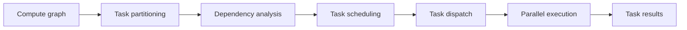

# Programming Paradigm

<!-- md-trans-meta sourceCommit=c757335981cdfedb9fcaea5bed6c066a8dc94f1f translatedAt=2026-10-27T02:37:35.608Z pushedAt=2026-10-27T08:58:38.062Z nl=2 -->

PyPTO adopts the PTO programming paradigm. Its core idea is to use tensors as the basic data representation, and to describe and assemble a complete computation flow (or compute graph) through a series of basic tensor operations. In PyPTO, all operations take tensors as input or output, forming a traceable compute graph structure that facilitates subsequent debugging, optimization, and compilation and execution on specific hardware.

## PTO Programming Paradigm Overview

The core design principles of the PTO programming paradigm include:

- Tensor-level abstraction: Computation is described using tensors rather than individual elements, closely aligning with the mathematical expressions used by algorithm designers.
- Declarative programming: Developers only need to describe "what to do," while the framework automatically handles "how to do it."
- Tile-based computation: All computations are ultimately performed based on tiles (hardware-aware data blocks), fully leveraging the parallel computing capabilities of the hardware.
- Compute graph-driven: By constructing a compute graph, the framework can automatically perform optimization, scheduling, and execution.

PyPTO provides three levels of programming APIs:

- Tensor-level programming: Build compute graphs directly using tensor and tensor Operation.
- Tile-level programming: Express complete computation with tile and tile Operation, explicitly reflecting memory access and dependencies.
- Block-level programming: Define the compute graph executed by a single processor core, and implement the overall computation through multiple instantiations.

In the current version, only tensor-level programming is available, which is the most commonly used and recommended programming approach.

## Core Data Structures

- Tensor: The most basic data structure in PyPTO, representing a multi-dimensional array. A tensor contains the following information:

    - Data type (dtype): such as FP32, FP16, INT32, BOOL, etc.
    - Shape: An integer array describing the length of each dimension, for example, \(32, 64\), \(1, 32, 128\), etc.
    - Format: The layout of data in memory.
    - Name: used to identify the tensor in the compute graph, facilitating debugging and visualization.

    Tensors can be combined through various operations (such as addition, multiplication, indexing operations, reduction operations, etc.). These operations typically generate new tensors or modify how they are referenced in the compute graph (for example, creating views, changing shapes, transposing, etc.).

- Tile: a sub-tensor of a tensor, obtained by splitting a large tensor into multiple sub-blocks through tiling. The tile is designed for the following purposes:

    - Enabling storage in the processor core's private cache (such as UB, L1) to improve data locality.
    - Fully leveraging the hardware parallel computing capability.
    - Optimizing memory access patterns.

    In tensor-level programming, tiling is automatically performed by the framework. Developers only need to specify the TileShape through the configuration API, and the framework automatically performs the tiling.

- View and Assemble: Provide view and composition operations on sub-tensors, which are very useful when processing dynamic shapes and loop computations.
    - View: Provides view operations on sub-tensors, allowing access to sub-tensors of a tensor without copying data.
    - Assemble: Combines multiple sub-tensors into a larger tensor.

## Tensor-Level Programming

Tensor-level programming is the primary programming approach currently supported by PyPTO. Developers directly use tensors and tensor Operations to build compute graphs, without needing to concern themselves with underlying tiling or hardware details.

- Basic Programming Pattern

    A typical tensor-level programming pattern is as follows: the kernel entry function is defined using the @pypto.frontend.jit decorator and undergoes JIT compilation upon the first call.

    ```python
    import pypto

    # 1. Configure Tiling (optional; the framework provides default values).
    pypto.set_vec_tile_shapes(64)

    # 2. Define the compute function.
    @pypto.frontend.jit
    def my_operator(a: pypto.Tensor(shape, dtype), b:  pypto.Tensor(shape, dtype), output:  pypto.Tensor(shape, dtype)):
        # Tensor operation.
        result = a + b  # or use pypto.add(a, b)
        output[:] = result

    # 3. Execute.
    my_operator(tensor_a, tensor_b, output_tensor)
    ```

- Tensor operations

    PyPTO provides a rich set of tensor operations, including:

    - Mathematical operations: add, sub, mul, div, matmul, etc.
    - Logical operations: logical\_not, etc.
    - Structural transformations: reshape, transpose, view, unsqueeze, etc.
    - Reduction operations: sum, amax, amin, topk, etc.
    - Activation functions: sigmoid, softmax, etc.
    - Transcendental functions: exp, log, etc.
    - Other operations: gather, scatter, concat, assemble, etc.

- Control flow

    PyPTO supports control flow operations for handling dynamic shapes and conditional execution:

    - Loop

        ```python
        # Process dynamic-dimension data.
        tile_size = pypto.symbolic_scalar(64)
        loop_count = dynamic_shape / tile_size

        for idx in pypto.loop(0, loop_count, 1, name="LOOP_BATCH"):
            offset = idx * tile_size
            end = (idx + 1) * tile_size
            input_view = input_tensor[offset:end, :]
            output_tensor[offset:end, :] = process_tile(input_view)
        ```

    - Conditional

        ```python
        for idx in pypto.loop(b_loop):
            t3_sub = t0_sub + t1_sub
            if pypto.cond(idx < 2):  # dynamic condition check
                t2[b_offset:b_offset_end, ...] = t3_sub + 1
            else:
                t2[b_offset:b_offset_end, ...] = t3_sub
        ```

- Symbolic programming

    PyPTO supports SymbolicScalar for expressing and processing dynamic shape tensors, enabling the framework to perform shape inference and optimization at compilation time.

    ```python
    # Create a dynamic shape tensor.
    tensor = pypto.tensor([-1, 32], pypto.DT_FP16, "dynamic")

    # Obtain the symbolic scalar of the dynamic dimension, and get the specific value at runtime.
    b = pypto.symbolic_scalar(tensor.shape[0])
    ```

## Compute Graph

- Composition of the compute graph

    The PyPTO compute graph consists of the following elements:

    - Tensor: A data node.
    - Operation (Op): An operation on data, classified into tensor Op and tile Op.
        - Tensor Op: Operates on tensors and is logically unconstrained by storage location and scale.
        - Tile Op: A subset of tensor Op, restricted to input and output being located in the L1 memory of the same core, ensuring data locality.

- Compute graph transformation process

    The user-defined compute graph is ultimately transformed into executable code:

    ```mermaid
    graph LR
        A[Tensor Graph<br/>User-defined compute graph] --> B[Tile Graph<br/>Hardware-aware Tile operations] --> C[Block Graph<br/>Subgraph partitioning] --> D[Execution Graph<br/>Execution graph] --> E[Executable code]
    ```

- Viewing the compute graph

    PyPTO provides multiple ways to view the compute graph:

    - JSON format: Export as JSON format for programmatic analysis.
    - Visualization tool: Visualize the compute graph structure through the PyPTO Toolkit plugin.

## MPMD Execution Model

PyPTO is based on the MPMD (Multiple Program Multiple Data) execution model. Compared with the traditional SPMD (Single Program Multiple Data) model:

- SPMD: Users are required to write a single kernel logic and instantiate it on multiple processor cores for execution, which introduces synchronization overhead and performance bottlenecks.
- MPMD: Computation is abstracted as a set of heterogeneous tasks, which are organized through dependencies. The runtime scheduler assigns tasks to appropriate execution units based on their dependencies, thereby avoiding global synchronization constraints and improving overall utilization and efficiency.

The advantages of the MPMD execution model include:

- Flexible scheduling: Different tasks can be assigned to different processor cores, avoiding global synchronization.
- Better resource utilization: Appropriate execution units are selected based on task characteristics.
- Fine-grained parallelism: The computational load can be split in parallel at a fine granularity while also being flexibly scheduled at the task level.
- Adaptation to multi-core architecture: Better adapt to the multi-core architecture of the NPU.

The execution process is as follows:



## Programming Example

With the PTO programming paradigm, diverse operators can be efficiently developed and seamlessly integrated with PyTorch.

- Vector add

    ```python
    import pypto

    # Configure tiling
    pypto.set_vec_tile_shapes(64)

    # Define the computation function
    @pypto.frontend.jit
    def vector_add(a:  pypto.Tensor(shape, dtype), b:  pypto.Tensor(shape, dtype), output:  pypto.Tensor(shape, dtype)):
        # Tensor operation: vector add
        output[:] = a + b  # Output the result

    # Execute
    vector_add(tensor_a, tensor_b, output_tensor)
    ```

- Cube multiplication

    ```python
    import pypto

    # Configure Cube tiling (for cube multiplication)
    pypto.set_cube_tile_shapes([64, 64], [128, 128], [128, 128])

    @pypto.frontend.jit
    def matmul(a:  pypto.Tensor(shape_a, dtype), b:  pypto.Tensor(shape_b, dtype), output:  pypto.Tensor(shape_c, dtype)):
        output[:] = pypto.matmul(a, b)  # Cube multiplication

    # Execute
    matmul(matrix_a, matrix_b, output_matrix)
    ```

- Dynamic shape processing

    ```python
    import pypto

    def softmax_core(x: pypto.Tensor) -> pypto.Tensor:
        row_max = pypto.amax(x, dim=-1, keepdim=True)  # Compute the row maximum
        sub = x - row_max                              # Normalize the values
        exp = pypto.exp(sub)                           # Exponential operation
        esum = pypto.sum(exp, dim=-1, keepdim=True)    # Summation
        return exp / esum                              # Normalize the probabilities

    @pypto.frontend.jit
    def dynamic_softmax(input_tensor :  pypto.Tensor(in_shape, dtype), output_tensor:  pypto.Tensor(out_shape, dtype)):
        # Obtain the dynamic dimension
        batch_size = input_tensor.shape[0]
        tile_size = pypto.symbolic_scalar(64)
        loop_count = batch_size // tile_size

        # Process in a loop
        for idx in pypto.loop(0, loop_count, 1, name="LOOP_BATCH"):
            offset = idx * tile_size
            end = (idx + 1) * tile_size

            # Extract the current tile
            x_view = input_tensor[offset:end, :]

            # Compute Softmax
            softmax_out = softmax_core(x_view)

            # Assemble the result
            output_tensor[offset:end, :] = softmax_out

    # Execute
    dynamic_softmax(input_tensor, output_tensor)
    ```

- Integration with PyTorch

    ```python
    import pypto
    import torch

    @pypto.frontend.jit
    def my_operator(x: pypto.Tensor(in_shape, dtype), weight: pypto.Tensor(weight_shape, dtype), output: pypto.Tensor(out_shape, dtype)):
        result = pypto.matmul(x, weight)
        output[:] = result

    # Use PyTorch Tensor
    input_torch = torch.randn(32, 128, device='npu')
    weight_torch = torch.randn(128, 64, device='npu')
    output_torch = torch.zeros(32, 64, device='npu')

    # Execute
    my_operator(input_torch, weight_torch, output_torch)
    ```

## Summary

Through tensor-level abstraction, the PTO programming paradigm enables developers to express computation logic in a more intuitive manner, while the framework automatically handles underlying optimization, scheduling, and execution. This design not only ensures development simplicity but also fully leverages the parallel computing capabilities of the hardware, providing an efficient and flexible solution for AI accelerator programming.
