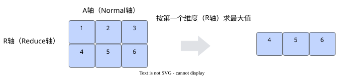
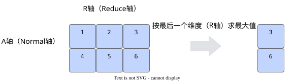

# pypto.amax

## 产品支持情况

<!-- npu="950" id1 -->
- Ascend 950PR&950DT系列产品：支持
<!-- end id1 -->
<!-- npu="A3" id2 -->
- Atlas A3系列产品：支持
<!-- end id2 -->
<!-- npu="910b" id3 -->
- Atlas A2系列产品：支持
<!-- end id3 -->
<!-- npu="9030" id7 -->
- Kirin9030处理器系列产品：支持
<!-- end id7 -->
<!-- npu="x90" id8 -->
- KirinX90处理器系列产品：支持
<!-- end id8 -->
<!-- npu="9050" id11 -->
- Kirin9050处理器系列产品：支持
<!-- end id11 -->

## 功能说明

对一个多维向量在指定的维度求最大值。

定义指定计算的维度（Reduce轴）为R轴，非指定维度（Normal轴）为A轴。如下图所示，对Shape为\(2, 3\)的二维矩阵进行运算，指定在第一维求最大值，输出结果为\[4, 5, 6\]；指定在第二维求最大值，输出结果为\[3, 6\]。

**图1**  amax按第一个维度计算示例


**图2**  amax按最后一个维度计算示例


## 函数原型

```python
amax(input: Tensor, dim: int, keepdim: bool = False, propagate_nan: bool = True) -> Tensor
```

## 参数说明

| 参数名  | 输入/输出 | 说明                                                                 |
|---------|-----------|----------------------------------------------------------------------|
| input   | 输入      | 源操作数。<br>支持的类型为：Tensor。不同型号支持的数据类型有所差异，详细请参见[约束说明](#约束说明)。<br>不支持空Tensor；Shape仅支持1-4维；Shape Size不大于2147483647（即INT32_MAX）。 |
| dim     | 输入      | 指定进行归约的维度。<br>支持任意单轴。                                       |
| keepdim | 输入      | 归约后是否保留被归约的维度。<br>默认值为False。 |
| propagate_nan | 输入 | 编译期bool常量。<br>为True时在存在NaN时返回NaN；为False时忽略NaN，全NaN时返回NaN。整数输入不受影响。<br>默认值为True。 |

## 返回值说明

返回输出Tensor，输出Tensor的Shape与keepdim参数相关。

若keepdim参数为True，则在执行归约操作后保留被归约的维度。输出Tensor在除dim指定的维度外，其他维度的Shape与输入Tensor的Shape一致，而在dim指定的维度上的大小为1。

若keepdim参数为False（默认），则被归约的维度会从输出Tensor中移除，而TileShape中对应的维度不变，所以建议在调其他operation前重设TileShape。

若propagate_nan参数为False，浮点输入混合正负零时选择+0，同号零保留原符号。

## 约束说明

- TileShape大小不超过64KB；

- Tensor数据类型说明：
   <!-- npu="950" id4 -->
   - Ascend 950PR&950DT系列产品：DT_FP16，DT_BF16，DT_FP32，DT_INT32，DT_INT16，DT_UINT8，DT_INT8，DT_INT64，DT_UINT64
   <!-- end id4 -->
   <!-- npu="A3" id5 -->
   - Atlas A3系列产品：DT_FP16，DT_BF16，DT_FP32，DT_INT32，DT_INT16
   <!-- end id5 -->
   <!-- npu="910b" id6 -->
   - Atlas A2系列产品：DT_FP16，DT_BF16，DT_FP32，DT_INT32，DT_INT16
   <!-- end id6 -->
   <!-- npu="9030" id9 -->
   - Kirin9030处理器系列产品：DT_FP16，DT_FP32
   <!-- end id9 -->
   <!-- npu="x90" id10 -->
   - KirinX90处理器系列产品：DT_FP16，DT_FP32
   <!-- end id10 -->
   <!-- npu="9050" id12 -->
   - Kirin9050处理器系列产品：DT_FP16，DT_FP32
   <!-- end id12 -->
- Tensor类型输入不支持`TileOpFormat.TILEOP_NZ`格式。
- 输入Tile、输出Tile和临时空间的总占用须小于可用UB。
   - propagate_nan=True沿用原生路径。非尾轴原生数值归约无专用临时空间，尾轴归约记当前Tile倒数第二维长度为H（一维时H=1），归约轴长度为K，元素字节数为E。专用临时空间按以下分档申请，除法取整，物理布局再按32字节对齐：
     - `K * E <= 256` 时为32字节；
     - `256 < K * E <= 512` 时为 `H * 256` 字节；
     - `K * E > 512` 时为 `H * floor(K * E / 512) * 256` 字节。
   - propagate_nan=False的专用临时空间按二维计算布局定容。尾轴归约取H为倒数第二维长度、W为归约轴长度；非尾轴归约取H为归约轴长度、W为归约轴后各维长度的乘积。BF16使用FP32计算，E=4；其他类型E为计算元素字节数。令 `A(x)=ceil(x/32)*32`、`B(x)=ceil(x/256)*256`，先将W对齐为 `A(W*E)/E`，再计算：
     - 工作数据 `D=H*W*E`，比较读取保护区 `C=B(W*E)-W*E`，位掩码 `M=H*A(ceil(W/8))`。
     - 单个结果区P在尾轴时为 `H*32`，非尾轴时为 `W*E`；结果行字节数F分别为32和 `W*E`。
     - 尾轴指令区Q按 `W*E<=256`、`256<W*E<=512`、`W*E>512` 三档分别为32、`H*256`、`H*floor(W*E/512)*256` 字节；非尾轴Q=0。
     - 尾轴归约TileOp申请 `max(D+C+M+2*P+Q+32, D+C+M+2*P+B(F)-F)` 字节。非尾轴结果直接写输出，不申请数值结果区，申请 `max(D+C+M+P+32, D+C+M+P+B(F)-F)` 字节。
     - 归约轴切分时，另按输出二维切片申请 `Hs*A(ceil(Ws/8))+32+Hs*B(Ws*E)` 字节，其中Hs/Ws为该切片的行数及对齐后的列数。外层切片及左右输入顺序复用此空间。
     BF16转FP32的中间张量，以及输入、输出和各中间结果各自计入UB，最终峰值按生命周期取最大，而非各项求和。
   - 总占用超出UB时，编译器报告容量错误。

## 调用示例

### TileShape设置示例

调用该operation接口前，应通过set_vec_tile_shapes设置TileShape。

TileShape维度应和输入input一致。

如输入input shape为[m, n]，输出为[m, 1]，TileShape设置为[m1, n1]，则m1，n1分别用于切分m，n轴。

```python
pypto.set_vec_tile_shapes(4, 16)
```

注意：如果keepdim设置为false，则被归约的维度会从输出Tensor中移除，而TileShape中对应的维度不变，所以建议在调其他operation前重设TileShape。

### 接口调用示例

```python
x = pypto.tensor([2, 3], pypto.DT_FP32)
y = pypto.amax(x, -1, True)
```

结果示例如下：

```python
输入数据x: [[1.0 2.0 3.0],
             [1.0 2.0 3.0]]
输出数据y: [[3.0],
             [3.0]]
```
