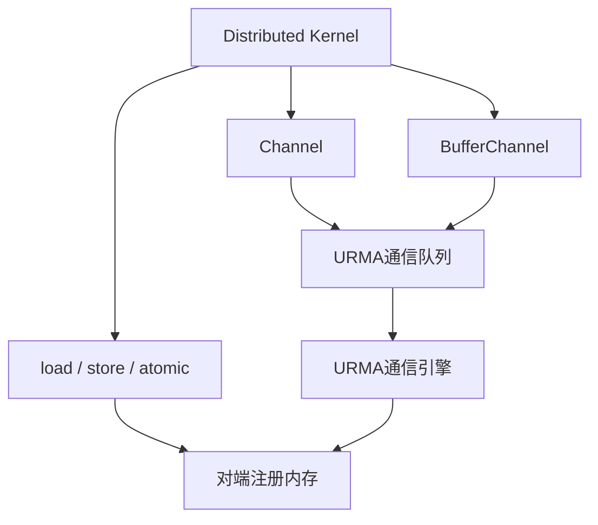
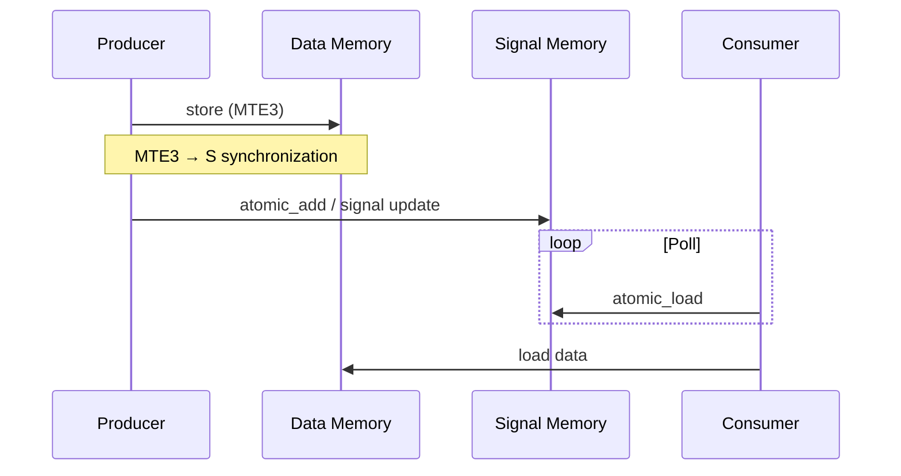
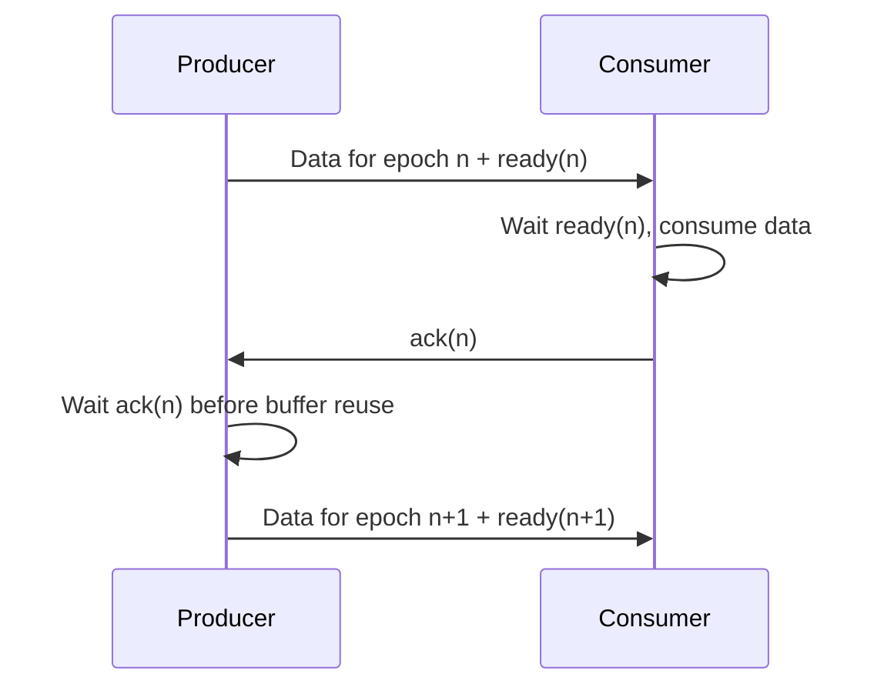

# 通信算子开发

## 概述

pypto_pro.language.distribute提供基于HCCL通信域和对称窗口（Window）的多卡设备侧通信接口。开发者可以在Kernel内直接访问对端内存，也可以通过URMA通信引擎提交异步读、写、归约和原子操作，实现计算与通信融合。



### 通信方式选择

| 通信方式 | 访问机制 | 适用场景 |
|---|---|---|
| UB_MEM | 直接映射对端地址，使用load/store/atomic | 细粒度访问、直接读写、软件同步 |
| URMA(Channel) | 组装并提交URMA请求 | 大块异步传输 |
| URMA(BufferChannel) | 在UB暂存区中缓存请求，批量提交 | 高频小包、离散地址、多请求批处理 |

Channel和BufferChannel均属于URMA平面，并非独立的物理互联平面。选择通信方式时，应综合考虑消息大小、地址连续性、请求数量、同步需求以及实际端到端带宽，而非仅比较单次API调用耗时。

两者的核心区别在于请求的组装和提交方式：

- Channel：调用write、read等接口时直接组装WQE并提交（默认submit=True），每次提交产生一个完成记录，适合大块传输和请求数量较少的场景。
- BufferChannel：先把多个请求追加到调用方预留的UB暂存区，再由一次submit()批量发布，整个批次只产生一个完成记录，适合高频小包、离散地址和多请求批处理。
- BufferChannel依赖Channel提供的基础通道（Jetty、对端和头部信息），因此需要先打开Channel，再绑定暂存缓冲区。

两个平面的典型通信效率如下：

| 平面 | 通信效率 |
|---|---:|
| UB_MEM | 60% |
| URMA | 85% |

通信效率受拓扑、消息大小和访问模式影响，以上数值为典型参考值。

### 接口分类

| 使用位置 | 接口 | 执行域 |
|---|---|---|
| Host | [create_window](../../../../api/pro_api/Communication-API/create_window.md) | Kernel启动前后 |
| Device | [barrier](../../../../api/pro_api/Communication-API/barrier.md) | Vector |
| Device | [channel](../../../../api/pro_api/Communication-API/channel.md)、[buffer_channel](../../../../api/pro_api/Communication-API/buffer_channel.md)、[remote_ptr](../../../../api/pro_api/Communication-API/remote_ptr.md)、[remote_tensor](../../../../api/pro_api/Communication-API/remote_tensor.md) | Vector |

设备侧通道及地址映射接口依赖标量操作，只能在Vector执行域调用；配合使用的load/store等指令仍须满足各自执行域限制。

## Window与内存注册

Window管理通信域内的已注册内存和通信资源。各rank使用本地Tensor注册对应区域，设备侧通过Window将本地地址映射为指定rank的对端地址。

### 访问平面

通过[Protocol](../../../../api/pro_api/Communication-API/basic_data_structures/Protocol.md)指定注册方式：

- Protocol.UB_MEM：通过pypto_pro.language.distribute.remote_ptr或pypto_pro.language.distribute.remote_tensor获取直接访问地址，配合load/store/atomic使用。
- Protocol.URMA：通过Channel或BufferChannel对已注册区域发起异步通信请求。

两种平面的远端地址应通过各自接口获取，不应混用。

### 典型拓扑与layer

HCCL将通信域内rank间的连接关系建模为分层的rank graph，每一层可以有自己的拓扑类型。实际集群通常按物理层级组网，典型结构如下：

| 层级 | 典型范围 | 典型拓扑 | 说明 |
|---|---|---|---|
| layer 0 | 服务器/节点内NPU互连 | 1DMesh、CLOS | 可包含多个拓扑实例，每个实例有自己的拓扑类型；通常每个服务器/节点一个实例。 |
| layer 1 | 服务器/节点间、超节点内互连 | CLOS网络 | 通常覆盖整个通信域，是该通信域的顶层网络。 |
| layer 2及以上 | 更大规模集群 | 多级CLOS | 按实际组网分层。 |

例如，2台服务器、每台3个NPU组成6 rank通信域时，layer 0可能有两个拓扑实例（每个3 rank，拓扑类型为1DMesh或CLOS），layer 1有一个拓扑实例（6 rank，拓扑类型为CLOS）。实际层级和拓扑类型以[pypto_pro.language.distribute.dump_topology()](../../../../api/pro_api/Communication-API/dump_topology.md)输出为准。

[pypto_pro.language.distribute.create_window()](../../../../api/pro_api/Communication-API/create_window.md)的layer参数用于选择窗口通道使用的网络层级：-1自动选择最高层，0表示服务器/节点内，1表示服务器/节点间。窗口建链后，通道固定在该层拓扑上。

### 生命周期


1. 使用torch.distributed.init_process_group初始化HCCL通信域。
2. 调用[create_window](../../../../api/pro_api/Communication-API/create_window.md)，通过memories传入本rank已有的NPU Tensor及对应协议。
3. 各rank应保持窗口名称、注册区域顺序、大小及对应协议一致。
4. 启动Kernel，使用设备侧接口访问对端内存或提交通信请求。
5. 确认相关Kernel和通信已完成后，调用[Window.close](../../../../api/pro_api/Communication-API/Window.md)释放窗口。

注册Tensor的底层存储必须在通信使用期间保持有效。窗口关闭前不要释放、重新分配或改变其注册地址。

## UB_MEM编程模式

UB_MEM不经过URMA通信队列，通过对端内存映射直接执行load/store/atomic。优先使用[remote_tensor](../../../../api/pro_api/Communication-API/remote_tensor.md)保留原Tensor的shape；需要改变shape、dtype或访问子区域时，使用[remote_ptr](../../../../api/pro_api/Communication-API/remote_ptr.md)与pypto_pro.language.make_tensor。

### UB_MEM数据与信号顺序

当使用MTE3写入数据、随后通过标量原子操作发布信号时，必须先建立MTE3到S的执行依赖。

```python
import pypto_pro.language as pl
import pypto_pro.language.distribute as pld

pl.system.sync_src(set_pipe=pl.PipeType.MTE3, wait_pipe=pl.PipeType.S, event_id=0)
pl.system.sync_dst(set_pipe=pl.PipeType.MTE3, wait_pipe=pl.PipeType.S, event_id=0)
```



如果一次数据写之后需要向多个rank发布信号，应尽量在信号循环之前统一执行必要同步，避免每次原子操作重复执行屏障。事件ID应与Kernel内其他同步事件协调，不能随意复用仍在使用的事件。

**轮询退避：**所有等待信号的while循环都必须在循环体内调用`pypto_pro.language.system.nop(200)`作为退避，不能写成空循环或仅反复执行atomic_load。nop降低信号地址的轮询频率，避免占用标量/访存资源并影响对端通信；具体周期可按平台调整。

### Push：远端写、本端读

```python
import pypto_pro.language as pl
import pypto_pro.language.distribute as pld

@pl.jit(auto_mutex=True)
def ubmem_push_signal_pattern(win: pld.Window,
                              data: pl.Tensor[[1, 1024], pl.DT_BF16],
                              sig: pl.Tensor[[256], pl.DT_INT64],
                              src: pl.Tensor[[1, 1024], pl.DT_BF16],
                              out: pl.Tensor[[1, 1024], pl.DT_BF16]):
    with pl.section_vector():
        me, nr = win.rank(), win.nrank()
        peer = (me + 1) % nr
        prev = (me + nr - 1) % nr
        epoch = 1  # 单轮；多轮时每轮递增

        tt = pl.TileType(shape=[1, 1024], dtype=pl.DT_BF16, target_memory=pl.MemorySpace.Vec)
        t = pl.make_tile(tt, addr=0)
        pl.load(t, src, [0, 0])

        # 1. 远端写：将数据写入远端注册区域。
        pl.store(pld.remote_tensor(win, data, peer), t, [0, 0])

        # 2. 保证数据写入完成，再发布信号。
        pl.system.sync_src(set_pipe=pl.PipeType.MTE3, wait_pipe=pl.PipeType.S, event_id=0)
        pl.system.sync_dst(set_pipe=pl.PipeType.MTE3, wait_pipe=pl.PipeType.S, event_id=0)
        pl.atomic_add(pld.remote_tensor(win, sig, peer), me, 1)

        # 3. 等待prev的数据就绪。
        while pl.atomic_load(sig, prev) < epoch:
            pl.system.nop(200)

        # 4. 本端读：直接读取本地窗口中prev推送过来的数据。
        pl.load(t, data, [0, 0])
        pl.store(out, t, [0, 0])
```

### Pull：本端写、远端读

生产侧将数据写入自己的注册区域，通知消费者；消费者在信号满足条件后直接读取生产侧内存。

```python
import pypto_pro.language as pl
import pypto_pro.language.distribute as pld

@pl.jit(auto_mutex=True)
def ubmem_pull_signal_pattern(
    win: pld.Window,
    data: pl.Tensor[[1, 1024], pl.DT_BF16],
    sig: pl.Tensor[[256], pl.DT_INT64],
    src: pl.Tensor[[1, 1024], pl.DT_BF16],
    out: pl.Tensor[[1, 1024], pl.DT_BF16],
):
    with pl.section_vector():
        me, nr = win.rank(), win.nrank()
        peer = (me + 1) % nr
        prev = (me + nr - 1) % nr
        epoch = 1  # 单轮；多轮时每轮递增

        tt = pl.TileType(shape=[1, 1024], dtype=pl.DT_BF16, target_memory=pl.MemorySpace.Vec)
        t = pl.make_tile(tt, addr=0)

        # 1. 本端写：将数据写入本地注册区域。
        pl.load(t, src, [0, 0])
        pl.store(data, t, [0, 0])

        # 2. 保证数据写入完成，再发布信号。
        pl.system.sync_src(set_pipe=pl.PipeType.MTE3, wait_pipe=pl.PipeType.S, event_id=0)
        pl.system.sync_dst(set_pipe=pl.PipeType.MTE3, wait_pipe=pl.PipeType.S, event_id=0)
        pl.atomic_add(pld.remote_tensor(win, sig, peer), me, 1)

        # 3. 等待prev的数据就绪。
        while pl.atomic_load(sig, prev) < epoch:
            pl.system.nop(200)

        # 4. 远端读：直接读取prev的数据。
        pl.load(t, pld.remote_tensor(win, data, prev), [0, 0])
        pl.store(out, t, [0, 0])
```

### 远端写与远端读对比

Push和Pull的区别在于数据写发生在哪一端、数据读发生在哪一端：

| 模式 | 生产者 | 消费者 | 数据写 | 数据读 |
|---|---|---|---|---|
| Push | 远端store到消费者内存 | 本地load自己的窗口 | 远端写 | 本地读 |
| Pull | 本地store自己的窗口 | 远端load生产者内存 | 本地写 | 远端读 |

**Push适合生产者驱动的场景**：生产者明确知道数据应该发送给谁，计算完成后直接写入对端内存，消费者可以使用本地数据进行后续计算。

**Pull适合消费者驱动的场景**：消费者明确知道自己需要哪些数据，按需从对端读取，可以避免不必要的数据传输和本地GM中转。

对于AllGather、All-to-All等通信模式，两种方式均可实现，具体选择取决于数据布局、访存效率和计算通信流水线的资源占用。

两种模式都需要生产侧在数据写完成后建立MTE3→S同步，再通过原子信号通知消费侧；消费侧看到信号后才能执行load。

## URMA编程模式

### 通信完成与同步语义

异步通信需要区分四个阶段：请求组装、请求发布、通信完成和消费侧数据可见性。


| 操作 | 语义 |
|---|---|
| `write(..., submit=False)` | 组装请求，允许延迟发布；队列压力可能触发内部发布 |
| `write(..., submit=True)` | 组装并发布请求，同时发布此前待提交的请求 |
| `submit()` | 发布待提交请求，不等待通信完成 |
| `drain()` | 等待此前已提交的通信完成，具体范围遵循通道完成语义 |
| `write_notify()` | 通过硬件关联数据写与信号通知 |
| `atomic_load()` | 轮询信号；必须配合nop退避，信号与数据之间的顺序须由生产侧协议保证 |

提交完成不等于通信完成；发送侧通信完成也不等于接收侧已经消费数据。若后续通信需要覆盖接收缓冲区，应额外建立消费确认或使用多缓冲区协议。

### URMA顺序控制

| 选项 | 用途 |
|---|---|
| UrmaOption.ODR_STRONG | 在硬件规定范围内约束请求执行顺序 |
| UrmaOption.FENCE | 建立硬件规定的前序操作完成依赖 |
| UrmaOption.CQE | 请求完成事件，用于完成队列管理 |

不要将上述选项视为通用内存屏障，也不要假定其能够跨不同通道建立顺序。具体适用操作、顺序范围和CQE覆盖规则以Channel API契约为准。

### is_shared与通道打开方式

窗口拓扑决定通道的打开方式。Host侧可用`win.is_shared()`查询，Device侧打开通道后可用`ch.is_shared()`查询，两者返回同一信息：

| 窗口类型 | is_shared() | 通道打开方式 | Jetty归属 | 并发保护 |
|---|---|---|---|---|
| 共享窗口 | True | pypto_pro.language.distribute.channel(win, ub)，省略peer | 每个AIV持有私有的shared-window Jetty | 私有Jetty；lock/unlock为空操作 |
| per-endpoint窗口 | False | pypto_pro.language.distribute.channel(win, ub, peer=k) | 每个peer一个Jetty，由多个AIV共享 | 多个AIV共享同一Jetty时，用lock/unlock包住post/submit/drain序列 |

- per-endpoint窗口必须指定peer。否则运行时触发错误。
- per-endpoint窗口下peer不能等于当前rank，否则会解析到错误的Jetty，行为未定义。
- 共享窗口下，通道使用当前AIV自己的Jetty；per-endpoint窗口下，通道使用peer对应的Jetty。
- 通道的UB暂存区至少为256字节，按64字节对齐，且不能与Tile或其他通道的暂存区重叠。

```python
import pypto_pro.language as pl
import pypto_pro.language.distribute as pld

# Host侧：根据窗口拓扑选择对应的Kernel变体。
shared = win.is_shared()

# Kernel内（me、nr已定义；以下两种写法二选一，由Host选择的Kernel决定）：
# 共享窗口：省略peer，通道使用当前AIV自己的Jetty。
ch = pld.channel(win, 0x2000)

# per-endpoint窗口：指定peer，通道使用该peer对应的Jetty。
ch = pld.channel(win, 0x2000, peer=(me + 1) % nr)
```

### 硬件通知：write_notify（不建议优先使用）

write_notify只保证**这一条消息**和通知值同时可见，不能建立它与前序其他写请求之间的顺序。因此不建议在批量或多条消息场景中使用；这类场景应优先使用下面的“暂存多条写 + 最后一条强序写”模式，或直接使用BufferChannel。

```python
import pypto_pro.language as pl
import pypto_pro.language.distribute as pld

@pl.jit(auto_mutex=True)
def notify_wait_pattern(win: pld.Window,
                        data: pl.Tensor[[1, 1024], pl.DT_BF16],
                        sig: pl.Tensor[[256], pl.DT_INT64],
                        src: pl.Tensor[[1, 1024], pl.DT_BF16],
                        out: pl.Tensor[[1, 1024], pl.DT_BF16]):
    with pl.section_vector():
        me, nr = win.rank(), win.nrank()
        peer = (me + 1) % nr
        prev = (me + nr - 1) % nr
        epoch = 1  # 单轮；多轮时每轮递增
        ch = pld.channel(win, 0x2000, peer=peer)

        ch.write_notify(ch.remote_ptr(data), src,
                        pl.addptr(ch.remote_ptr(sig), me), epoch)

        while pl.atomic_load(sig, prev) < epoch:
            pl.system.nop(200)

        tt = pl.TileType(shape=[1, 1024], dtype=pl.DT_BF16,
                         target_memory=pl.MemorySpace.Vec)
        t = pl.make_tile(tt, addr=0)
        pl.load(t, data, [0, 0])
        pl.store(out, t, [0, 0])
```

write_notify适用于单条消息 + 单次通知、且不需要与其它写请求建立批量顺序的场景。源缓冲区复用、通道资源回收以及Kernel退出时的完成要求仍须独立满足。

### 单边写与批量提交

发送侧主动发起通信，接收侧无需参与通信请求的提交。若发送侧需要等待请求完成，则调用drain。

```python
import pypto_pro.language as pl
import pypto_pro.language.distribute as pld

@pl.jit(auto_mutex=True)
def one_sided_write_pattern(win: pld.Window,
                            data: pl.Tensor[[1, 1024], pl.DT_BF16],
                            src: pl.Tensor[[1, 1024], pl.DT_BF16]):
    with pl.section_vector():
        me, nr = win.rank(), win.nrank()
        ch = pld.channel(win, 0x2000, peer=(me + 1) % nr)
        ch.write(ch.remote_ptr(data), src, submit=False)
        ch.submit()
        ch.drain()
```

对于连续多个请求，推荐前面的请求使用submit=False暂存，最后由一条submit=True且带ODR_STRONG | FENCE | CQE的写统一发布并建立前序写完成依赖：

```python
import pypto_pro.language as pl
import pypto_pro.language.distribute as pld

# data: Tensor[[2, 1024], DT_BF16]
dst = ch.remote_ptr(data)
ch.write(dst, src_a, submit=False)
ch.write(pl.addptr(dst, 1024), src_b, submit=True,
         option=pld.UrmaOption.ODR_STRONG | pld.UrmaOption.FENCE | pld.UrmaOption.CQE)
ch.drain()
```

批量场景下优先使用BufferChannel，由一次`bch.submit()`发布整个批次。不要依赖队列压力触发发布来保证程序正确性；若没有后续submit=True请求，应显式调用`submit()`。

### 连续写的可见顺序

当需要保证后一条写可见，并确保它之前的写也已可见时，可使用强序选项（适用于硬件保证的同通道写写排序范围）。

```python
import pypto_pro.language as pl
import pypto_pro.language.distribute as pld

dst = ch.remote_ptr(data)
ch.write(dst, src_a, submit=False)
ch.write(dst, src_b, submit=False, option=pld.UrmaOption.ODR_STRONG | pld.UrmaOption.FENCE | pld.UrmaOption.CQE)
ch.submit()
ch.drain()
```

该模式约束发送侧请求顺序，使后一条写可见时其前序写也已可见；但不保证接收侧观察到每一次中间写的结果。若消费者需要逐次确认，必须增加独立的消费确认协议。

### 数据写与独立信号写

显式构造数据写与信号写是推荐方式，可建立多条数据写与信号写的顺序：前面的数据写使用submit=False暂存，信号写使用submit=True并带ODR_STRONG | FENCE | CQE。其正确性依赖硬件对该操作组合的顺序保证。

```python
import pypto_pro.language as pl
import pypto_pro.language.distribute as pld

epoch = 1  # 单轮；多轮时每轮递增
ch.write(ch.remote_ptr(data), src, submit=False)
ch.write(pl.addptr(ch.remote_ptr(sig), me), epoch,
         option=pld.UrmaOption.ODR_STRONG | pld.UrmaOption.FENCE | pld.UrmaOption.CQE)
ch.drain()

while pl.atomic_load(sig, prev) < epoch:
    pl.system.nop(200)
pl.load(t, data, [0, 0])
```

批量场景优先使用BufferChannel；单条消息且不需要批量排序时可使用write_notify。

## 多轮通信与资源复用

单轮示例中epoch设为1，信号计数器从0开始。重复启动Kernel或在循环中复用信号时，应让epoch随轮次递增，并保证每个信号槽每轮按协议增加1（或由write_notify写入当前epoch）。

例如，每轮恰好执行一次原子加一时，可使用如下等待方式：

```python
import pypto_pro.language as pl
import pypto_pro.language.distribute as pld

# epoch从1开始；计数器初始为0，并且每轮恰好增加1。
while pl.atomic_load(sig, prev) < epoch:
    pl.system.nop(200)  # 必需的轮询退避，不能省略
```

递增信号只能区分通信轮次，不能单独防止生产者提前覆盖数据。对于单缓冲区，需要消费确认；对于双缓冲或环形缓冲区，需要保证槽位在复用前已被消费。



多AIV或多生产者场景还需明确通道、UB暂存区、信号槽位及数据缓冲区的所有权。除非接口明确支持并发提交，不应假定多个执行单元可以无同步地共享同一通道或队列。

## Channel与BufferChannel性能基线

| 操作 | Channel cycles/op | Channel us/op | BufferChannel cycles/op | BufferChannel us/op |
|---|---:|---:|---:|---:|
| write（post）/ write 64B | 478.00 | 0.478 | 9.73 | 0.010 |
| write（submit） | 497.00 | 0.497 | — | — |
| write 2KB | — | — | 9.72 | 0.010 |
| write value | 476.00 | 0.476 | 9.13 | 0.009 |
| read | 546.64 | 0.547 | 9.77 | 0.010 |
| write_reduce | 547.62 | 0.548 | 9.77 | 0.010 |
| write_notify（submit） | 520.00 | 0.520 | — | — |
| write_notify（post）/ write_notify | 525.00 | 0.525 | 18.88 | 0.019 |
| atomic_fetch_add | 556.39 | 0.556 | 20.11 | 0.020 |
| atomic_cas | 554.35 | 0.554 | 20.11 | 0.020 |
| submit | 3.86 | 0.004 | 2.59 | 0.003 |
| drain | 647.05 | 0.647 | 235.42 | 0.235 |

### 如何解读性能数据

- Channel post：submit=False，只统计发布之前的请求组装。
- Channel submit模式：每次write均立即发布。
- BufferChannel请求类操作：只统计暂存到UB暂存区的耗时，后续submit和drain不在该计时区间内。
- submit和drain单独计时；drain包含等待此前已提交请求完成的时间，受队列状态和在途请求影响。

**BufferChannel的约9–10 ns/op是请求暂存开销，不是跨卡通信延迟。** 两类接口的计时边界不同，不能直接将表中的比值解释为端到端通信加速比。

对于批量大小为N的请求，建议分别测量请求组装、发布、完成等待及完整批次时间。若阶段不存在重叠，其总时间可近似表示为：

```text
T_batch ≈ T_prepare(N) + T_submit(N) + T_drain(N)
BW_effective = Total_payload_bytes / T_batch
```

如存在计算通信重叠、内部自动发布或流水线执行，应以实际测得的批次端到端时间为准。

### 性能优化建议

- 选定合适的协议类型。
- 尽可能使用连续数据传输，减少请求数量。
- 对高频离散请求优先评估BufferChannel批处理。
- 对无需逐条完成的请求使用submit=False，在适当边界统一发布。
- 将drain放在真正依赖通信完成的边界，而不是每次请求之后。
- UB_MEM多peer信号发布时，尽可能将公共的内存同步移到循环外。
- 同时测量有效带宽、请求吞吐率、端到端延迟及计算通信重叠效果。
- 信号轮询循环必须保留pypto_pro.language.system.nop退避，避免高频原子读增加访存压力并影响对端通信。
- 算法实现上避免同一时间进行All-to-One通信，避免单个rank的通信压力过大。
