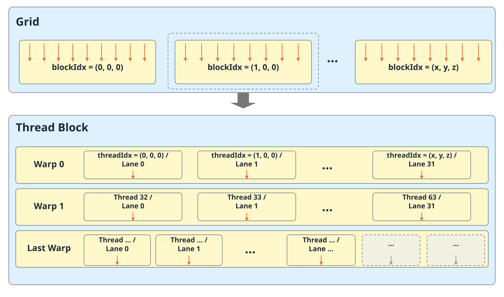
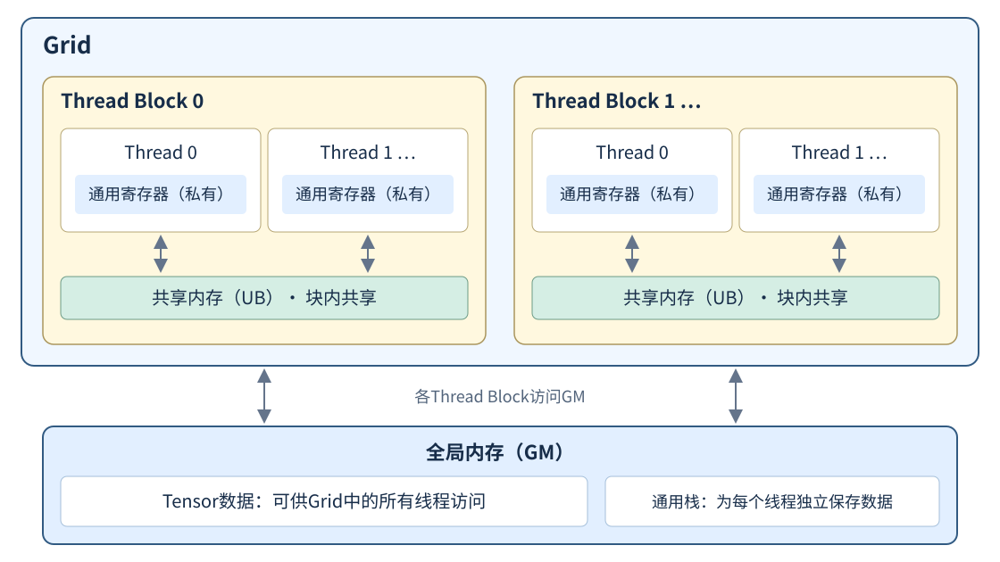
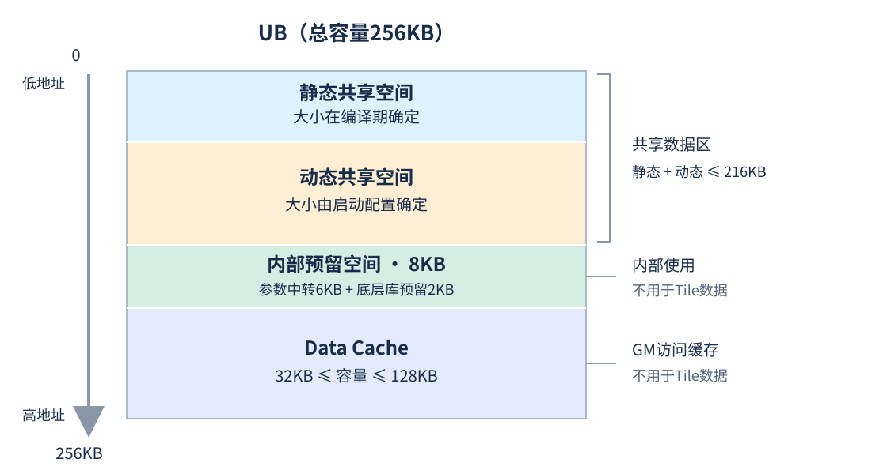
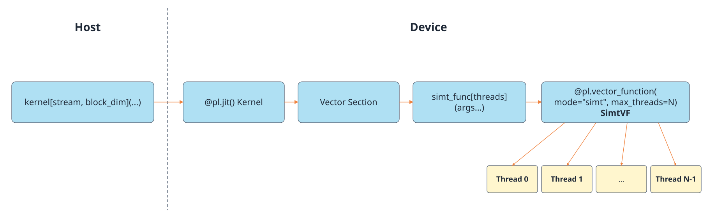

# 编程范式

SIMT（Single Instruction Multiple Threads，单指令多线程）是一种线程并行模型，以Thread为基本执行单元。同一份程序由多个Thread并行执行，每个Thread根据自身索引处理不同的数据。SIMT允许每个Thread独立寻址，并根据数据进入不同的条件分支或循环。与面向规则数据块、批量执行相同操作的SIMD相比，SIMT更适合表达不规则数据访问和逐Thread控制逻辑。

PyPTO Pro在AIV上支持SIMT编程和SIMD与SIMT混合编程。开发者可以由Host直接启动SIMT kernel，也可以在外层Kernel中调用SIMT vector function（简称SIMT VF），组合数据搬运、SIMD计算和SIMT计算。具体开发步骤见[SIMT计算](../../development/vector_computation/simt_computation.md)。

## 线程架构

### 线程层次结构

SIMT采用Grid、Thread Block和Thread三级线程层次，从顶层到底层划分并行任务。

**图1 SIMT线程层次结构**



#### Grid（线程块网格）

Grid是SIMT线程层次结构的最顶层，由多个Thread Block组成。grid_dim = (grid_x, grid_y, grid_z)表示Grid在各维度上的Thread Block数量，各Thread Block通过自身坐标标识，Grid具有以下特征：

- Grid的维度由用户的执行配置决定：SIMT编程在Host启动SIMT kernel时通过grid参数配置Grid尺寸；SIMD与SIMT混合编程中，Grid规模由实际生效的Vector核数决定，仅使用X维，即grid_dim = (grid_x, 1, 1)。
- Grid各维度乘积不超过65535，即一个Grid中线程块总数不能超过65535。
- Grid中所有的线程块具有相同的尺寸，且各自互相独立，按任意顺序执行。
- 一次启动的线程总数为：

$$
threads = grid_x \times grid_y \times grid_z
\times block_x \times block_y \times block_z
$$

#### Thread Block（线程块）

Thread Block是Grid的组成单元，由若干Thread组成。block_dim = (block_x, block_y, block_z)表示一个Thread Block在各维度上的Thread数量，三个分量的乘积为块内Thread总数，Thread Block具有以下特征：

- 同一Thread Block内的Thread执行相同的SIMT操作，各Thread可以根据自身索引和数据选择不同的执行路径。
- 混合编程中，Thread Block内的线程可以访问外层Kernel传入的共享UB Tile实现数据交互。
- Thread Block内的线程可以通过同步机制实现协作。
- Thread Block内的线程数上限为2048，一个线程块中的线程数量为：

$$
threads_{\mathrm{block}} = block_x \times block_y \times block_z
$$

#### Thread（线程）

Thread是SIMT结构中的最小编程单元，每个Thread具有独立的局部变量和执行状态，拥有独立的寄存器和栈空间。

#### 线程索引

在SIMT线程架构下，每个线程在Grid内由线程块坐标和块内线程坐标共同唯一标识。开发者可以通过线程层级查询接口确定当前线程负责的数据：

| 接口 | 含义 | 返回形式与范围 |
|---|---|---|
| pypto_pro.language.simt.grid_dim() | Grid在各维度上的Thread Block数量。 | dim3对象，各分量为DT_UINT32 Scalar，值由本次启动配置决定。 |
| pypto_pro.language.simt.block_dim() | Thread Block在各维度上的Thread数量。 | dim3对象，各分量为DT_UINT32 Scalar，三个分量的乘积不超过max_threads。 |
| pypto_pro.language.simt.block_idx() | 当前Thread Block在Grid中的三维坐标。 | dim3对象，各分量为DT_UINT32 Scalar，范围为[0, Grid对应维度的大小)。 |
| pypto_pro.language.simt.thread_idx() | 当前Thread在Thread Block内的三维坐标。 | dim3对象，各分量为DT_UINT32 Scalar，范围为[0, Thread Block对应维度的大小)。 |
| pypto_pro.language.simt.linear_thread_idx() | 当前Thread在块内按X维优先展开的编号，不含线程块偏移。 | DT_UINT32 Scalar，范围为[0, 块内线程总数)。 |

块内坐标为(thread_x, thread_y, thread_z)时，线性线程编号按以下方式计算，X维变化最快：

```text
linear_thread_idx = thread_x + thread_y × block_x + thread_z × block_x × block_y
```

**示例：从二维线程坐标定位数据**

假设Grid尺寸为(3, 1, 1)，每个Thread Block尺寸为(4, 2, 1)，共有3个线程块、每块8个线程。SIMT编程可在Host侧配置这两个尺寸；混合编程则由3个实际生效的Vector核分别调用一次`copy_by_index[4, 2](...)`。以下用混合编程展示索引计算：

```python
import pypto_pro.language as pl


@pl.vector_function(mode="simt", max_threads=8)
def copy_by_index(
    source: pl.Tensor[[1, 24], pl.DT_FP32],
    output: pl.Tensor[[1, 24], pl.DT_FP32],
):
    block_size = pl.simt.block_dim()
    block_pos = pl.simt.block_idx()
    local_idx = pl.simt.linear_thread_idx()

    threads_per_block = block_size.x * block_size.y * block_size.z
    global_idx = block_pos.x * threads_per_block + local_idx
    output[0, global_idx] = source[0, global_idx]


@pl.jit(arch="3510")
def copy_kernel(
    source: pl.Tensor[[1, 24], pl.DT_FP32],
    output: pl.Tensor[[1, 24], pl.DT_FP32],
):
    with pl.section_vector():
        copy_by_index[4, 2](source, output)
```

Host通过`copy_kernel[None, 3](source, output)`启动。以第2个Thread Block内坐标为(2, 1, 0)的线程为例，其位置与数据索引的关系如下：

| 信息 | 当前值 | 含义或计算过程 |
|---|---|---|
| Grid尺寸 | (3, 1, 1) | X维有3个Thread Block。 |
| Thread Block尺寸 | (4, 2, 1) | X维4个线程、Y维2个线程，每块共8个线程。 |
| Thread Block坐标 | (1, 0, 0) | 坐标从0开始，第2个Thread Block的X坐标为1。 |
| Thread坐标 | (2, 1, 0) | 当前线程位于块内X维第3列、Y维第2行。 |
| local_idx | 6 | 2 + 1 × 4 + 0 × 4 × 2 = 6。 |
| global_idx | 14 | 前一个Thread Block占8个位置，因此1 × 8 + 6 = 14。 |
| 总线程数 | 24 | 3个Thread Block × 每块8个线程。 |

该线程复制索引14处的元素，全部线程共同覆盖索引0至23。本例的线程总数与元素数量相同；数据量不是每块线程数的整数倍时，应在元素访问前判断边界。若Grid使用二维或三维，计算全局一维索引时还须先展开Thread Block坐标，不能只使用其X分量。

线程坐标查询、索引展开及边界处理参见[线程层级与索引](../../development/vector_computation/simt_computation.md#线程层级与索引)。

### Warp执行机制

Warp是硬件在线程块内组织执行和调度的单位。线程按块内线性编号每32个划分为一个Warp；一个Warp中的线程执行同一条指令，各自保留独立的寄存器状态。Warp内的执行位置称为Lane，Lane ID为0～31。

同一Warp中的线程可以根据数据进入不同分支，这称为分支发散。执行某条分支路径时，属于该路径的Lane参与执行，其他Lane暂时被屏蔽；硬件依次处理不同路径，随后在公共路径继续执行。因此，线程可以有不同的控制流，但分支发散会降低Warp的执行效率。

活跃线程是指在当前指令位置实际参与执行的线程，活跃状态随执行位置变化。任务划分时可尽量让相邻线程执行相近的计算路径，减少分支发散；线程间有数据依赖时仍须使用相应的同步或Warp协作接口。概念与示例参见[Warp简介](../../../../../api/pro_api/SIMT-API/warp/warp_intro.md)，接口用法参见[Warp API](../../../../../api/pro_api/SIMT-API/warp/index.md)。

### 配置最大线程数

每个线程拥有独立的寄存器和栈空间，而每个AIV核的寄存器总量有限。单线程的计算越复杂，局部变量和中间结果越多，通常需要占用的寄存器也越多。

最大线程数表示每个Thread Block允许启动的线程数量上限，在编译期确定。编译器根据该上限分配通用寄存器资源；随着最大线程数增大，每个线程可分配的寄存器数量会按档位减少，具体数量参见[寄存器](#寄存器)中的对应关系表。

配置最大线程数时，需要注意以下事项：

- 最大线程数须为编译期确定的整数，取值范围为1～2048。
- 实际启动的块内线程数为Thread Block各维度的乘积，可以小于最大线程数，但不能超过该值。例如，最大线程数为256时，可以启动每块128个线程的计算任务。
- 编译器按配置的最大线程数分配寄存器。对于同一份编译结果，仅减少实际启动的线程数，不会自动增加每个线程的寄存器配额。
- 应结合任务划分和单线程计算复杂度选择最大线程数。配置过大可能使每线程可用寄存器不足，编译器将部分数据转存到[栈空间](#栈空间)，增加访存开销；配置过小则会限制每个Thread Block可启动的线程数。

两种编程方式的具体配置方法参见[定义SIMT kernel](../../development/vector_computation/simt_computation.md#定义simt-kernel)和[定义SIMT VF](../../development/vector_computation/simt_computation.md#定义simt-vf)。

## 内存层级

SIMT线程可以访问全局内存、共享内存、栈空间和寄存器：

| 内存类型 | 线程访问范围 | 生命周期 | 物理位置 |
|---|---|---|---|
| 全局内存 | Grid中的所有线程 | 从分配到释放，可跨Kernel调用保留。 | 核外GM（Global Memory） |
| 共享内存 | 同一Thread Block内的线程 | 混合编程中由外层Kernel中的Tile使用范围决定。 | AIV的UB（Unified Buffer） |
| 通用栈空间 | 单个Thread | 线程执行期间。 | GM |
| 通用寄存器 | 单个Thread | 线程执行期间。 | AIV寄存器文件 |

- 全局内存是Grid中所有线程均可直接访问的内存空间，即GM（Global Memory）。
- 共享内存是同一线程块内所有线程共享的内存，位于UB（Unified Buffer），用于线程间的数据交换和复用。
- 每个线程拥有独立的通用栈空间，位于GM，主要用于存放线程私有的临时数据。
- 每个线程拥有独立的通用寄存器，用于存储局部变量和中间结果，可用数量与[最大线程数](#配置最大线程数)有关。
- 寄存器的访问速度最高；共享内存的访问延迟通常低于全局内存。

**图2 SIMT内存层级示意图**



### 全局内存

全局内存位于Device侧，用于保存Kernel的输入、输出和工作空间。其生命周期独立于单次Kernel执行：只要对应存储尚未释放或复用，其中的数据就可以在后续Kernel中继续使用。

PyPTO Pro通过Tensor访问GM。Host在启动Kernel前准备NPU Tensor并初始化输入数据，各线程根据自己的索引读写Tensor元素，Host读取输出前须等待相关任务完成。

多个线程访问同一Tensor时，应划分各线程负责的数据范围，并使用相应的同步或原子操作处理数据依赖。GM访问涉及的缓存由底层管理。

### 共享内存

共享内存位于AIV内的UB，适合保存块内线程需要交换或重复使用的中间数据。

SIMD与SIMT混合编程由外层Kernel创建和管理UB Tile，再传给SIMT VF供块内线程共同访问。SIMT VF返回后，外层Kernel可继续使用该Tile进行SIMD计算或数据搬运。

当前SIMT kernel尚未提供共享UB对象，不支持传入或创建Tile。

共享内存不会自动初始化。使用Tile中的数据前，应先完成数据搬运或写入；存在跨线程的先写后读依赖时，还须保证相应的同步已经完成。具体用法参见[Tile创建和操作](../../development/tile_creation_and_operations.md)及[SIMT数据访问约束](../../development/vector_computation/simt_computation.md#数据对象)。

#### UB内存划分

UB从低地址到高地址划分为以下区域：

1. **静态共享空间**：大小在编译期确定，用于保存共享数据。
2. **动态共享空间**：大小由启动配置确定，与静态共享空间共同保存共享数据。混合编程中，所需大小由框架根据Tile占用自动推导，无需开发者手动配置。
3. **内部预留空间**：供编译器和底层库使用。
4. **Data Cache**：缓存SIMT线程访问的GM数据，与共享数据使用UB中的不同区域。

<!-- npu="950" id1 -->
**图3 UB内存划分排布示意图**



UB总容量为256KB，默认内部预留空间为8KB。Data Cache至少需要32KB，最多使用128KB，其容量按以下方式计算：

```text
Data Cache容量 = min(256KB - 静态共享空间 - 动态共享空间 - 8KB, 128KB)
```

因此，在保留上述内部空间和最小Data Cache的情况下，静态与动态共享空间合计不能超过216KB。
<!-- end id1 -->

共享数据占用越多，留给Data Cache的空间就可能越少，从而影响GM访问效率。Tile读写须限制在有效地址范围内，不能占用内部预留空间或Data Cache。

### 栈空间

栈空间由编译器和运行时管理，开发者无需手动分配。GM上的SIMT通用栈保存线程私有的临时数据，分支栈保存Warp分支发散和恢复执行所需的状态；UB内部预留空间还用于函数调用参数的中转。

当寄存器不足时，编译器可能将部分局部变量和中间结果转存到GM上的通用栈，这称为寄存器溢出（register spill）。因此，Scalar虽然是线程私有数据，也不保证始终存放在寄存器中。

访问GM上的栈会增加访存开销，栈空间占用过大还可能引发栈溢出。开发时应减少不必要的临时变量，简化函数调用链和分支逻辑，并结合单线程计算复杂度配置[最大线程数](#配置最大线程数)。

### 寄存器

每个SIMT线程拥有独立的通用寄存器，用于保存局部变量和中间结果，由编译器根据最大线程数分配。

<!-- npu="950" id2 -->
最大线程数与每线程可用的通用寄存器数量对应关系如下：

| 最大线程数 | 每线程可用的通用寄存器数量 |
|---|---|
| 1～256 | 127 |
| 257～512 | 64 |
| 513～1024 | 32 |
| 1025～2048 | 16 |

通用寄存器位宽为32bit，一个64位数据通常需要占用两个寄存器。
<!-- end id2 -->

## SIMT编程方式

PyPTO Pro支持SIMT编程和SIMD与SIMT混合编程两种方式，两者主要在入口定义、启动位置、外层执行域和可用数据对象上有所区别；还支持用于复用SIMT逐线程逻辑的SIMT helper。

| 函数类型 | 调用者 | 线程配置 | 结果传递 |
|---|---|---|---|
| SIMT kernel | Host | Host配置Grid和Thread Block尺寸。 | 将结果写入Tensor，不返回值。 |
| SIMT VF | 外层Kernel的Vector执行域 | 外层Kernel调用点配置Thread Block尺寸，Grid由实际生效的Vector核数决定。 | 将结果写入Tensor或UB Tile，不返回值。 |
| SIMT helper | SIMT kernel、SIMT VF或其他SIMT helper | 使用调用者当前线程的配置，不创建新线程。 | 可以不返回值或返回一个Scalar，也可写入传入的Tensor或Tile。 |

### SIMT编程

SIMT kernel由Host直接启动，函数体描述每个线程执行的计算。开发者在Host侧配置Grid和Thread Block，在函数内通过线程索引访问GM Tensor，无需包裹Vector执行域。

这种方式适合以逐线程寻址和控制流组织整个计算任务。函数定义、参数和启动方式参见[定义与启动SIMT kernel](../../development/vector_computation/simt_computation.md#simt编程)。

### SIMD与SIMT混合编程

外层Kernel组织数据搬运、SIMD计算和SIMT VF调用。SIMT VF由外层Kernel在Vector执行域中启动，描述块内各线程执行的计算，不能由Host直接启动。

这种方式适合将规整的SIMD计算与不规则的SIMT计算组合起来，并通过UB Tile交换中间数据。

**图4 SIMD与SIMT混合编程启动关系**



图中各Vector核分别启动一个包含N个线程的Thread Block。外层Kernel还需组织搬运与计算之间的数据依赖，具体用法参见[定义与启动SIMT VF](../../development/vector_computation/simt_computation.md#simd与simt混合编程)。

图中的N表示本次调用的实际线程数，可以小于SIMT VF声明的max_threads。同一个外层Kernel可在不同计算阶段调用SIMT VF，每次调用均使用该调用点配置的线程尺寸。

### SIMT helper

SIMT helper用于复用逐线程计算逻辑，可由SIMT kernel、SIMT VF或其他SIMT helper调用。它在调用者的当前线程内执行，不创建新线程，也不重新划分Grid或Thread Block。

两种编程方式均可使用SIMT helper。其可访问的数据对象由调用入口决定：SIMT kernel的调用链使用Scalar和Tensor；SIMT VF的调用链还可使用符合要求的Tile。
