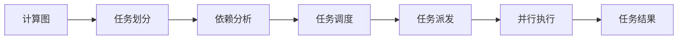

# 编程范式

PyPTO采用PTO编程范式，核心思想是使用Tensor作为数据的基本表达方式，通过一系列对Tensor的基本运算来描述并组装完整的计算流程（或计算图）。在PyPTO中，所有运算都以Tensor为输入或输出，形成可追溯的计算图结构，方便后续的调试、优化以及在特定硬件上的编译和执行。

## PTO编程范式概述

PTO编程范式的核心设计理念包括：

- Tensor级别抽象：以Tensor而非单个元素描述计算，贴近算法设计者的数学表达式。
- 声明式编程：开发者只需描述“做什么”，框架自动处理“怎么做”。
- 基于Tile的计算：所有计算最终都基于Tile（硬件感知的数据块）进行，充分利用硬件并行计算能力。
- 计算图驱动：通过构建计算图，框架可以自动进行优化、调度和执行。

PyPTO提供了三种层次的编程接口：

- Tensor层次编程：直接使用Tensor和Tensor Operation构建计算图。
- Tile层次编程：以Tile和Tile Operation表达完整的计算，显式体现访存与依赖。
- Block层次编程：定义单个处理器核执行的计算图，并通过多次实例化实现整体计算。

当前版本仅开放Tensor层次编程，这是最常用和推荐的编程方式。

## 核心数据结构

- Tensor：是PyPTO中最基本的数据结构，表示一个多维数组。Tensor包含以下信息：

    - 数据类型（dtype）：如FP32、FP16、INT32、BOOL等
    - 形状（shape）：用一个整型数组描述各维度长度，例如\(32, 64\)、\(1, 32, 128\)等
    - 格式（format）：数据在内存中的排布格式
    - 名称（name）：用于在计算图中标识该Tensor，便于调试与可视化

    Tensor之间可以通过各种操作（如加法、乘法、索引操作、归约操作等）进行组合，这些操作通常会生成新的Tensor，或者改变其在计算图中的引用方式（例如创建视图、改变Shape、转置等）。

- Tile：是Tensor的子区间（sub-Tensor），通过Tiling（切分）将大的Tensor切分为多个子块。Tile的设计目的是：

    - 使其能够存放在处理器核内私有缓存（如UB，L1 Buffer）中，以提升数据局部性
    - 充分利用硬件并行计算能力
    - 优化内存访问模式

    在Tensor层次编程中，Tiling由框架自动完成，开发者只需通过配置接口指定TileShape，框架会自动进行切分。

- View与Assemble：提供对子Tensor的视图和组合操作，在处理动态Shape和循环计算中非常有用。
    - View：提供对子Tensor的视图操作，允许在不复制数据的情况下访问Tensor的子区间。
    - Assemble：将多个子Tensor组合成一个更大的Tensor。

## Tensor层次编程

Tensor层次编程是PyPTO当前主要支持的编程方式，开发者直接使用Tensor和Tensor Operation构建计算图，无需关心底层的Tile切分和硬件细节。

- 基本编程模式

    典型的Tensor层次编程模式如下，Kernel入口函数通过@pypto.frontend.jit装饰器定义，在第一次调用时会进行JIT编译。

    ```python
    import pypto

    # 1. 配置Tiling（可选，框架会提供默认值）
    pypto.set_vec_tile_shapes(64)

    # 2. 定义计算函数
    @pypto.frontend.jit
    def my_operator(a: pypto.Tensor(shape, dtype), b:  pypto.Tensor(shape, dtype), output:  pypto.Tensor(shape, dtype)):
        # Tensor操作
        result = a + b  # 或使用pypto.add(a, b)
        output[:] = result

    # 3. 执行
    my_operator(tensor_a, tensor_b, output_tensor)
    ```

- Tensor操作

    PyPTO提供了丰富的Tensor操作，包括：

    - 数学运算：add、sub、mul、div、matmul等
    - 逻辑运算：logical\_not等
    - 结构变换：reshape、transpose、view、unsqueeze等
    - 归约操作：sum、amax、amin、topk等
    - 激活函数：sigmoid、softmax等
    - 超越函数：exp、log等
    - 其他操作：gather、scatter、concat、assemble等

- 控制流

    PyPTO支持控制流操作，用于处理动态Shape和条件执行：

    - 循环（Loop）

        ```python
        # 处理动态维度数据
        tile_size = pypto.symbolic_scalar(64)
        loop_count = dynamic_shape / tile_size

        for idx in pypto.loop(0, loop_count, 1, name="LOOP_BATCH"):
            offset = idx * tile_size
            end = (idx + 1) * tile_size
            input_view = input_tensor[offset:end, :]
            output_tensor[offset:end, :] = process_tile(input_view)
        ```

    - 条件分支（Conditional）

        ```python
        for idx in pypto.loop(b_loop):
            t3_sub = t0_sub + t1_sub
            if pypto.cond(idx < 2):  # 动态条件判断
                t2[b_offset:b_offset_end, ...] = t3_sub + 1
            else:
                t2[b_offset:b_offset_end, ...] = t3_sub
        ```

- 符号化编程

    PyPTO支持符号化标量（SymbolicScalar），用于支持动态Shape Tensor的表达和处理，使得框架可以在编译时进行Shape推断和优化。

    ```python
    # 创建动态Shape Tensor
    tensor = pypto.tensor([-1, 32], pypto.DT_FP16, "dynamic")

    # 获取动态维度的符号化标量，在运行时获取具体数值
    b = pypto.symbolic_scalar(tensor.shape[0])
    ```

## 计算图

- 计算图的组成

    PyPTO的计算图由以下元素组成：

    - Tensor：数据节点。
    - Operation（Op）：对数据的操作，分为Tensor Op与Tile Op。
        - Tensor Op：作用于Tensor，逻辑上不受存储位置和规模约束。
        - Tile Op：Tensor Op的子集，限定输入输出位于同一核的L1 Buffer，确保数据局部性。

- 计算图的转换流程

    将用户定义的计算图最终转换成可执行代码：

    ```mermaid
    graph LR
        A[Tensor Graph<br/>用户定义的计算图] --> B[Tile Graph<br/>硬件感知的Tile操作] --> C[Block Graph<br/>子图分区] --> D[Execution Graph<br/>执行图] --> E[可执行代码]
    ```

- 计算图的查看

    PyPTO提供了多种方式查看计算图：

    - JSON格式：导出为JSON格式，便于程序分析
    - 可视化工具：通过PyPTO Toolkit插件可视化计算图结构

## MPMD执行模型

PyPTO基于MPMD（Multiple Program Multiple Data）执行模型，与传统的SPMD（Single Program Multiple Data）模型相比：

- SPMD：用户需编写单一内核逻辑并实例化到多个处理器核上运行，带来同步开销和性能瓶颈
- MPMD：计算被抽象为一组异构任务，任务之间通过依赖关系组织。运行时调度器根据依赖关系将任务分配到合适的执行单元，避免了全局同步限制，提升了整体利用率与效率

MPMD执行模型的优势包括：

- 灵活的调度：不同任务可以分配到不同的处理器核，避免全局同步
- 更好的资源利用：根据任务特性选择合适的执行单元
- 细粒度并行：计算负载既可在细粒度上并行切分，又能在任务级别灵活调度
- 适配多核架构：更好地适配NPU的多核架构

执行流程为：



## 编程示例

依托PTO编程范式，开发者可高效开发多样化算子，并与PyTorch无缝集成。

- 向量加法（Vector Add）

    ```python
    import pypto

    # 配置Tiling
    pypto.set_vec_tile_shapes(64)

    # 定义计算函数
    @pypto.frontend.jit
    def vector_add(a:  pypto.Tensor(shape, dtype), b:  pypto.Tensor(shape, dtype), output:  pypto.Tensor(shape, dtype)):
        # Tensor操作：向量加法
        output[:] = a + b  # 输出结果

    # 执行
    vector_add(tensor_a, tensor_b, output_tensor)
    ```

- 矩阵乘法（Matrix Multiplication）

    ```python
    import pypto

    # 配置Cube Tiling（用于矩阵乘法）
    pypto.set_cube_tile_shapes([64, 64], [128, 128], [128, 128])

    @pypto.frontend.jit
    def matmul(a:  pypto.Tensor(shape_a, dtype), b:  pypto.Tensor(shape_b, dtype), output:  pypto.Tensor(shape_c, dtype)):
        output[:] = pypto.matmul(a, b)  # 矩阵乘法

    # 执行
    matmul(matrix_a, matrix_b, output_matrix)
    ```

- 动态Shape处理

    ```python
    import pypto

    def softmax_core(x: pypto.Tensor) -> pypto.Tensor:
        row_max = pypto.amax(x, dim=-1, keepdim=True)  # 计算行最大值
        sub = x - row_max                              # 值归一化
        exp = pypto.exp(sub)                           # 指数运算
        esum = pypto.sum(exp, dim=-1, keepdim=True)    # 求和
        return exp / esum                              # 概率归一化

    @pypto.frontend.jit
    def dynamic_softmax(input_tensor :  pypto.Tensor(in_shape, dtype), output_tensor:  pypto.Tensor(out_shape, dtype)):
        # 获取动态维度
        batch_size = input_tensor.shape[0]
        tile_size = pypto.symbolic_scalar(64)
        loop_count = batch_size // tile_size

        # 循环处理
        for idx in pypto.loop(0, loop_count, 1, name="LOOP_BATCH"):
            offset = idx * tile_size
            end = (idx + 1) * tile_size

            # 提取当前Tile
            x_view = input_tensor[offset:end, :]

            # 计算Softmax
            softmax_out = softmax_core(x_view)

            # 组装结果
            output_tensor[offset:end, :] = softmax_out

    # 执行
    dynamic_softmax(input_tensor, output_tensor)
    ```

- 与PyTorch集成

    ```python
    import pypto
    import torch

    @pypto.frontend.jit
    def my_operator(x: pypto.Tensor(in_shape, dtype), weight: pypto.Tensor(weight_shape, dtype), output: pypto.Tensor(out_shape, dtype)):
        result = pypto.matmul(x, weight)
        output[:] = result

    # 使用PyTorch Tensor
    input_torch = torch.randn(32, 128, device='npu')
    weight_torch = torch.randn(128, 64, device='npu')
    output_torch = torch.zeros(32, 64, device='npu')

    # 执行
    my_operator(input_torch, weight_torch, output_torch)
    ```

## 总结

PTO编程范式通过Tensor级别的抽象，使开发者能够以更直观的方式表达计算逻辑，而框架则自动处理底层的优化、调度和执行。这种设计不仅保证了开发的简洁性，还充分利用了硬件的并行计算能力，为AI加速器编程提供了一个高效且灵活的解决方案。
