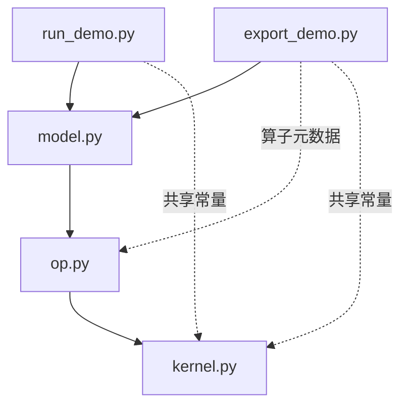

# PyPTO 自定义算子集成样例

## 概述

本目录展示如何通过自定义算子将 PyPTO kernel 集成到 Torch 模型中，涵盖模型的 Python 执行以及面向部署的模型导出。

## 样例特性

- **kernel 实现：** 提供 PyPTO JIT kernel 或用于创建 kernel 的工厂。
- **算子声明：** 将 kernel 与输出形状和数据类型推导、可选的类型化属性，以及用于 CPU 执行的可选 Torch 参考实现关联起来。
- **模型组合：** 在 Torch 模型中调用已注册的自定义算子。导出配置与部署步骤取决于所选的集成方式。

## 目录结构

- [`onnx/`](onnx/README.md) —— ONNX 样例列表、框架关系图、执行与部署说明，以及算子命名说明。
- [`tools/exported_custom_op_litenpu/`](../../../tools/exported_custom_op_litenpu) —— 共享的导出、构建、安装与执行辅助工具。
- [`python/pypto/extensions/torch_custom_op_litenpu/`](../../../python/pypto/extensions/torch_custom_op_litenpu) —— 随 PyPTO 安装的自定义算子声明、Torch 注册与执行，以及 ONNX 集成模块。
- [`python/tests/st/examples/exported_custom_op_litenpu/`](../../../python/tests/st/examples/exported_custom_op_litenpu) —— 导出、构建与原生库加载的系统测试。

### 样例的典型文件结构

- `kernel.py`：kernel 实现或工厂，以及实现所需的常量。
- `op.py`：算子声明、推导函数、CPU 参考实现和声明元数据。
- `model.py`：模型组合与配置。
- `export_demo.py`：导出入口、配置与检查。
- `run_demo.py`：样例所支持模式的执行入口。



箭头表示直接导入关系。实线表示常见结构；虚线表示部分文件组织中使用的额外导入关系，不表示运行时可以省略这些导入。

## 前置条件

每个样例应在独立的 Python 进程中运行。Python 模块缓存与 Torch 算子注册表都是进程全局的，因此在同一解释器中加载多个样例可能发生冲突。

### PyPTO 版本要求

这些样例依赖 `pypto.extensions.torch_custom_op_litenpu`（含 `ExportedCustomOp`、`common/run.py` 等）。随 CANN 9.2.0 发布的 PyPTO 不包含这些模块。运行前，请检查实际加载的 PyPTO 安装路径：

```bash
python3 -c "import pypto; print(pypto.__file__)"
```

该路径用于识别实际加载的安装，不能据此确认所需扩展是否可用。

`ModuleNotFoundError: No module named 'pypto.extensions...'` 或 `AttributeError: ... has no attribute 'ExportedCustomOp'` 等错误可能表示缺少所需扩展或 API。若确认缺失，请按照仓库的[环境部署](../../../docs/zh/install/prepare_environment.md)与[编译安装](../../../docs/zh/install/build_and_install.md)指南从本仓库源码编译安装 PyPTO。

### CANN 环境配置

对于使用 CANN 的流程，请在当前 shell 中初始化其环境：

```bash
source /usr/local/Ascend/ascend-toolkit/set_env.sh
```

使用 `--device=npu` 时，请通过 `npu-smi info` 选择一个空闲设备并设置其 ID：

```bash
export TILE_FWK_DEVICE_ID=0          # 替换为所选设备的 ID
```

## 编写约定

- 同一算子的相关函数应使用一致的名称，例如 `add_kernel`、`add_infer_shape`、`add_infer_dtype` 和 `add_torch`。kernel 工厂可使用 `create_<name>_kernel`。目录名描述样例用途，不要求与其中每个算子的名称一致。
- 对于直接使用 `@pypto.frontend.jit` 定义的 kernel，设置 `runtime_options={"run_mode": pypto.RunMode.SIM}`，避免导入时出现 "NPU is not available" 错误。
- 样例实现不得依赖其他样例中的文件。README、注释和文档字符串应直接说明本样例，不通过与其他样例比较或要求读者查阅其他样例来解释。允许依赖框架 API、共享支持库，也可引用本公共指南。可复用模块不应导入命令行入口。
- 允许使用辅助模块或专用文件组织，并应在相应文档中说明额外的依赖关系。文档所描述的文件、依赖或制品传递关系发生变化时，应更新相关图。保持中英文指南一致。
