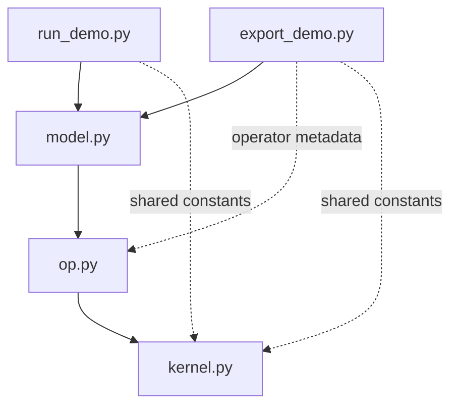

# PyPTO Custom-Operator Integration Examples

## Overview

These examples integrate PyPTO kernels into Torch models through custom operators. They cover model execution in Python and export for deployment.

## Sample Features

- **Kernel implementation:** provide a PyPTO JIT kernel or a factory that creates one.
- **Operator declaration:** associate the kernel with output shape and dtype inference, optional typed attributes, and an optional Torch reference implementation for CPU execution.
- **Model composition:** call the registered custom operators from a Torch model. Export configuration and deployment steps are specific to the selected integration.

## Code Structure

- [`onnx/`](onnx/README_en.md) — ONNX example catalogue, framework diagrams, execution and deployment instructions, and operator naming.
- [`tools/exported_custom_op_litenpu/`](../../../tools/exported_custom_op_litenpu) — Shared export, build, setup, and execution helpers.
- [`python/pypto/extensions/torch_custom_op_litenpu/`](../../../python/pypto/extensions/torch_custom_op_litenpu) — Custom-operator declarations, Torch registration and execution, and ONNX integration, installed with PyPTO.
- [`python/tests/st/examples/exported_custom_op_litenpu/`](../../../python/tests/st/examples/exported_custom_op_litenpu) — System tests for export, build, and native library loading.

### Typical Example Layout

- `kernel.py`: kernel implementations or factories and implementation constants.
- `op.py`: operator declarations, inference functions, CPU references, and declaration metadata.
- `model.py`: model composition and configuration.
- `export_demo.py`: export entry point, configuration, and checks.
- `run_demo.py`: execution entry point for the example's supported modes.



Arrows indicate direct imports. Solid edges show the common layout; dashed edges show additional imports used in some layouts, not imports that can be skipped at runtime.

## Prerequisites

Run each example in a separate Python process. Python's module cache and Torch's operator registry are process-global, so examples can conflict when loaded into the same interpreter.

### PyPTO Version Requirement

These examples depend on `pypto.extensions.torch_custom_op_litenpu` (providing `ExportedCustomOp`, `common/run.py`, and more). The PyPTO released with CANN 9.2.0 does not contain these modules. Before running, check which PyPTO installation is loaded:

```bash
python3 -c "import pypto; print(pypto.__file__)"
```

The path identifies the loaded installation; it does not confirm whether the required extension is available.

Errors such as `ModuleNotFoundError: No module named 'pypto.extensions...'` or `AttributeError: ... has no attribute 'ExportedCustomOp'` may indicate a missing extension or API. If that is the cause, build and install PyPTO from this repository's source following the [environment setup](../../../docs/zh/install/prepare_environment.md) and [build and installation](../../../docs/zh/install/build_and_install.md) guides.

### CANN Configuration

For workflows that use CANN, initialize its environment in the current shell:

```bash
source /usr/local/Ascend/ascend-toolkit/set_env.sh
```

For `--device=npu`, choose a free device from `npu-smi info` and set its ID:

```bash
export TILE_FWK_DEVICE_ID=0          # replace with the selected device ID
```

## Authoring Conventions

- Use consistent names for related operator functions, such as `add_kernel`, `add_infer_shape`, `add_infer_dtype`, and `add_torch`. A kernel factory can use `create_<name>_kernel`. Directory names describe example purpose and need not match every operator they contain.
- For kernels defined directly with `@pypto.frontend.jit`, set `runtime_options={"run_mode": pypto.RunMode.SIM}` to avoid an import-time "NPU is not available" error.
- Implementations must not depend on files in other demos. README text, comments, and docstrings should explain each demo directly, without comparisons with or instructions to consult other demos. Framework APIs, shared support libraries, and references to this common guide are allowed. Reusable modules should not import command-line entry points.
- Helper modules and specialized layouts are allowed; document their additional relationships locally. Update affected diagrams when documented files, dependencies, or artifact handoffs change. Keep the Chinese and English guides aligned.
