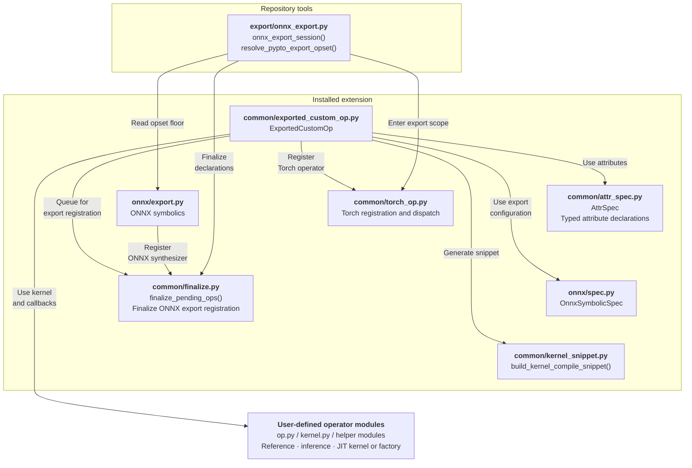
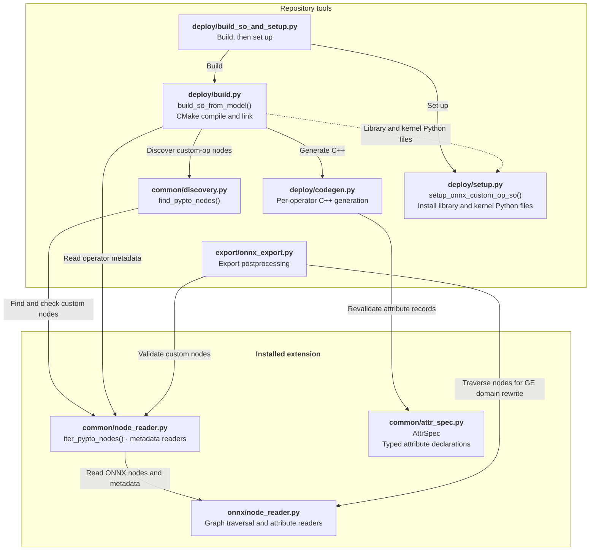
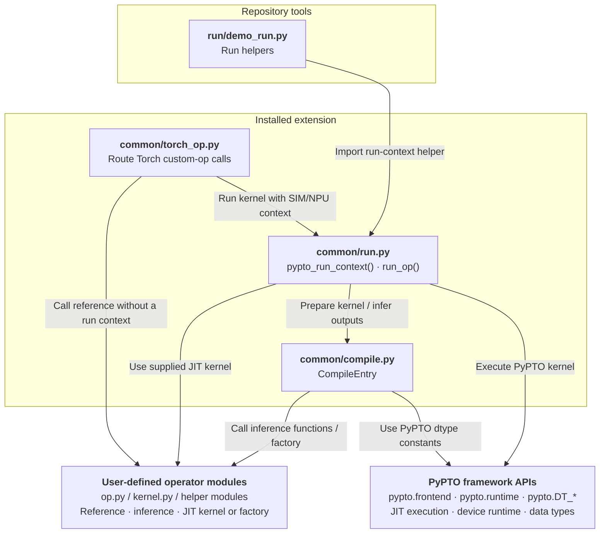
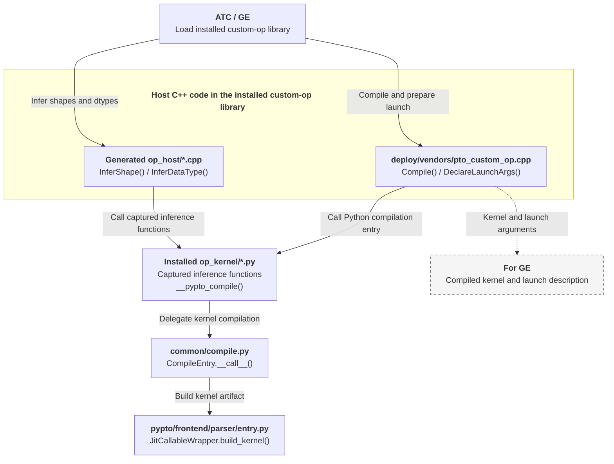

# ONNX 导出样例

本目录展示如何声明 PyPTO 自定义算子、导出 ONNX 模型并执行模型。

## 样例列表

| 样例 | 用途 | 样例特定用法 |
|---|---|---|
| [add/](add/) | 声明、导出并执行逐元素加法自定义算子。 | — |
| [nested_control_flow/](nested_control_flow/) | 展示如何发现嵌套 ONNX `If` 子图中的加法、减法和乘法算子。根图中不包含 PyPTO 算子。 | `run_demo.py` 的 `--branch` 参数可选 `add`、`sub` 或 `mul`，用于选择执行分支。参见[导出实现说明](nested_control_flow/export_demo.py)。 |

“—” 表示除通用运行说明外，没有额外的选项或限制。

## 自定义算子框架概览

以下四张图展示框架如何支持这些 ONNX 样例，分别介绍算子声明与 ONNX 导出、算子库构建与安装、Python 执行，以及 ATC/GE 编译与启动准备。

“Repository tools” 指 `tools/exported_custom_op_litenpu`；“Installed extension” 指 `pypto.extensions.torch_custom_op_litenpu`。

**框架图示说明：** 实线箭头从使用方指向其使用的模块；虚线箭头表示制品传递方向。

<details>
<summary><strong>算子声明与 ONNX 导出</strong> — 点击展开图示</summary>

`ExportedCustomOp` 将 kernel、推导回调、可选的类型化属性和可选的 CPU 参考实现（`torch_defn`）关联起来；`torch_op_qualname` 配置 Torch 注册，`onnx_spec=OnnxSymbolicSpec(...)` 配置 ONNX 导出。在这些样例中，导入算子模块时会注册对应的 Torch 算子；导出定型阶段会生成并注册对应的 ONNX symbolic。



</details>

<details>
<summary><strong>自定义算子库的构建与安装</strong> — 点击展开图示</summary>

构建与安装工具处理已导出的自定义算子节点，并安装原生库及其 kernel Python 文件。



</details>

<details>
<summary><strong>Python 执行：参考实现、模拟器与 NPU</strong> — 点击展开图示</summary>

Torch 分发选择用户提供的参考实现，或在模拟器/NPU 上下文中执行 PyPTO kernel。Python 执行无需导出 ONNX，也无需构建 ONNX 自定义算子库。



</details>

<details>
<summary><strong>ATC/GE 编译与启动准备</strong> — 点击展开图示</summary>

ATC/GE 调用已安装算子库的推导与编译回调，获取 kernel 制品和启动信息。



</details>

## 运行样例

### 环境准备

请先完成[上级指南中的公共前置条件](../README.md#前置条件)。
ONNX 所需的额外条件如下。

#### 依赖说明

`export_demo.py` 的导出链路依赖 `onnx`，它是**可选依赖**：ONNX 导出时需要，PyPTO 核心与
`run_demo.py` 的 CPU/设备运行路径都不依赖它（`pypto.extensions.torch_custom_op_litenpu` 对 `onnx`
采用函数内懒加载）。首次导出前请先安装：

```bash
pip install onnx
```

未安装时 `export_demo.py` 会报 `ModuleNotFoundError: No module named 'onnx'`。

#### ATC/GE 要求

构建与加载供 ATC/GE 使用的 ONNX 自定义算子库，需要 CANN 提供兼容的 GE 开发头文件与运行时库。

### 执行样例

每个样例应在独立的 Python 进程中运行，以避免 Python 模块缓存与 Torch 算子注册表中的冲突。

请在本目录（`examples/03_advanced/exported_custom_op_litenpu/onnx/`）下运行。以下命令使用 `add/`。运行其他样例时，将脚本路径中的 `add/` 替换为该样例的目录，并遵循样例列表中的相应用法说明。

**ONNX 导出与算子库安装**

`export_demo.py` 导出 ONNX 模型。`tools/exported_custom_op_litenpu/deploy/build_so_and_setup.py` 从该制品构建自定义算子库 `libcust_opapi.so`，并放置到 `framework/onnx/` 下供 ATC/GE 发现，同时将所需的 kernel Python 文件安装到 `op_kernel/` 下。

```bash
python3 add/export_demo.py /tmp/add.onnx        # 导出 ONNX 模型
python3 ../../../../tools/exported_custom_op_litenpu/deploy/build_so_and_setup.py /tmp/add.onnx
```

**Python 执行**

`run_demo.py` 按以下模式之一执行模型：

```bash
python3 add/run_demo.py                         # 在 cpu 上运行（各算子的 torch_defn），从不导出
python3 add/run_demo.py --device=npu            # 在设备上运行真实 kernel
python3 add/run_demo.py --soc_version=Kirin9030 # 在环境级 NPU 模拟器上运行
```

在支持这些参数的入口中，`run_demo.py` 接受 `--device={cpu,npu}` 与 `--soc_version=<soc>`。后者选择环境级 NPU 模拟器，要求使用 `--device=cpu` 或省略 `--device`，不能与 `--device=npu` 同时使用。

## 算子命名

算子声明分别配置 Torch 名称与 ONNX 类型：

| 配置 | 使用位置 |
|---|---|
| `torch_op_qualname="pypto::add"` | 模型通过 `torch.ops.pypto.add(...)` 调用算子。 |
| `OnnxSymbolicSpec(op_type="Add", ...)` | 导出的 ONNX 节点类型为 `PyptoCustomOpAdd`。 |

请显式设置这两个字段。框架为 ONNX 类型添加 `PyptoCustomOp` 前缀，而不是根据 Torch 名称推导该类型。
