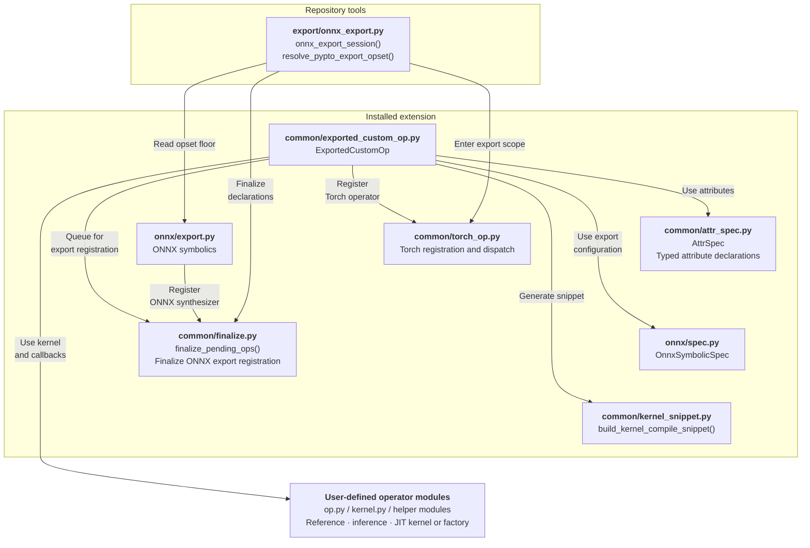
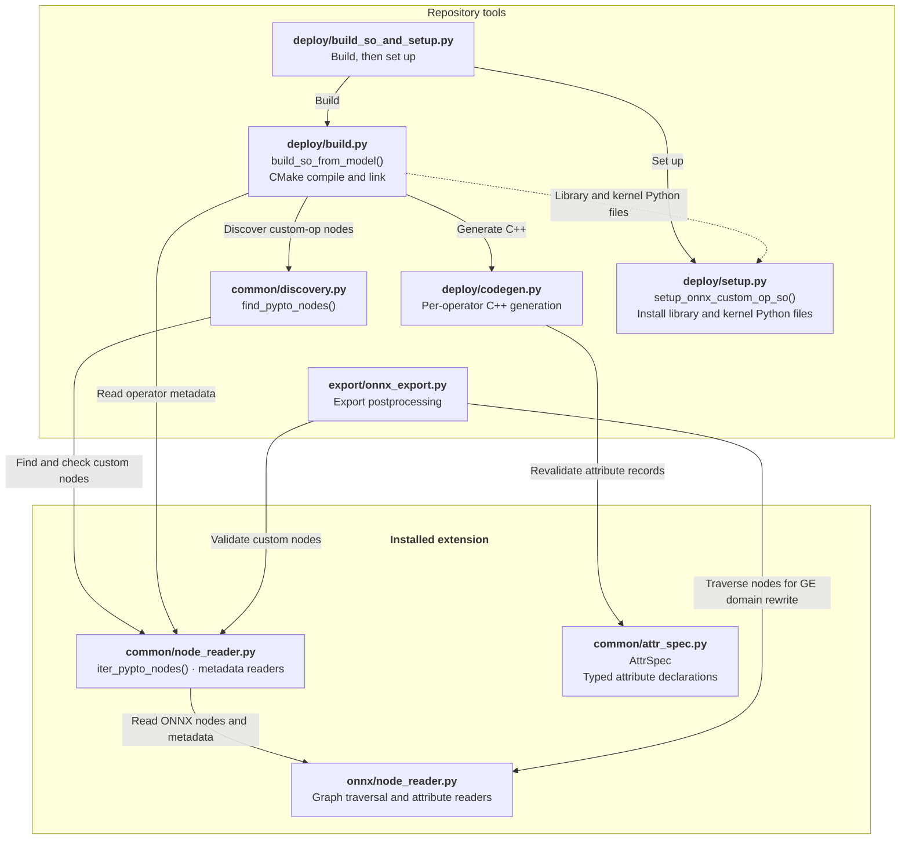
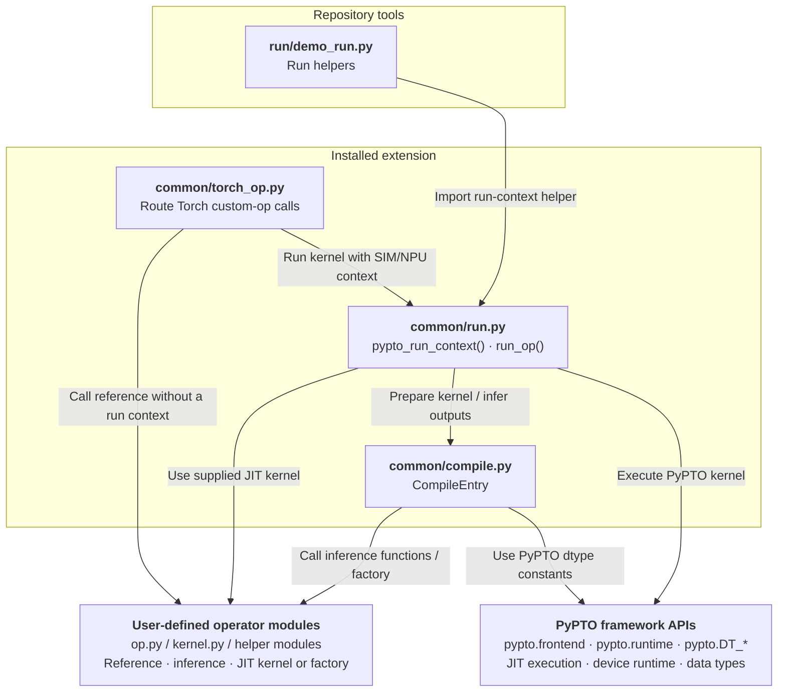
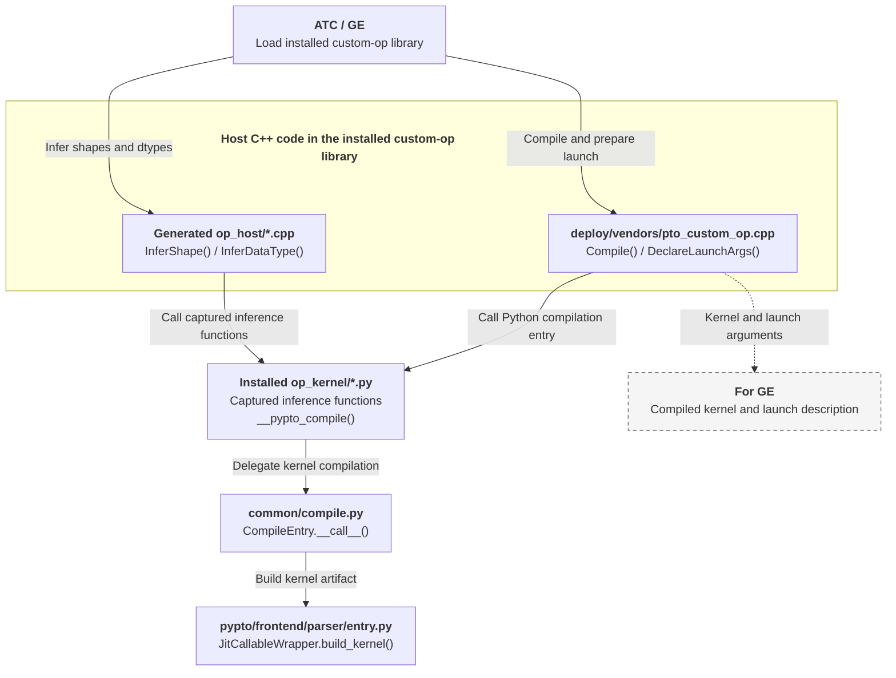

# ONNX Export Examples

These examples demonstrate declaring PyPTO custom operators, exporting ONNX models, and executing the models.

## Examples

| Example | Purpose | Example-specific usage |
|---|---|---|
| [add/](add/) | Declares, exports, and executes an elementwise-addition custom operator. | — |
| [nested_control_flow/](nested_control_flow/) | Demonstrates discovering addition, subtraction, and multiplication operators in nested ONNX `If` subgraphs. The root graph contains no PyPTO operators. | `run_demo.py` accepts `--branch` with `add`, `sub`, or `mul` to select the execution branch. See [export details](nested_control_flow/export_demo.py). |

“—” means no additional options or restrictions beyond the common running instructions.

## Custom-Op Framework Overview

The four diagrams below show how the framework supports these ONNX examples. They cover operator declaration and ONNX export, library build and setup, Python execution, and ATC/GE compilation and launch preparation.

“Repository tools” refers to `tools/exported_custom_op_litenpu`; “Installed extension” refers to `pypto.extensions.torch_custom_op_litenpu`.

**Framework diagram notation:** solid arrows point from a consumer to a module it uses; dashed arrows follow artifact handoffs.

<details>
<summary><strong>Operator declaration and ONNX export</strong> — click to expand diagram</summary>

`ExportedCustomOp` combines the kernel, inference callbacks, optional typed attributes, and optional CPU reference (`torch_defn`); `torch_op_qualname` configures Torch registration and `onnx_spec=OnnxSymbolicSpec(...)` configures ONNX export. In these examples, importing the operator modules registers their Torch operators; export finalization generates and registers their ONNX symbolics.



</details>

<details>
<summary><strong>Custom-op library build and setup</strong> — click to expand diagram</summary>

The build and setup tools process exported custom-op nodes and install the native library together with its kernel Python files.



</details>

<details>
<summary><strong>Python execution: reference, simulator and NPU</strong> — click to expand diagram</summary>

Torch dispatch selects the supplied reference implementation or PyPTO kernel execution under a simulator/NPU context. Python execution does not require ONNX export or building the ONNX custom-op library.



</details>

<details>
<summary><strong>ATC/GE compilation and launch preparation</strong> — click to expand diagram</summary>

ATC/GE invokes the installed library's inference and compilation callbacks to obtain kernel artifacts and launch information.



</details>

## Running the Examples

### Environment Setup

First follow the [shared prerequisites in the parent guide](../README_en.md#prerequisites).
The additional ONNX requirements are listed below.

#### Dependencies

The export path in `export_demo.py` depends on `onnx`, an **optional dependency**: ONNX export
requires it. PyPTO core and the CPU/device run path of `run_demo.py` do not
(`pypto.extensions.torch_custom_op_litenpu` imports `onnx` lazily inside functions). Install it before the
first export:

```bash
pip install onnx
```

Without it, `export_demo.py` raises `ModuleNotFoundError: No module named 'onnx'`.

#### ATC/GE Requirements

Building and loading the ONNX custom-op library for ATC/GE requires compatible GE development headers and runtime libraries from CANN.

### Execution

Run each example in a separate Python process to avoid conflicts in Python's module cache and Torch's operator registry.

Run from this directory (`examples/03_advanced/exported_custom_op_litenpu/onnx/`). The commands below use `add/`. For another example, replace `add/` in the script paths with its directory and follow its usage notes in the catalogue.

**ONNX export and library setup**

`export_demo.py` exports an ONNX model. `tools/exported_custom_op_litenpu/deploy/build_so_and_setup.py` builds the custom-op library `libcust_opapi.so` from it and installs the library under `framework/onnx/` and kernel Python files under `op_kernel/` for ATC/GE.

```bash
python3 add/export_demo.py /tmp/add.onnx        # export the ONNX model
python3 ../../../../tools/exported_custom_op_litenpu/deploy/build_so_and_setup.py /tmp/add.onnx
```

**Python execution**

`run_demo.py` executes the model using one of the following modes:

```bash
python3 add/run_demo.py                         # run on cpu (each op's torch_defn), never exports
python3 add/run_demo.py --device=npu            # run the real kernels on a device
python3 add/run_demo.py --soc_version=Kirin9030 # run on the env-level NPU simulator
```

Where supported, `run_demo.py` accepts `--device={cpu,npu}` and `--soc_version=<soc>`. The latter selects the environment-level NPU simulator and requires `--device=cpu` or an omitted `--device`; it cannot be combined with `--device=npu`.

## Operator Names

An operator declaration configures its Torch name and its ONNX type separately:

| Configuration | Where it is used |
|---|---|
| `torch_op_qualname="pypto::add"` | The model calls the operator as `torch.ops.pypto.add(...)`. |
| `OnnxSymbolicSpec(op_type="Add", ...)` | Export produces an ONNX node with type `PyptoCustomOpAdd`. |

Set both fields explicitly. The framework adds the `PyptoCustomOp` prefix to the ONNX type; it does not derive that type from the Torch name.
